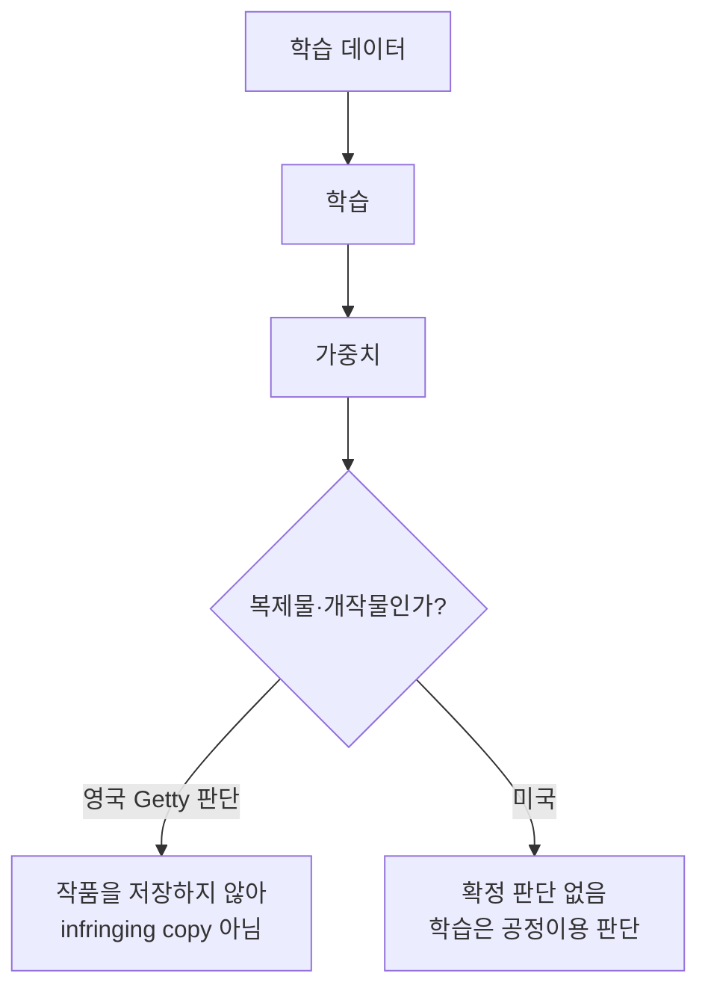

# 모델 가중치는 개작인가

> AI 모델의 가중치 파일이 학습 데이터 저작물의 "복제물"이나 "개작물(파생물)"이냐는 질문이다. 이 답에 따라 ShareAlike·NoDerivatives 같은 라이선스 조건이 모델에 닿는지가 갈린다. 2026-11 현재 법역을 가로지르는 확정 답은 없다.

## 쉽게 말하면
수천 권을 읽고 쓴 요약 노트가 원본 책의 "복사본"일까? 노트에 책 문장이 그대로 들어 있지 않다면 복사본이 아니라는 시각과, 책 없이는 만들 수 없으니 파생물이라는 시각이 맞선다.

## 자세히
- **영국 Getty v. Stability AI (고등법원, 2025-11-04, The Register 보도로 확인)**: Joanna Smith 판사는 모델이 학습 작품의 복제본을 저장하지 않으므로 "model weights are not themselves an infringing copy"라고 판단해 수입에 의한 2차 침해 주장을 기각했다. 1차 저작권 침해 주장은 학습이 영국에서 이뤄졌다는 증명을 못 해 철회됐다. 상표 침해는 일부만 인정. 따라서 **학습 자체의 적법성은 판단하지 않았고**, 판단 범위는 영국법의 "infringing copy" 해석에 한정된다(검색 요약상 항소 허가 보도가 있으나 확인 필요).
- **미국 Kadrey v. Meta (N.D. Cal., 2025-06, 검색 요약)**: Chhabria 판사가 해당 원고들에 대해 학습이 공정이용이라며 Meta에 약식판결. 그러나 판결문은 Meta의 사용이 일반적으로 적법하다는 뜻이 아니라고 한정했다고 보도된다. 이 판결은 **가중치가 복제물·파생물인지**를 판단하지 않았다.
- **라이선스와의 연결**: [CC ShareAlike](#cc-sharealike)는 공개 공유되는 개작물에 적용되는데, CC는 모델 가중치가 개작물인지 답하지 않는다. 가중치가 복제물이 아니라면 ND·SA가 가중치에 직접 닿지 않을 가능성이 있다는 것이 영국 판단에서 이어지는 해석이다(해석이며 판결이 아님).
- **위험이 이동하는 곳**: 평론은 위험이 가중치 존재보다 **출력 단계의 재현(암기·유출)**에 있을 수 있다고 본다.
- 법률 자문이 아니다. 관할(영국·미국·EU)마다 다르다.

## 그림으로 보기

## 예시
- 연구팀이 BY-SA 코퍼스로 학습한 모델을 공개: 가중치도 SA를 따라야 하는가? 미해결이므로 보수적으로는 같은 조건 공개나 허락 확보를 검토.
- 교육 소재: 영국·미국 판결을 비교표로 만들고 "무엇이 판단되지 않았나"를 찾는 토론.

## 헷갈리는 것과 비교
| 개념 | 차이 |
|---|---|
| 학습의 적법성 | 수집·복제 단계(공정이용·TDM) |
| 가중치의 법적 지위 | 모델 파일이 복제물·개작물인지 |
| 출력 침해 | 생성 결과가 원작을 재현 |
| [텍스트·데이터 마이닝 예외](#text-data-mining-exception) | 학습 단계의 허용 근거 |

## 더 읽을거리
- [The Register: Getty v. Stability AI 판결 보도](https://www.theregister.com/2025/11/04/uk_court_getty_stability_ai/) — 영국 판단 요지(직접 확인).
- [Taft: Two Federal Judges Rule ... Fair Use](https://www.taftlaw.com/news-events/law-bulletins/two-federal-judges-rule-in-separate-cases-that-training-ai-models-using-copyrighted-works-is-fair-use/) — 미국 판결 요약(검색 결과로만 확인).
