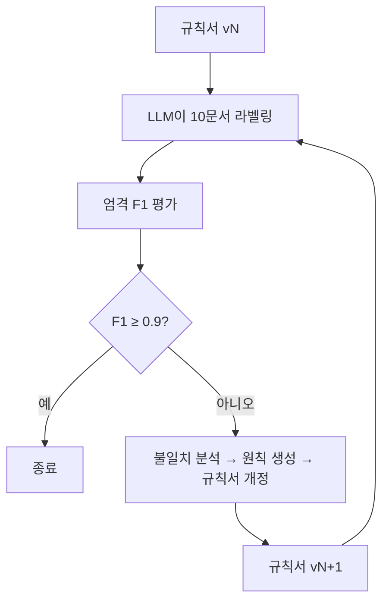

# 중재 기반 규칙서 정제

> 사람용 라벨 규칙서를 **LLM이 라벨링해 보고, 틀린 패턴을 LLM 중재자가 분석해 규칙서를 고치는 순환**으로 다듬는 방법이다(arXiv 2605.20809). 초기 라벨링 프로젝트의 시범 라운드를 작은 개발 세트로 흉내 낸다.

## 쉽게 말하면
시범 라벨러(LLM)가 열 문서를 라벨링해 보고, 중재자(또 하나의 LLM)가 "어떤 유형으로 틀렸는지"를 분석해 규칙서에 한 줄 규칙을 추가한 뒤 다시 시켜 보는 과정이다. 목표 점수에 닿거나 더 좋아지지 않으면 멈춘다.

## 자세히
(논문 arXiv 2605.20809의 초록과 HTML 본문을 직접 열어 확인한 내용. 저자 보고이며 재현하지 않음)
- **사이클 3단계**: ① **라벨링**: LLM이 10개 문서 개발 세트를 현재 규칙서로 라벨링 ② **평가**: 정답과 엄격한 구간·유형 F1로 채점 ③ **중재**: F1이 0.9 미만이면 불일치 분석 → 패턴 설명 → 원칙 생성 → 규칙서 개정을 수행(LLM이 중재자), 개정본을 다음 사이클에 사용.
- **종료 조건**: F1이 0.9에 도달하거나 개정해도 개선이 없을 때(이 경우 마지막 개정은 폐기).
- **오류 분류 4가지**: 라벨 불일치, 경계 불일치, 거짓 음성, 거짓 양성. 가장 빈번한 유형이 다음 중재의 표적.
- **최소 감독**: 정제에는 무작위 학습 문서 **10개**만 쓴다(초기 시범 세트 모사). 성능은 별도 100문서 평가 세트로 재고 시험 세트는 보류.
- **데이터**: NCBI Disease(평가 세트 개체 791개), BC5CDR(2,146), BioRED(3,531). 모델은 GPT·Gemini·DeepSeek 계열.
- **결과(엄격 F1)**: **원래 규칙서를 넣는 것**이 가장 큰 이득이었다(NCBI에서 GPT-5 0.46→0.73, DeepSeek 0.31→0.55). **중재의 추가 이득은 작아** 보통 +0.01~0.03, 최대 GPT-5의 BioRED에서 +0.06. 중재 후 최고는 GPT-5로 BC5CDR 0.86, BioRED 0.82, NCBI 0.76. 추론 최적화 모델이 비추론 모델보다 좋았다. Gemini의 개선은 통계적으로 유의했고 DeepSeek는 아니었다. 초록의 결론: 세 가설(규칙서 통합이 돕는다, 추론 모델이 유리하다, 최소 감독에서도 중재가 가능하다)이 확인됐고 개선 여지가 크다.
- **한계(논문)**: 상세한 초기 규칙서가 필요하다(많은 벤치마크·분야에는 없음), 규칙서 품질 보증 표준이 없다, 10문서 정제 세트는 선택 편향에 취약하고 종료 지표가 불안정하다, 개정이 거짓 양성을 늘려 정밀도-재현율 균형이 생긴다, GPT-5는 반복당 비용이 다른 모델의 약 10배, 생의학 NER 3개 데이터만 다뤘다.
- **실무적 시사(제안)**: 규칙서 **자체를 LLM 입력으로 넣는 것**이 가장 큰 효과였으므로 먼저 규칙서를 명확히 쓰고, 중재 정제는 소폭 추가 개선과 규칙서 결함 발견용으로 쓴다. 개정안은 사람이 검토하고 [버전 관리](#guideline-versioning)한다. 개발 세트가 작아 과적합 위험이 있으니 별도 [검증 부분집합](#llm-labeler-validation-subset)에서 재확인한다.

## 그림으로 보기

## 예시
- 사내 의도 분류 규칙서를 LLM 중재로 다듬는 경우: 시범 10건의 오류 유형 상위 1개를 규칙으로 추가하고 사람이 승인. 큰 이득은 규칙서 자체를 명확히 쓰는 데서 온다.
- 교육: "규칙서도 반복 개선하는 산출물"이며 AI가 개선 보조자가 될 수 있음을 설명.

## 헷갈리는 것과 비교
| 개념 | 차이 |
|---|---|
| 중재 기반 정제 | LLM이 오류 패턴을 분석해 규칙서를 고침 |
| [규칙서 반복 개발](#guideline-draft-iteration) | 사람 중심 시범-토론-개정 순환 |
| [LLM 라벨러 프롬프트](#llm-labeler-guideline-prompt) | 규칙서를 LLM 지시로 옮김 |
| 프롬프트 최적화 | 프롬프트 문구 탐색(규칙서 정제와 목적이 유사) |

## 더 읽을거리
- [Refining and Reusing Annotation Guidelines for LLM Annotation (arXiv 2605.20809)](https://arxiv.org/abs/2605.20809) — 초록.
- [논문 HTML](https://arxiv.org/html/2605.20809v1) — 사이클·수치·한계(본문 확인).
- [Repurposing Annotation Guidelines to Instruct LLM Annotators (arXiv 2510.12835)](https://arxiv.org/abs/2510.12835) — 규칙서를 LLM 지시로 전환(초록 확인).
