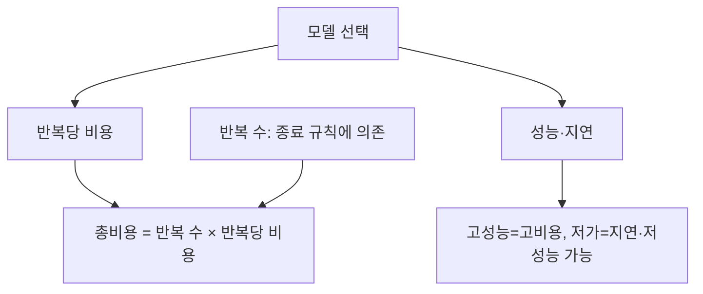

# 중재 LLM 비용

> 규칙서를 LLM으로 반복 정제할 때 드는 **반복당 비용과 모델 선택의 균형**. 같은 작업이 모델에 따라 센트 단위부터 수 달러까지 벌어지고, 성능이 가장 좋은 모델이 가장 비싼 경향이 있다.

## 쉽게 말하면
시범 라벨링을 한 번 돌릴 때마다 비용이 든다. 최고급 전문가는 정확하지만 시간당 단가가 몇십 배고, 값싼 보조원은 느리고 정확도가 낮을 수 있다. 몇 번 반복할지와 누구에게 맡길지를 같이 정해야 한다.

## 자세히
(arXiv 2605.20809 표 3, 본문 열어 확인. 저자 보고, 달러 단위만 제시되고 토큰 수와 중재자 비용 분리는 없음)
- **측정 방식**: 마지막 반복의 비용(c_i)과 **반복 수 × c_i**로 추정한 전체 비용(C_proc). 평가 세트가 아니라 10문서 정제 세트 기준.
  | 데이터셋 | 모델 | 반복 | 마지막 반복 비용 | 추정 총비용 |
  |---|---|---|---|---|
  | NCBI | GPT-5 | 3 | $1.186 | $3.557 |
  | NCBI | Gemini | 5 | $0.092 | $0.460 |
  | NCBI | DeepSeek | 2 | $0.054 | $0.109 |
  | BC5CDR | GPT-5 | 1 | $1.729 | $1.729 |
  | BC5CDR | Gemini | 1 | $0.099 | $0.099 |
  | BC5CDR | DeepSeek | 1 | $0.055 | $0.055 |
  | BioRED | GPT-5 | 2 | $1.991 | $3.982 |
  | BioRED | Gemini | 1 | $0.251 | $0.251 |
  | BioRED | DeepSeek | 1 | $0.048 | $0.048 |
- **직접 계산한 배율(반복당)**: GPT-5는 DeepSeek 대비 약 22~41배(NCBI 22.0배, BC5CDR 31.4배, BioRED 41.5배), Gemini 대비 약 8~18배(12.9배, 17.5배, 7.9배). 저자는 "대개 한 자릿수 order of magnitude 차이"라고 표현한다.
- **총비용은 반복 수에 좌우**: Gemini는 NCBI에서 5번 돌려 $0.460이지만 반복당은 GPT-5의 1/13이라 총비용 차이는 약 7.7배다. 개선이 막혀 마지막 개정을 폐기하는 종료 규칙 때문에 반복 수가 예측 불가.
- **성능·지연과의 균형(논문)**: GPT-5는 성능이 높지만 비용이 크다. DeepSeek는 반복당 비용이 가장 낮으나 **지연이 매우 길고**(BioRED 29.8분) 성능도 낮다. 저자는 LLM 중재가 사람 노동의 비용 효율적 대안일 수 있다고 보지만 전문가가 절대 품질에서는 앞선다고 한다.
- **실무 의사결정 틀**
  1. **초기 정제는 저가 모델**로 여러 번 돌려 규칙서의 명백한 결함을 잡는다.
  2. 마지막 검증·최종 라운드만 고성능 모델.
  3. 비용 상한(예: 총 $5)과 반복 상한(예: 5회)을 둔다.
  4. 사람 전문가 시간당 비용과 비교해 손익분기를 계산한다. 위 수치로는 LLM 정제 한 번에 $0.05~$4 수준이다(해당 논문 설정 한정, 모델 가격은 빠르게 변함).
- **한계**: 가격·모델은 시점에 따라 달라지고 논문 수치는 2026년 상반기 모델 기준이다. 중재자 호출과 라벨링 호출 비용이 합쳐져 있다.

## 그림으로 보기



## 예시
```python
cost_per_iter = {"gpt5": 1.19, "gemini": 0.09, "deepseek": 0.05}   # 논문 NCBI 기준 근사
max_iter, budget = 5, 5.0
for m, c in cost_per_iter.items():
    print(m, "5회 예상", round(c*5, 2), "예산 내" if c*5 <= budget else "초과")
```
- 사내 라벨링 지침(분류 20개 규칙) 정제 계획: 저가 모델 3회 + 고성능 1회, 총 $2 이내로 상한 설정.

## 헷갈리는 것과 비교
| 항목 | 의미 |
|---|---|
| 반복당 비용 | 한 사이클의 LLM 호출 비용 |
| 총비용 | 반복 수를 곱한 추정 |
| 지연 | 한 사이클 걸리는 시간 |
| [중재 기반 규칙서 정제](#moderation-guideline-refinement) | 이 비용이 드는 절차 |

## 더 읽을거리
- [arXiv 2605.20809 (HTML)](https://arxiv.org/html/2605.20809) — 표 3 비용과 모델 선택 논의(열어 확인).
