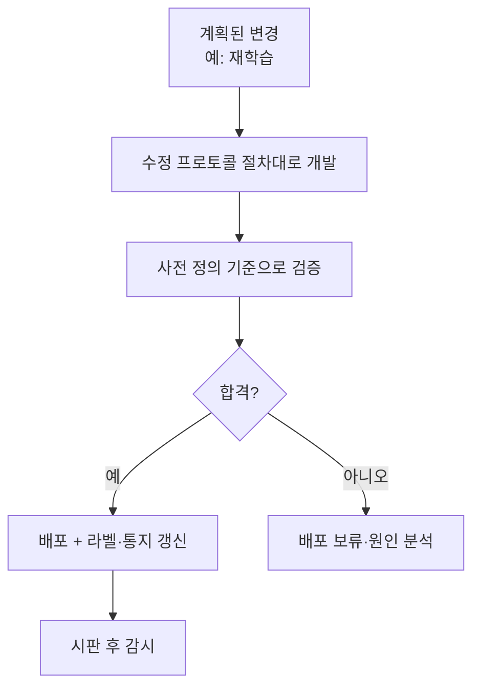

# 수정 프로토콜

> PCCP의 한 부분. 계획한 변경(재학습 등)을 어떤 방법으로 개발·검증·적용할지와 합격 기준을 사전에 정해 두는 문서.

## 쉽게 말하면
요리 레시피 변경 때 "이 범위 안에서 바꾸고, 이 맛 테스트를 통과해야 판다"를 미리 적어 둔 품질 매뉴얼이다. 그 안에서는 새 허가를 다시 받지 않는다.

## 자세히
출처: 로펌 해설 2건(McDermott, Foley, 검색·페이지 요약). FDA 지침 본문은 직접 읽지 못했다.
- **PCCP 3요소**: ① 변경 설명(계획 변경 목록, 자동 적용인지 사람이 개입하는지, 업데이트 빈도, 자동 업데이트 범위 가드레일) ② **수정 프로토콜** ③ 영향 평가(편익·위험과 완화).
- **수정 프로토콜 내용**: 변경을 개발·검증·적용하는 방법과 사전 정의 합격 기준; 데이터 관리에서 **편향 완화** 방법; 기준 표준(reference standard) 설정 방식(임상의 판독 사용 시 포함); 성능 평가에서 **해결 불가한 실패** 처리; 변경 후 안전·효과를 보는 **시판 후 감시 전략**; 기존 위험 관리 체계 준수.
- **재학습 절차**: 해설은 재학습 관행을 구체적으로 다루지 않는다. 실무에서는 데이터 갱신 주기·분할·재현 가능한 학습 파이프라인을 여기에 적는다는 일반 설명이 있다(출처 확인 못 함).
- **범위 이탈**: PCCP가 상정한 변경만, PCCP와 일치하게 적용해야 PCCP 안에 머문다. 허가된 PCCP 자체를 바꾸면 보통 새 제출이 필요하다.
- **라벨**: 변경 시점·방식·사용자 통지를 라벨·공개 문서에 반영하도록 권고.
- 상위 개념은 [PCCP](#fda-pccp), 법 근거는 [515C](#section-515c), 허가 후 감시는 [드리프트 모니터링](#model-drift-monitoring).

## 그림으로 보기

## 예시
- 수정 프로토콜 항목 예: 새 학습 데이터 출처 기준 / 기준 표준 판독자 2인+중재자 / 성능 합격 기준(민감도 ≥ 기존 수치, 하위 집단 하락 폭 한계) / 실패 시 롤백.
- 합격 기준을 넘지 못하면 변경은 PCCP 밖으로 간주되어 새 제출 대상.

## 헷갈리는 것과 비교
| 개념 | 차이 |
|---|---|
| 변경 설명 | 무엇을 바꿀지 |
| 수정 프로토콜 | 어떻게 바꾸고 검증할지 |
| 영향 평가 | 위험·편익 평가 |

## 더 읽을거리
- [McDermott: FDA Final Guidance on PCCPs for AI-Enabled Devices](https://www.mcdermottlaw.com/insights/fda-issues-final-guidance-on-predetermined-change-control-plans-for-ai-enabled-devices/) — 수정 프로토콜·라벨·시판 후 감시 요약
- [Foley: FDA final PCCP guidance](https://www.foley.com/insights/publications/2025/01/fda-final-guidance-ai-device-software-predetermined-change-control-plan/) — 3요소와 새 제출 조건(검색 결과로만 확인)
