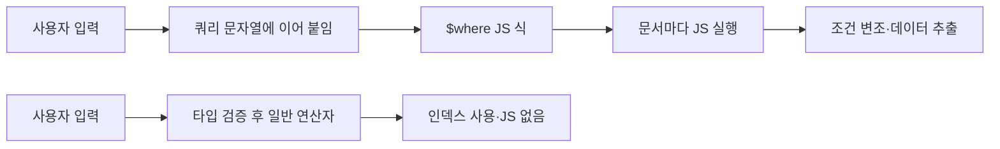

# $where와 서버 측 JS

> `$where`는 MongoDB가 문서마다 JavaScript 식을 실행해 조건을 판정하는 연산자다. 사용자 입력이 이 식에 섞이면 NoSQL 인젝션의 가장 위험한 입구가 된다.

## 쉽게 말하면
도서관 사서에게 "제목이 A인 책을 찾아 줘"라고 부탁하는 것이 일반 쿼리다. `$where`는 "책마다 이 메모에 적힌 계산을 직접 해 보고 맞으면 가져와"라고 메모를 건네는 것이다. 메모 내용을 손님이 쓸 수 있다면, 사서는 손님이 적은 어떤 계산이든 실행하게 된다.

## 자세히
MongoDB 공식 문서 기준:
- `{ $where: <string|JavaScript> }` 형태이며 문서를 `this`(또는 `obj`)로 참조한다. 문서마다 한 번씩 실행한다.
- **느리다**: 인덱스를 쓰지 못해 `$where` 단독이면 컬렉션 전체를 훑는다. 일반 연산자 조건을 함께 두면 그 조건이 먼저 평가되어 대상이 줄어든다.
- 서버 측 JavaScript는 `$where`·`$function`·`$accumulator`·`mapReduce`에 필요하고 **기본값은 켜짐**이다. 안 쓰면 `security.javascriptEnabled: false` 또는 `--noscripting`으로 끈다.
- 6.0에서 JS 엔진이 MozJS-60에서 MozJS-91로 바뀌었다.
- 공격 방식(PortSwigger 설명): 입력이 `$where` 문자열에 이어 붙으면 항상 참인 조건으로 전체 문서를 반환하거나, 불리언 조건으로 비밀번호를 한 글자씩 추출하거나, 응답 지연(timing)으로 값을 추정한다. `$ne`·`$regex` 같은 연산자를 JSON 객체로 끼워 넣는 연산자 주입도 흔하다.
- 방어: ① `$where`를 쓰지 않는다. ② 대신 일반 연산자 → `$expr` → `$function` 순으로 고려한다. ③ 입력 타입을 검증해 객체가 문자열 자리에 오지 못하게 하고 허용 키 목록을 둔다. ④ 서버 측 JS를 끈다.

## 그림으로 보기


## 예시
```javascript
// 위험: 입력을 문자열에 이어 붙임
db.users.find({ $where: "this.name == '" + name + "'" })
// name = "' || '1'=='1" 이면 모든 문서가 반환된다

// 안전: 값은 값으로만 전달
db.users.find({ name: String(name) })
```
AI 앱에서는 LLM이 만든 쿼리나 도구 인자를 그대로 DB에 넘길 때 같은 문제가 생긴다.

## 헷갈리는 것과 비교
| 개념 | 차이 |
| --- | --- |
| `$where` | JS 실행, 인덱스 불가, 인젝션 위험 큼 |
| `$expr` | 집계 식 사용, JS 없이 빠름 |
| `$function` | `$expr` 안의 커스텀 JS, 필요할 때만 |
| [NoSQL 인젝션](#nosql-injection) | `$where`는 그 한 갈래 |
| [SQL 인젝션](#sql-injection) | 문자열 결합 문제는 같고 문법이 다르다 |

## 더 읽을거리
- [MongoDB Docs: $where](https://www.mongodb.com/docs/manual/reference/operator/query/where/) — 성능·보안·대안 연산자
- [PortSwigger: NoSQL injection](https://portswigger.net/web-security/nosql-injection) — 문법·연산자 주입, 예방
