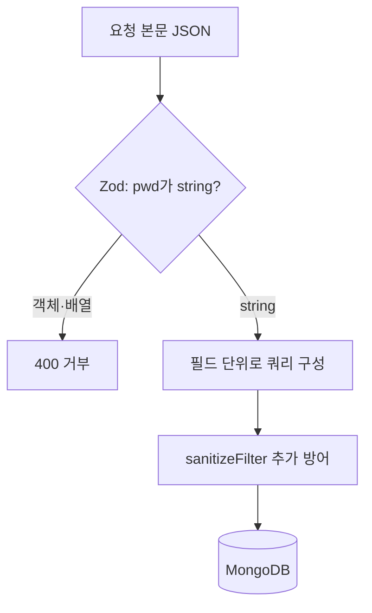

# 스키마 검증으로 입력 타입 고정

> NoSQL 인젝션은 문자열이 와야 할 자리에 `{"$ne": ""}` 같은 **객체**를 보내 쿼리 의미를 바꾼다. 스키마(타입) 검증으로 "이 필드는 문자열"이라고 고정하고, 쿼리를 필드 단위로 직접 만들면 막을 수 있다.

## 쉽게 말하면
은행 창구에 "비밀번호"란이 있는데, 숫자·글자만 받는 칸이 아니라 "비밀번호가 빈칸이 아닌 아무 값"이라고 적을 수 있는 칸이라면 아무 비밀번호나 통과한다. 칸에 "글자만"이라는 규칙을 붙이면 그런 식의 문장은 접수가 안 된다.

## 자세히
- 공격: 로그인 요청 본문이 `{"user":"admin","pwd":{"$ne":""}}`이고 서버가 `User.findOne(req.body)`를 쓰면, 비밀번호 조건이 "빈 문자열이 아님"이 되어 인증이 우회된다(PentesterLab 용어집 요약).
- 방어 계층(여러 겹을 함께 쓴다):
  1. **필드 단위로 쿼리 구성**: `findOne({ user: String(req.body.user), pwd: String(req.body.pwd) })`처럼 요청 본문을 통째로 넘기지 않는다. 아래 CVE 권고도 이런 구성은 영향이 없다고 밝힌다.
  2. **스키마·타입 검증**: Zod 같은 검증 라이브러리로 문자열인지 확인하고 객체 값은 거부한다([허용 목록 검증](#allowlist-validation), [검증과 정화](#input-validation-vs-sanitization)).
  3. **Mongoose sanitizeFilter**: 쿼리 연산자를 `$eq`로 감싸 무력화한다. 만능은 아니다.
  4. **필터 가능한 필드 허용 목록**.
- **주의 사례(CVE-2026-42334 / GHSA-wpg9-53fq-2r8h, CVSS 7.5)**: `sanitizeFilter`가 `$nor` 안의 연산자를 재귀적으로 정화하지 않아 `$ne`·`$gt`·`$regex`가 통과했다. 수정 버전은 6.13.9, 7.8.9, 8.22.1, 9.1.6. 영향 조건: `sanitizeFilter`를 켠 채 `Model.findOne(req.body)`처럼 입력을 그대로 넘긴 앱. 임시 방편은 `$nor` 키 제거나 별도 스키마 검증 추가.
- 교훈: 라이브러리의 정화 기능 하나에 기대지 말고 "입력 형태를 먼저 고정"한다. 의존성 업데이트도 보안의 일부다.
- Mongoose 스키마 캐스팅만으로 충분하다는 보장은 자료에 없었다(검색 요약). 자격 증명은 명시적 문자열 검사를 덧붙인다.

## 그림으로 보기


## 예시
```js
const Login = z.object({ user: z.string().max(64), pwd: z.string().max(128) });
const { user, pwd } = Login.parse(req.body);      // {"$ne":""} 는 여기서 예외
const doc = await User.findOne({ user, pwd });    // req.body를 통째로 넘기지 않음
```
(비밀번호는 실제로는 해시 비교를 해야 하며 위는 타입 고정 설명용이다.)

## 헷갈리는 것과 비교
| 개념 | 차이 |
| --- | --- |
| 스키마 검증 | 입력의 타입·형태를 고정(거부) |
| sanitizeFilter | 연산자를 `$eq`로 감쌈 — 우회 CVE 이력 있음 |
| [NoSQL 인젝션](#nosql-injection) | 공격 자체 |
| 필드 단위 쿼리 | 연산자 객체가 들어갈 틈 자체를 제거 |

## 더 읽을거리
- [GHSA-wpg9-53fq-2r8h (OSV)](https://osv.dev/vulnerability/GHSA-wpg9-53fq-2r8h) — Mongoose `$nor` 우회, 영향 버전·수정 버전
- [NoSQL injection (PentesterLab 용어집)](https://pentesterlab.com/glossary/nosql-injection) — `$ne` 우회 예(검색 결과로만 확인)
