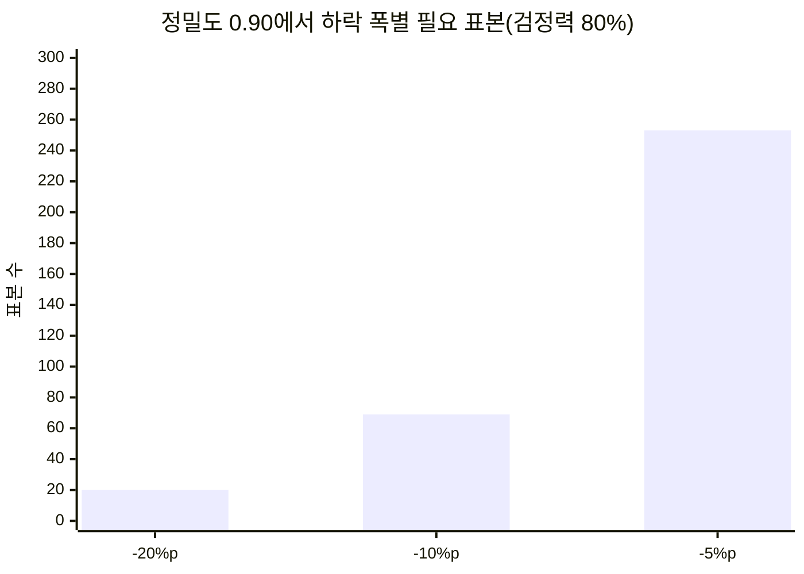
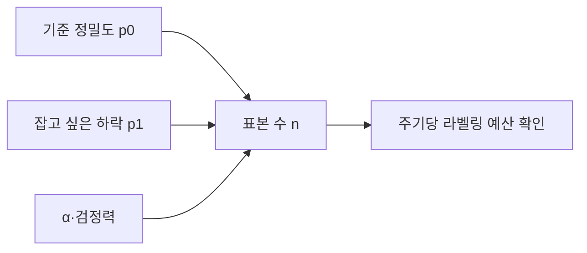

# 감시 표본 크기 산정

> 운영 중인 분류기의 정밀도 하락을 감시하려면, **얼마나 떨어졌을 때 잡을지(탐지 폭)** 와 **얼마나 확실히 잡을지(검정력)** 로 라벨링할 표본 수를 거꾸로 계산해야 한다. 작은 하락일수록 표본이 급격히 많이 든다.

## 쉽게 말하면
공장에서 합격률 90%인 라인이 85%로 떨어졌는지 알려면 꽤 많은 제품을 열어 봐야 한다. 70%로 크게 떨어졌다면 20개만 봐도 알아챈다. "작은 변화를 보려면 큰 표본"이 규칙이다.

## 자세히
- **계산식**(단측 정규근사): n ≈ [ (z_α·√(p0(1−p0)) + z_β·√(p1(1−p1))) / (p0−p1) ]². p0=기준 정밀도, p1=잡고 싶은 하락 후 정밀도.
- **직접 계산·시뮬레이션**(p0 = 0.90, α = 0.05 단측, 검정력 80% 목표, 이항 정확검정으로 3,000회 확인):

| 잡고 싶은 하락(p1) | 필요한 표본 n | 시뮬레이션 검정력 |
|---|---|---|
| 0.85 (−5%p) | 253 | 0.778 |
| 0.80 (−10%p) | 69 | 0.763 |
| 0.70 (−20%p) | 20 | 0.774 |

  하락 폭이 절반(−10%p→−5%p)이면 표본이 약 3.7배 필요했다. 정규근사의 검정력이 0.76~0.78로 목표 0.80에 조금 못 미쳤으니(이항 분포의 이산성), 실무에서는 계산값에 여유를 둔다. 하락이 없을 때 n=100 검정의 헛경보율은 0.039였다.
- **실무 설계**: ① 감시 주기(주/일)당 라벨 수 예산 → 탐지 가능한 하락 폭 역산, ② 하락 폭이 작아 표본이 못 감당하면 누적 표본·이동 창 사용(탐지 지연 허용), ③ 양성이 드물면 [층화 평가 표집](#stratified-evaluation-sampling)으로 예측 양성 칸에 라벨을 집중.
- 한계: 라벨 노이즈·분포 이동·시간적 상관은 반영하지 않은 단순 모형이다.

## 그림으로 보기



## 예시
```python
from scipy import stats
import numpy as np
za, zb = stats.norm.ppf(0.95), stats.norm.ppf(0.80)
n = ((za*np.sqrt(.9*.1) + zb*np.sqrt(.85*.15)) / (.9-.85))**2   # ≈ 253
```
- 주 100건 라벨링이 가능하면 −10%p 이상 하락은 1주에, −5%p 하락은 약 3주 누적해야 잡힌다.

## 헷갈리는 것과 비교
| 개념 | 차이 |
|---|---|
| 감시 표본 크기 | 하락 탐지용 라벨 수 계산 |
| [점수 평균의 표준오차](#standard-error-of-mean-score) | 평균 추정의 정밀도 |
| [층화 평가 표집](#stratified-evaluation-sampling) | 드문 양성에서 표본 효율 높이기 |
| [분류기 감시 표집](#classifier-monitoring-sampling) | 상위 주제 |

## 더 읽을거리
- [scipy.stats.binomtest](https://docs.scipy.org/doc/scipy/reference/generated/scipy.stats.binomtest.html) — 이항 정확검정.
- [Wikipedia: Power of a test](https://en.wikipedia.org/wiki/Power_of_a_test) — 검정력과 표본 크기.
