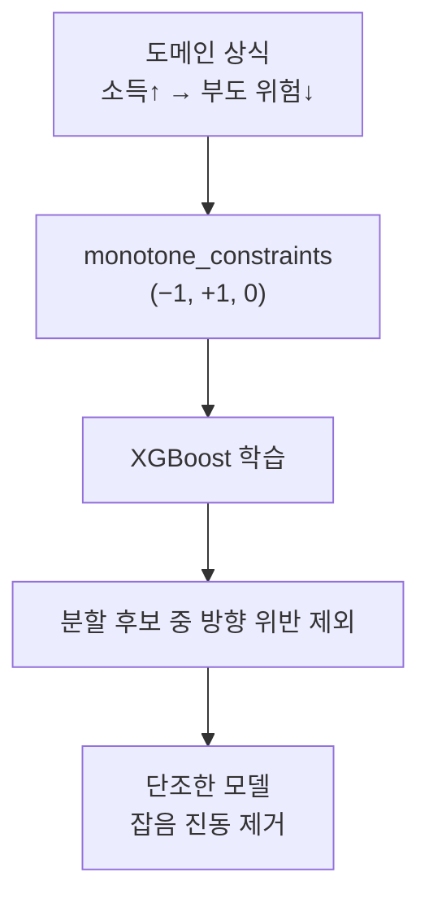

# XGBoost 단조 제약 설정

> XGBoost의 `monotone_constraints` 파라미터로 특성별 단조 방향(증가 +1, 감소 −1, 제약 없음 0)을 지정해, 그 특성이 커질 때 예측이 한 방향으로만 움직이도록 강제하는 설정.

## 쉽게 말하면
"소득이 높을수록 승인 확률이 내려가면 안 된다"는 상식을 모델에 못 박는 설정이다. 데이터의 잡음 때문에 모델이 그 상식을 어기는 구간을 만들더라도, 제약이 있으면 그 구간을 만들지 못한다.

## 자세히
출처: XGBoost 공식 문서 "Monotonic Constraints"(열어서 읽음) + 이 세션에서 직접 실행한 확인 스크립트(아래).
- **파라미터**: `monotone_constraints`에 **특성당 값 하나**. `1` 증가(특성이 커져도 예측이 줄지 않음), `-1` 감소, `0` 제약 없음. 문서의 Python 예는 튜플 `(1,-1)`이다. 특성 이름 사전 `{"f0": 1, "f2": -1}` 형태도 가능하며 적지 않은 특성은 0이다(Python).
- **효과(문서)**: 시뮬레이션에서 제약 없는 모델은 추세와 진동을 모두 학습하지만, 제약 모델은 추세는 유지하고 방향을 어기는 진동은 버린다.
- **`tree_method` 주의(문서)**: `hist`, `approx`에서 단조 제약이 불필요하게 얕은 트리를 만들 수 있다. 제약이 모든 분할 후보를 없애면 분할이 일어나지 않는다. `max_bin`을 늘려 후보를 늘린다.
- **기타(문서)**: reduced gradient는 단조 제약을 지원하지 않는다. 제약은 강한 사전 믿음을 반영해야 한다.
- **직접 확인(이 세션)**: 특성 0은 증가 추세+진동, 특성 1은 감소 추세+진동이 있는 합성 데이터(2,000행)로 `hist`, `max_depth=4`, 200라운드 학습. 한 특성만 바꾸고 나머지는 고정해 200개 격자점의 예측 변화를 세었다. **제약 없음**: 특성 0에서 감소 구간 70개, 특성 1에서 증가 구간 60개. **`(1,-1)` 제약**: 두 방향 위반 모두 0. 합성 데이터의 한 실행 결과이므로 일반적 크기를 뜻하지 않는다.

## 그림으로 보기


## 예시
```python
import xgboost as xgb
params = {"tree_method": "hist", "max_depth": 4}
params["monotone_constraints"] = (1, -1)   # f0 증가, f1 감소
model = xgb.train(params, dtrain, num_boost_round=200)
```
- 신용 점수: 소득·상환 이력은 증가, 부채 비율·연체 횟수는 감소로 지정.
- 점검: 제약 후 성능 하락이 크지 않은지(검증 세트), 제약을 준 이유를 문서에 남겼는지.

## 헷갈리는 것과 비교
| 개념 | 차이 |
|---|---|
| 단조 제약 | 모델이 한 방향 관계만 학습하도록 강제 |
| [단조 제약 개념](#monotonic-constraints) | 상위 개념과 효용 |
| 정규화 | 복잡도를 줄이는 일반 기법, 방향까지 강제하지 않음 |
| [모델 상식 규칙](#model-sanity-rules) | 제약 대신 학습 후 규칙으로 점검 |

## 더 읽을거리
- [Monotonic Constraints (XGBoost 공식 문서)](https://xgboost.readthedocs.io/en/stable/tutorials/monotonic.html) — 파라미터 형식·예제·주의(열어서 확인)
