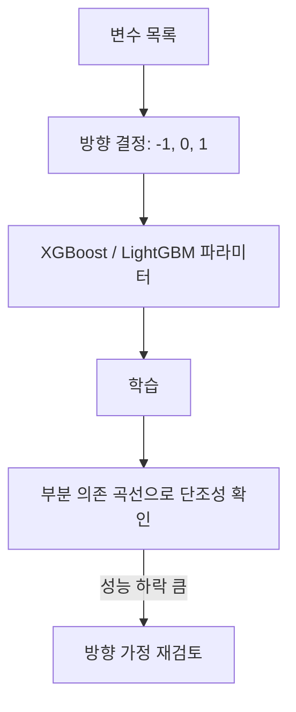

# 단조 제약 설정법

> XGBoost·LightGBM에서 `monotone_constraints`로 변수별 방향을 거는 구체적인 방법. 개념은 [단조 제약](#monotonic-constraints), 이 노드는 두 라이브러리의 파라미터와 주의점이다.

## 쉽게 말하면
"이 변수는 오르면 점수가 내려가야 한다"를 변수마다 -1, 0, 1로 적은 목록을 모델에 넘겨 주는 설정이다.

## 자세히
출처: XGBoost 공식 문서와 LightGBM 파라미터 문서(2026-11-15 확인).
- **XGBoost**: `monotone_constraints` = 변수 순서대로 `1`(증가), `-1`(감소), `0`(없음). 파이썬에서는 `{"f0": 1, "f2": -1}`처럼 이름으로 지정 가능(나머지 제약 없음). `hist`·`approx`에서 제약으로 트리가 지나치게 얕아지면 `max_bin`을 올려 본다.
- **LightGBM**: 별칭 `mc`, `monotone_constraint`, `monotonic_cst`. 모든 변수에 대해 순서대로 값을 지정해야 한다(예: `[-1, 0, 1]`). **범주형 변수에는 출력의 단조 제약을 걸 수 없다.**
- **`monotone_constraints_method`(LightGBM)**: 기본 `basic`은 학습을 늦추지 않지만 예측을 과하게 제약. `intermediate`는 약간 느릴 수 있으나 훨씬 덜 제약해 결과가 크게 좋아질 수 있고, `advanced`는 더 덜 제약하며 느릴 수 있다.
- **`monotone_penalty`(LightGBM)**: 기본 0.0. 값 X는 트리의 처음 X(내림) 수준에서 단조 분할을 금지하는 패널티로 작동. 0.0이면 패널티 없음.
- **실무 점검**: 제약을 건 모델과 안 건 모델의 검증 성능 차이를 비교하고, 성능이 크게 떨어지면 그 방향 가정이 데이터와 맞는지 확인한다([잘못된 부호 진단](#wrong-sign-diagnostic)).

## 그림으로 보기


## 예시
```python
# LightGBM: [연체횟수, 소득, 나이] 순서
params = {"objective":"binary", "monotone_constraints":[1, -1, 0],
          "monotone_constraints_method":"intermediate"}
```
연체 횟수↑ → 부도 확률 비감소, 소득↑ → 비증가, 나이는 제약 없음.

## 헷갈리는 것과 비교
| 개념 | 차이 |
|---|---|
| XGBoost 제약 | 이름 딕셔너리 지원 |
| LightGBM 제약 | 모든 변수 순서대로 값 필요, 범주형 불가 |
| [WoE 구간화](#woe-binning) | 전처리로 단조성 확보 |

## 더 읽을거리
- [XGBoost: Monotonic Constraints](https://xgboost.readthedocs.io/en/stable/tutorials/monotonic.html)
- [LightGBM Parameters](https://lightgbm.readthedocs.io/en/stable/Parameters.html) — monotone 관련 파라미터
