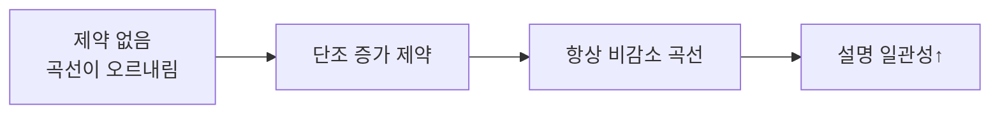

# 단조 제약

> 모델이 학습할 때 "이 변수가 커지면 예측은 줄지 않아야 한다(또는 늘지 않아야 한다)"는 방향을 강제하는 설정. 도메인 지식과 설명 가능성을 위해 쓴다.

## 쉽게 말하면
"소득이 높을수록 대출 한도가 낮아지면 안 된다"는 상식을 모델이 어기지 않게 못 박는 것이다. 데이터의 우연한 요동 때문에 이상한 구간이 생기는 것을 막는다.

## 자세히
출처: XGBoost 공식 문서(2026-11-15 확인).
- **의미**: 증가 제약은 변수가 오를 때 예측이 줄지 않고, 감소 제약은 오를 때 늘지 않는다.
- **XGBoost 사용**: `monotone_constraints` 파라미터. 변수 순서대로 `1`(증가), `-1`(감소), `0`(제약 없음). 파이썬에서는 `{"f0": 1, "f2": -1}`처럼 이름으로 지정 가능(나머지는 제약 없음).
- **쓰는 이유**: ① 비즈니스·과학 규칙(가격이 오르면 수요는 감소) ② 강한 사전 지식이 있을 때 예측 성능 향상. 문서의 예시에서 제약 모델은 전체 추세를 유지하고 규칙을 어기는 가짜 진동을 없앴다.
- **주의**: `hist`·`approx` 트리 방식에서 제약 때문에 모든 분할 후보가 사라져 트리가 지나치게 얕아질 수 있고, `max_bin`을 키우면 도움이 된다. 벡터 리프 모델(3.4.0 추가)은 출력마다 독립 적용. reduced gradient는 단조 제약을 지원하지 않는다.
- **신용 분야 의미**: 변수 방향이 일관돼야 [이유 코드](#reason-codes)를 설명하기 쉽다(예: 연체가 늘면 점수가 반드시 내려감). 이 연결은 일반론이다.
- 제약은 상호작용·비선형 형태는 자유로 두고 방향만 고정한다.

## 그림으로 보기


## 예시
```python
params = {"objective":"binary:logistic", "tree_method":"hist"}
params["monotone_constraints"] = (-1, 1, 0)  # 연체 횟수↓, 소득↑, 나이 제약 없음
model = xgb.train(params, dtrain, num_boost_round=300)
```

## 헷갈리는 것과 비교
| 개념 | 차이 |
|---|---|
| 단조 제약 | 학습 시 방향 강제 |
| 사후 설명(SHAP) | 학습 후 기여 계산 |
| 정규화 | 복잡도 제한, 방향 강제 아님 |

## 더 읽을거리
- [XGBoost: Monotonic Constraints](https://xgboost.readthedocs.io/en/stable/tutorials/monotonic.html) — 사용법·주의
