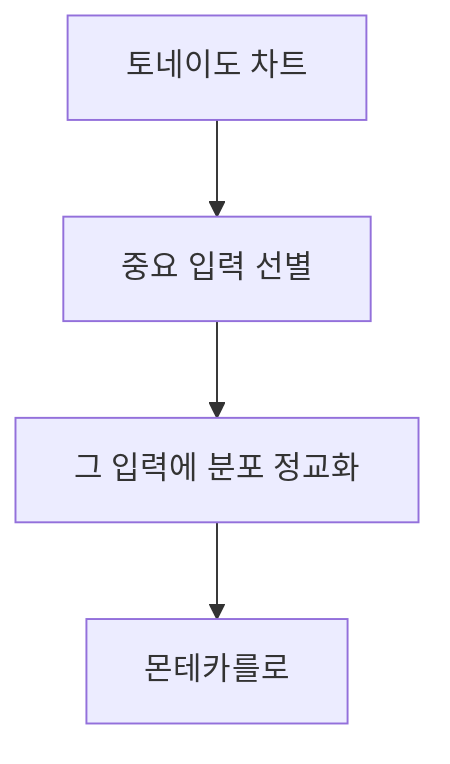

# 몬테카를로 ROI 시뮬레이션

> ROI 입력(절감 시간, 사용자 수, 단가 등)을 하나의 숫자가 아니라 "범위와 모양(분포)"으로 두고, 무작위로 수만 번 뽑아 계산한 뒤 결과의 범위와 확률을 얻는 방법. "ROI는 얼마?"가 아니라 "ROI가 5천만 원 아래일 확률은?"에 답한다.

## 쉽게 말하면
내일 날씨를 한 가지로 단정하지 않고 "비 올 확률 30%"처럼 가능성의 폭으로 말하는 것과 같다. 입력이 불확실하면 결과도 점이 아니라 폭으로 말해야 정직하다.

## 자세히
- **일반 절차(Wikipedia, 열람)**: 가능한 입력의 집합을 정의 → 확률분포에 따라 입력을 무작위로 뽑음 → 각 입력에 결정적 계산 수행 → 결과를 모아 최종 추정. 단일 "만약" 시나리오 대신 변수별 분포를 표집해 많은 결과를 만들고 각 결과의 확률을 추정한다. 사업 위험, 비용·일정 초과 예측, 금융 투자 가치 평가에 쓰인다.
- **표본 수**: 표본이 많을수록 근사가 좋아지고, 적분의 경우 표본을 4배로 늘리면 오차가 대략 절반으로 준다. 필요한 크기는 목표 정확도·신뢰 수준·결과 분산에 달려 있다.
- **입력 분포 고르기**: 자료가 적을 땐 삼각분포(최소·최빈·최대, 평균=(a+b+c)/3)가 자주 쓰인다(Wikipedia, 열람). 세 값을 추정하기 쉬워서다. 분포 선택은 가정이며 결과를 크게 좌우한다.
- **한계(해석)**: 입력 간 상관을 무시하면 폭이 잘못 나온다. "쓰레기 입력, 쓰레기 출력"이라 분포 근거(파일럿 실측, 업계 자료)를 적어야 한다. 앞 노드 [토네이도 차트](#tornado-chart)로 중요한 입력을 먼저 골라 분포를 정교하게 잡는 순서가 효율적이다.

## AI ROI 가상 예시(직접 시뮬레이션한 가상 수치)
토네이도 예시와 같은 모델(연 순효과 = 사용자×월 절감시간×12×인건비 − 사용자×라이선스×12)에 삼각분포를 적용했다. 사용자 수 80/100/120(최소/최빈/최대), 월 절감 시간 2/3/4, 시간당 인건비 24,000/30,000/36,000, 라이선스 월 24,000/30,000/36,000원. 입력은 서로 독립이라 가정. 난수 시드 42, 10만 회.
- 평균 약 7,200만 원, 중앙값 약 7,100만 원
- 5~95% 구간 약 4,340만 ~ 10,420만 원
- 순효과가 0 미만일 확률 약 0%, 3,000만 원 미만 약 0.3%, 5,000만 원 미만 약 11.6%

→ "평균 7,200만 원"이라는 한 줄보다 "90% 확률로 약 4,300만~10,400만 원, 5천만 원을 못 넘길 확률 약 12%"가 의사결정에 더 쓸모 있다. 이 수치는 가정한 분포에서만 성립하는 가상 예시다.

## 그림으로 보기

## 예시
- 스프레드시트에서 `RAND()` 기반 삼각분포 열을 만들어 수천 행을 계산하거나, 파이썬 `random.triangular(low, high, mode)`로 시뮬레이션. 위 결과가 그 방식으로 나왔다.
- 교육 실습: 자기 도입안 입력 3개에 최소·최빈·최대를 적고 1,000회 시뮬레이션한 뒤 "손익분기 미달 확률"을 계산.

## 헷갈리는 것과 비교
| 개념 | 차이 |
|---|---|
| 몬테카를로 | 분포에서 반복 표집해 결과 분포를 얻음 |
| [토네이도 차트](#tornado-chart) | 입력을 하나씩 바꾼 영향 순위 |
| 시나리오 분석 | 낙관·기준·비관 몇 개 시나리오 |
| 점추정 ROI | 한 숫자, 불확실성 없음 |

## 더 읽을거리
- [Wikipedia: Monte Carlo method](https://en.wikipedia.org/wiki/Monte_Carlo_method) — 절차·표본 크기(앞부분 열람)
- [Wikipedia: Triangular distribution](https://en.wikipedia.org/wiki/Triangular_distribution) — 자료가 적을 때의 분포(열람)
