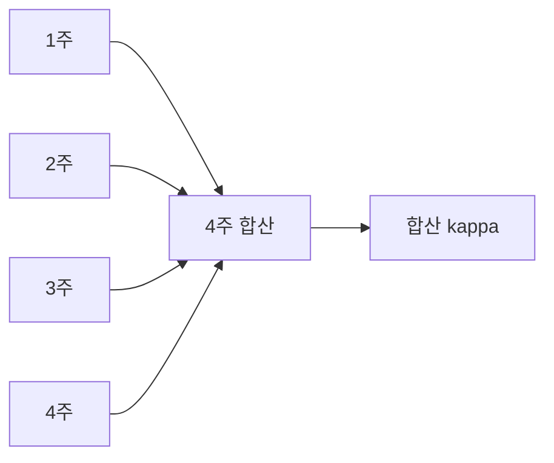
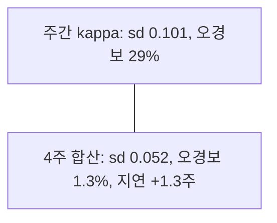

# 이동 평균 kappa

> 이동 평균 kappa는 최근 몇 주의 이중 라벨 데이터를 합쳐서(또는 평균해서) 계산한 kappa다. 주 단위 표본이 작을 때 kappa의 큰 흔들림을 줄여 추세를 안정적으로 보게 해 준다.

## 쉽게 말하면
하루 기온은 들쭉날쭉해도 최근 일주일 평균 기온은 추세가 잘 보인다. 주간 kappa도 한 주 값만 보지 말고 최근 4주를 묶어서 보면 오경보가 줄어든다.

## 자세히
- **직접 시뮬레이션(이진 균형, 주석자 2명 정확도 0.92(참 kappa 약 0.70), 주 50개 이중 라벨, 1,500회 반복)**: 주간 kappa는 평균 0.698에 표준편차 0.101, 최근 4주 데이터를 합쳐 계산한 kappa는 평균 0.704에 표준편차 0.052였다. 합치면 흔들림이 절반으로 줄었다.
- **경보 규칙 비교(같은 설정, 정확도가 0.92에서 0.82로 떨어지는 경우, 각 400회)**:

| 지표 | 경보 기준 | 하락 후 경보까지(평균 주) | 정상 12주 중 오경보 확률 |
| --- | --- | --- | --- |
| 주간 kappa | 0.50 미만 | 1.3 | 0.290 |
| 4주 합산 kappa | 0.55 미만 | 2.6 | 0.013 |

  주간 값은 빨리 반응하지만 정상인데도 12주 중 29%에서 경보가 울린다. 4주 합산은 감지가 1.3주 늦지만 오경보가 1.3%로 거의 없다. 이는 [탐지 지연과 비용](#detection-delay-tradeoff)의 전형적 교환이다. (가정된 시뮬레이션이다.)
- **주의(해석)**: ① 합산 kappa는 데이터를 이어 붙여 계산한다(주간 kappa의 단순 평균과 다르다. 클래스 분포가 주마다 다르면 차이가 생김) ② 창이 길수록 오래된 정보가 섞여 최근 변화 반응이 늦다 ③ 지침 개정·주석자 교체 시 창을 새로 시작한다.
- **쓰임(해석)**: 평소에는 이동 평균으로 추세를 보고, 급격한 하락 신호는 주간 값·[누적합(CUSUM)](#cusum-for-agreement)으로 보완한다. 화면은 [주간 일치도 대시보드](#weekly-agreement-dashboard)에 둘을 함께 표시한다.

## 그림으로 보기

## 예시
- 주 50개 이중 라벨이면 이동 4주(200개)로 합산 kappa를 매주 갱신해 대시보드에 표시.
- 교육 활용: 한 주 값과 4주 합산 값을 같은 데이터로 그려 흔들림 차이를 비교한다.

## 헷갈리는 것과 비교
| 개념 | 차이 |
| --- | --- |
| 이동 평균(합산) kappa | 최근 여러 주를 묶어 안정적 추세 |
| 주간 kappa | 빠르지만 흔들림 큼 |
| [누적합(CUSUM) 감시](#cusum-for-agreement) | 편차를 누적해 작은 변화 감지 |
| [라벨링 관리도](#control-chart-for-labeling) | 한계선·규칙 기반 감시 |

## 더 읽을거리
- [Control chart (Wikipedia)](https://en.wikipedia.org/wiki/Control_chart) — 평소 변동과 신호 규칙
- [Interrater reliability: the kappa statistic (McHugh, 2012)](https://pmc.ncbi.nlm.nih.gov/articles/PMC3900052/) — kappa 해석
