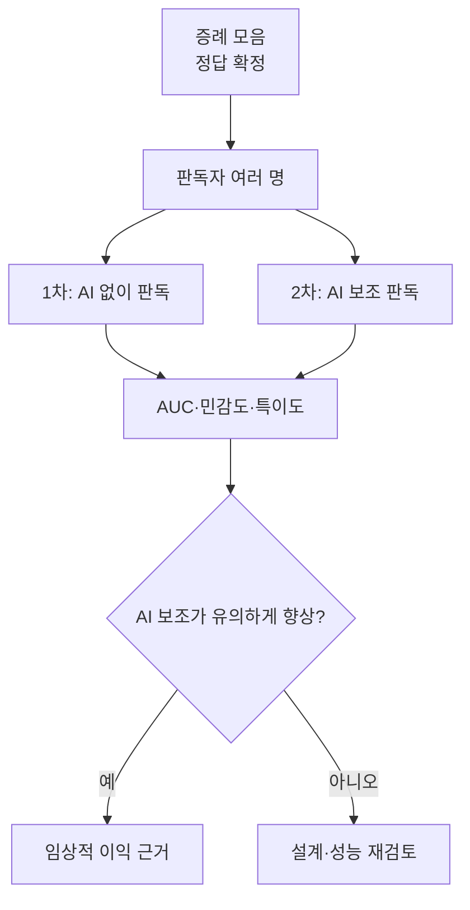

# MRMC 독자 연구

> Multi-Reader Multi-Case. 여러 판독자(reader)가 여러 증례(case)를 AI 없이, 그리고 AI 도움을 받아 판독하게 해 AI가 판독자의 성능을 실제로 높이는지 비교하는 임상 평가 설계. 영상 AI의 FDA 허가에서 자주 쓰인다.

## 쉽게 말하면
AI 계산기가 정답률이 높다는 것(단독 시험)과, 그 계산기를 쓴 사람이 더 잘 푼다는 것(독자 연구)은 다른 이야기다. MRMC는 같은 문제를 여러 사람이 도구 없이 한 번, 도구와 함께 한 번 풀게 해서 도움이 되는지 본다.

## 자세히
출처: Innolitics "Reference Guide for Testing Expectations for AI/ML-Enabled SaMD"(열어서 읽음, 업계 해설)와 검색 요약. FDA 지침 원문과 iMRMC 페이지는 이번에 열지 못했다.
- **왜 여러 명·여러 증례**: 판독자마다 편차가 크고 증례마다 난이도가 달라서, 한 명이나 한 증례로는 기기를 비교하기 어렵다. 보건당국이 완전 교차(fully crossed) 설계를 기대하는 경우가 많다는 설명이 있다.
- **설계 요소**: 같은 증례를 AI 없이 → AI 보조로 판독하는 비교(without vs with). 이 글은 판독자 수·무작위 순서·**휴지기(washout)**는 다루지 않는다. 휴지기 설계는 FDA 지침에서 확인해야 한다.
- **평가 지표**: 판독자 AUC와 그 향상(ΔAUC), 민감도·특이도, 분류(triage) 기기는 검토 시간.
- **표준 단독 시험과의 구분**: 단독(standalone) 시험은 격리된 독립 데이터에서 알고리즘만 평가(분석적 타당성). 독자 연구는 판독자 성능 향상을 평가(임상적 타당성). CADe·CADx에서는 단독 정확도가 필요조건이고 독자 연구가 임상적 이익을 보인다.
- **기기 유형별 기대(같은 글 요약)**: CADe(MYN, 892.2070)는 보통 독자 연구를 기대하고, CADx(POK, 892.2060)는 MRMC가 필요하다고 서술. 암·골절 검출(QDQ/QBS, 892.2090)은 AI 유무 비교 독자 연구가 거의 항상 필요. 분류(QAS/QFM, 892.2080)는 검토 시간·알림 시간으로 입증해 전체 MRMC가 필요 없을 수 있다.
- **예(검색 요약)**: 치과 AI 510(k)에서 면허 치과의 19명이 치근단 방사선 379장을 판독(AUC 1차 평가변수), 대동맥 CAD는 244증례 완전 교차 설계, 흉부 CAD는 24명이 238증례를 교차 설계로 판독. 각 수치는 개별 제출 요약에서 확인한 것이 아니다.
- **분석 도구**: FDA의 iMRMC 소프트웨어가 AUC 차이 분석과 표본 크기 산정을 돕는다는 검색 요약(해당 페이지는 열지 못함).

## 그림으로 보기

## 예시
- 폐결절 검출 AI: 방사선과 전문의 20명이 300증례를 AI 유무 조건에서 읽고, 보조 시 AUC가 올라갔는지(ΔAUC)와 읽는 시간을 보고.
- 교육 활동: 두 조건의 결과표를 보고 "단독 정확도와 독자 개선이 왜 다를 수 있는가"를 토론.

## 헷갈리는 것과 비교
| 개념 | 차이 |
|---|---|
| 단독(standalone) 시험 | 알고리즘만 평가, 독자 연구는 사람과 함께 평가 |
| [외부 검증](#external-validation) | 다른 병원·시간 데이터로 일반화 확인 |
| [임상 검증 근거](#clinical-validation-evidence) | 상위 개념 |
| [전향적 검증 비율](#prospective-validation-share) | 실제 진료 흐름에서 모은 근거의 비율 |

## 더 읽을거리
- [Reference Guide for Testing Expectations for AI/ML-Enabled SaMD (Innolitics)](https://innolitics.com/articles/ai-ml-samd-testing-expectations-guide/) — 기기 유형별 독자 연구 기대(열어서 확인, 업계 해설)
- [FDA RST 카탈로그 (iMRMC 관련)](https://www.fda.gov/medical-devices/science-and-research-medical-devices/rst-catalog) — 리다이렉트만 확인, 본문 미열람
