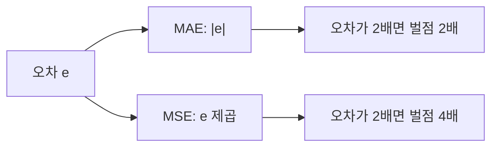
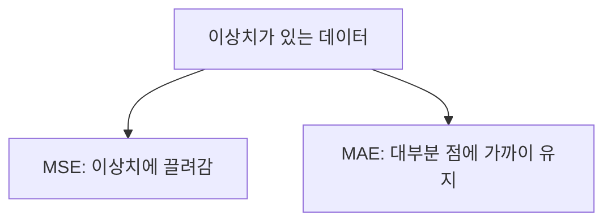

# MSE와 MAE 비교

> MSE(평균 제곱 오차)와 MAE(평균 절대 오차)는 둘 다 회귀 손실이지만, 큰 오차(이상치)를 대하는 방식이 달라 모델이 학습하는 방향도 달라진다.

## 쉽게 말하면
지각 벌금에 비유하면, MAE는 늦은 시간에 비례해 벌금을 받는 것이고, MSE는 늦을수록 벌금이 제곱으로 늘어 한 번 크게 늦으면 치명적인 것이다. 후자를 겪으면 사람은 "큰 지각만은 피하자"가 되어 평소엔 오히려 손해를 감수한다.

## 자세히
Google ML Crash Course 기준:
- MAE = (1/N)Σ|정답−예측|, MSE = (1/N)Σ(정답−예측)², RMSE = √MSE.
- 제곱하면 큰 오차는 훨씬 커지고 1보다 작은 오차는 더 작아진다. 그래서 **MSE는 이상치 쪽으로 모델을 끌어당긴다**. MAE는 이상치에 더 강건해 대부분의 점에 가까운 예측을 유지한다.
- 큰 실수가 특히 치명적이면 MSE, 이상치가 잡음이라 영향을 줄이고 싶으면 MAE, 평균적인 오차 크기를 그대로 알고 싶어도 MAE가 직관적이다.
- MAE·RMSE는 예측값과 단위가 같아 해석이 쉽고, RMSE는 MAE보다 큰 오차에 더 휘둘린다.
- 배치 학습에서는 샘플 손실을 평균 낸다. 상위 개념은 [손실 함수](#loss-function).

## 그림으로 보기

## 예시
- 오차 1, 1, 1, 10인 예측 4개: MAE = 13/4 = 3.25, MSE = (1+1+1+100)/4 = 25.75. 하나의 큰 오차가 MSE를 거의 지배한다.
- 배달 시간 예측에서 가끔 생기는 폭우 지연은 잡음이면 MAE, 고객 이탈 같은 큰 실수를 꼭 피해야 하면 MSE.

## 헷갈리는 것과 비교
| 개념 | 차이 |
|---|---|
| MSE | 큰 오차를 강하게 벌함, 이상치에 민감 |
| MAE | 오차에 선형 벌점, 이상치에 강건 |
| RMSE | MSE의 제곱근, 단위가 예측값과 같음 |
| [교차 엔트로피](#cross-entropy) | 분류용. 확률을 평가 |

## 더 읽을거리
- [Google ML Crash Course: Linear regression · Loss](https://developers.google.com/machine-learning/crash-course/linear-regression/loss) — MAE·MSE·RMSE 정의와 비교.
