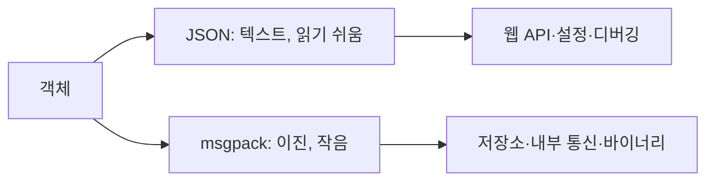

# msgpack과 JSON

> MessagePack은 JSON처럼 언어 간 데이터를 교환하되 이진(binary)으로 작게 인코딩하는 포맷이다. JSON은 사람이 읽을 수 있는 텍스트 포맷이다.

## 쉽게 말하면
같은 내용을 편지(JSON)로 쓰느냐 약어 전보(msgpack)로 보내느냐의 차이다. 전보는 짧고 빠르지만 사람이 바로 읽을 수 없고, 편지는 길어도 누구나 열어 본다.

## 자세히
msgpack.org 기준:
- "JSON처럼 여러 언어 사이에서 데이터를 교환하되 더 빠르고 작다"고 소개하며 50개 이상의 언어·환경을 지원한다고 한다(주장. 사이트에 구체적 벤치마크 수치는 없다).
- 크기: 작은 정수는 1바이트, 짧은 문자열은 내용 + 1바이트 정도의 오버헤드.
- 타입: nil, bool, 정수(부호 유/무), 실수(32/64비트), Str, **Bin(바이너리 원본)**, Array, Map, Ext(앱 정의 확장), Timestamp.
- JSON은 바이너리를 Base64 등으로 바꿔야 하고, 문자열 이스케이프·실수 파싱 비용이 있다고 MPack 문서가 설명한다.
- 선택 기준: 사람이 열어 보고 디버깅하고 웹 API로 쓰면 JSON, 저장·전송 크기와 속도·바이너리가 중요하면 msgpack. LangGraph의 기본 serde는 ormsgpack과 JSON을 섞어 쓴다([serde](#langgraph-serde)).
- msgpack도 데이터만 표현하므로 [pickle](#pickle-security)처럼 불러올 때 코드가 실행되지 않는다. 다만 Ext 타입을 앱이 해석하는 방식에 따라 위험이 생길 수 있어 신뢰할 수 없는 입력엔 주의한다(일반 지침).

## 그림으로 보기


## 예시
```python
import json, msgpack
d = {"id": 7, "ok": True, "blob": b"\x00\x01"}
msgpack.packb(d)        # bytes 그대로 저장 가능
json.dumps(d)           # TypeError: bytes는 직렬화 불가
```

## 헷갈리는 것과 비교
| 개념 | 차이 |
| --- | --- |
| JSON | 텍스트, 바이너리 불가 |
| msgpack | 이진, Bin 타입 지원 |
| [pickle](#pickle-security) | 파이썬 전용, 코드 실행 위험 |

## 더 읽을거리
- [MessagePack](https://msgpack.org/) — 포맷 소개와 타입
- [Python docs: pickle](https://docs.python.org/3/library/pickle.html) — JSON과의 비교 설명
