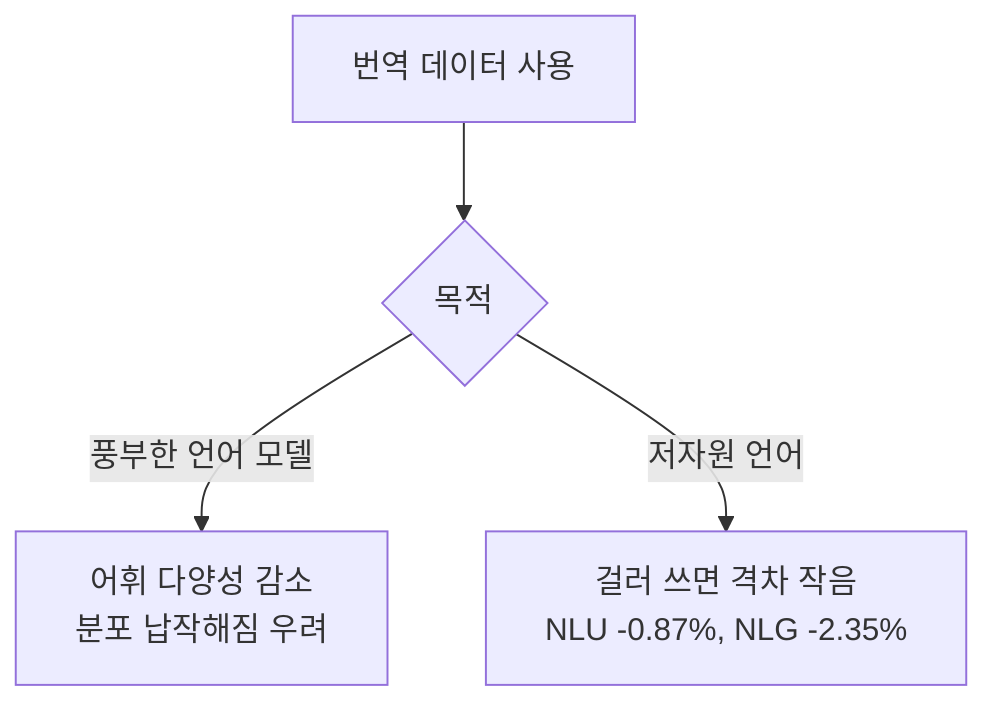

# 기계 번역투 (translationese)

> 번역된 글(특히 기계 번역)은 원래 그 언어로 쓴 글과 **어휘·문장 구조가 체계적으로 다르다.** 이런 "번역투" 글이 학습 데이터에 많이 섞이면 모델의 언어 분포가 달라질 수 있지만, 저자원 언어에서는 오히려 유용한 자원이 되기도 한다.

## 쉽게 말하면
영어 소설을 한국어로 옮긴 글에서 "그는 그의 어머니를 사랑했다"처럼 어색한 문장을 본 적이 있을 것이다. 번역투는 원문 언어의 흔적이 남은 문체다. 이런 글만 읽고 자란 사람은 한국어를 약간 다르게 쓴다.

## 자세히
- **영향 연구(Kunz, "Dialects of Translationese Shape Language Model Learning", arXiv 2602.16469, EMNLP Findings 2026, 초록 직접 읽음)**: 24개 출처 언어에서 영어로 기계 번역한 텍스트로 **작은 영어 모델**을 학습해 비교했다. 출처 언어가 모델 동작에 뚜렷한 영향을 주었고, 일반 퍼플렉시티는 번역 코퍼스의 **어휘 다양성**과 더 강하게 연관됐으며, 문법 성능은 영어와의 **유형론적 유사도**와 상관됐다(충분한 데이터일 때). **번역 품질**은 언어 모델 성능의 강한 예측 변수였다. 초록에 수치는 없다. 검색 요약에는 원어민 영어 대비 불리해진다는 설명이 있으나 본문은 확인하지 못했다.
- **저자원 언어에서의 긍정적 사용(Doshi 외, "Pretraining Language Models Using Translationese", arXiv 2403.13638, 초록 직접 읽음)**: 영어 웹 문서를 인도 계열 저자원 언어로 기계 번역하고, 작은 깨끗한 데이터로 학습한 작은 모델이 번역문을 걸러 쓴다. 28M·85M 파라미터 모델을 처음부터 학습한 결과, 걸러 낸 합성 데이터는 깨끗한 데이터 대비 NLU 상대 하락 **0.87%**, NLG **2.35%**에 그쳤고 소량의 깨끗한 데이터를 더하면 격차가 더 줄었다. Gemma-2B·Llama-3-8B 지속 사전학습의 few-shot에서도 경쟁력이 있었다고 한다.
- **정리**: 번역투 데이터는 (1) 영어 같은 풍부한 언어의 모델을 "납작하게" 만들 위험(첫 연구의 방향)과 (2) 자원이 적은 언어를 보충하는 수단(둘째 연구) 두 면이 있다. 목적에 따라 필터·혼합 비율이 다르다. 이 둘은 서로 다른 설정(작은 영어 모델 vs 저자원 언어 사전학습)의 결과라서 한쪽이 다른 쪽을 반박하지 않는다.
- **점검법(제안)**: ① 도메인·URL 단서(번역 사이트·자동 번역 표지)로 번역 문서 비율 추정 ② 번역 문서를 따로 표시해 성능 영향 ablation ③ 혼합 시 원어민 데이터 비율 유지.
- 한계: 웹 전체에서 기계 번역 글의 비중 수치는 이번에 확인하지 못했다(검색에서 찾지 못함).

## 그림으로 보기

## 예시
| 설정 | 결과 |
|---|---|
| 영어 모델을 24개 언어 번역문으로 학습 | 출처 언어·번역 품질이 성능 좌우(Kunz) |
| 저자원 언어 사전학습에 번역문 사용 | 깨끗한 데이터 대비 NLU 0.87%·NLG 2.35% 하락(Doshi 외) |
- 업무 장면: 한국어 사내 모델에 영어 자료를 번역해 보충한다면 번역 문서에 태그를 달고, 원어민 한국어 문서 비율을 정해 둔다.

## 헷갈리는 것과 비교
| 개념 | 차이 |
|---|---|
| 번역투 | 번역된 글의 체계적 문체 차이 |
| [AI 생성 글의 웹 오염](#ai-generated-web-contamination) | 생성 AI 글이 분포를 좁히는 문제 |
| [역번역](#back-translation) | 의도적으로 번역을 왕복해 증강하는 기법 |
| [기계 번역 웹 텍스트](#machine-generated-web-text) | 이 노드가 속한 상위 개념 |

## 더 읽을거리
- [Dialects of Translationese Shape Language Model Learning (arXiv 2602.16469)](https://arxiv.org/abs/2602.16469) — 24개 출처 언어 실험(초록 직접 읽음).
- [Pretraining Language Models Using Translationese (arXiv 2403.13638)](https://arxiv.org/abs/2403.13638) — 저자원 언어 합성 데이터(초록 직접 읽음).
