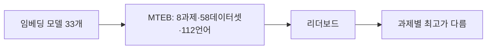
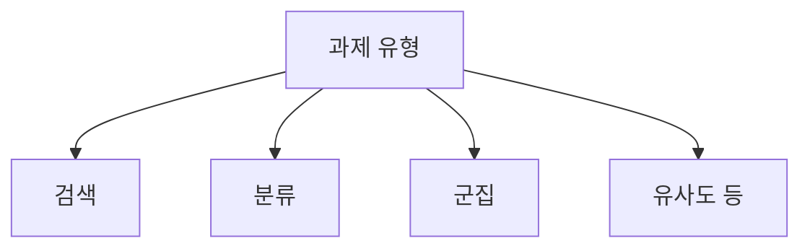

# MTEB 벤치마크

> 텍스트 임베딩 모델을 여러 과제에서 한꺼번에 비교하는 벤치마크(Massive Text Embedding Benchmark)다. 8가지 과제 유형, 58개 데이터셋, 112개 언어로 구성되며 한 방법이 모든 과제에서 최고는 아님을 보였다.

## 쉽게 말하면
임베딩 모델을 한 과목(검색)만이 아니라 여러 과목(분류·군집·유사도…)에서 시험 보는 종합 시험이다. 한 과목 1등이 전 과목 1등이 아니다.

## 자세히
(MTEB 논문 arXiv 2210.07316 초록을 직접 열어 확인.)
- **구성**: **8개 과제 유형, 58개 데이터셋, 112개 언어**. 논문은 **33개 모델**을 평가했다.
- **핵심 발견**: 모든 과제에서 가장 좋은 단일 임베딩 방법은 없다 → 아직 보편적 임베딩 방식이 없다.
- **공개**: 오픈소스 코드와 공개 리더보드(GitHub).
- **사용(제안)**: 리더보드 순위는 영어 일반 과제 기준이므로 한국어·도메인 문서에서는 자체 골든 질의 세트로 재평가한다([골든 질의 세트](#golden-query-set)). 차원 수·비용·지연도 함께 고려.
- **연결**: OpenAI 임베딩 문서는 text-embedding-3-large를 256차원으로 줄여도 MTEB에서 1536차원 ada-002보다 낫다고 서술한다(공식 문서 기준).

## 그림으로 보기

## 예시
- RAG용 임베딩 모델을 고를 때 MTEB 검색 점수로 후보를 3개로 줄이고 내 문서 100질의로 최종 비교.
- 교육 활용: 리더보드 점수와 실제 업무 성능이 다른 이유 토론.

## 헷갈리는 것과 비교
| 개념 | 차이 |
|---|---|
| MTEB | 임베딩 모델 종합 평가 |
| 사내 골든 세트 | 내 데이터·질의 기준 평가 |
| LLM 벤치마크 | 생성 모델 평가 |

## 더 읽을거리
- [MTEB (arXiv 2210.07316)](https://arxiv.org/abs/2210.07316) — 초록.
- [OpenAI 임베딩 가이드](https://developers.openai.com/api/docs/guides/embeddings) — 차원 축소와 MTEB 언급.
