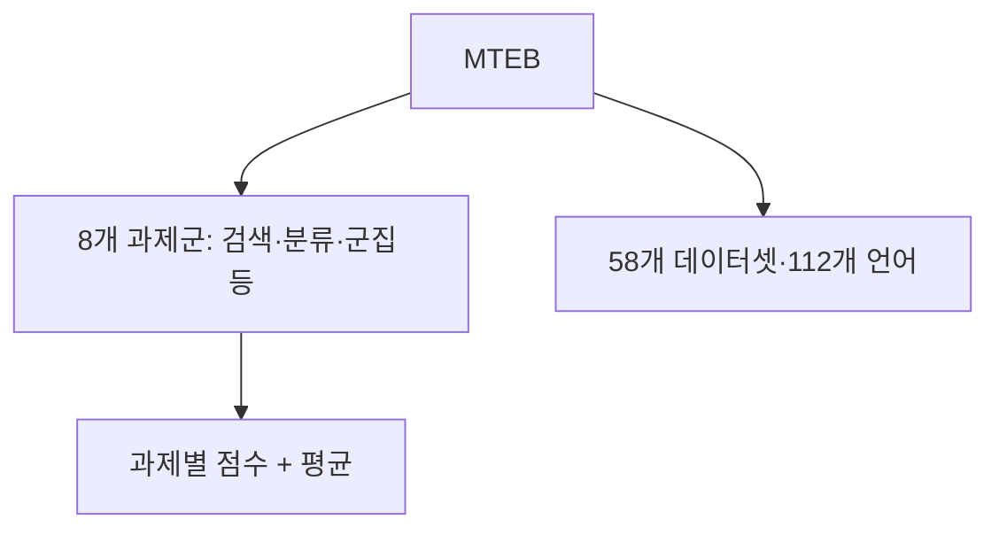

# MTEB 리더보드 읽기

> **MTEB(Massive Text Embedding Benchmark)** 는 텍스트 임베딩 모델을 여러 과제로 한꺼번에 비교하는 벤치마크다. 점수표 한 줄이 아니라 **내 과제와 맞는 열**을 읽어야 한다.

## 쉽게 말하면
종합 시험 성적표에는 국어·수학·영어 점수가 따로 있다. 평균이 1등이어도 내가 필요한 과목(예: 검색)이 약할 수 있다. MTEB 표도 평균과 과목별 점수를 함께 봐야 한다.

## 자세히
(Muennighoff 외, arXiv 2210.07316 초록 확인)
- 구성: **8개 임베딩 과제, 58개 데이터셋, 112개 언어.** 논문에서 **33개 모델**을 평가했다.
- 핵심 발견: **모든 과제에서 앞서는 단일 임베딩 방법은 없다.** 범용 최강은 아직 없다는 결론.
- 읽는 법(일반 지식): ① 내 용도(RAG면 검색 Retrieval 점수) 열을 먼저 본다 ② 한국어면 해당 언어 서브셋을 확인 ③ 모델 크기·차원·최대 길이·비용도 본다 ④ 리더보드 점수는 자체 보고가 섞일 수 있어 내 데이터로 소규모 재검증한다.
- 현재 순위는 계속 바뀌므로 이 글에는 적지 않는다.

## 그림으로 보기

## 예시
- 사내 문서 검색용 임베딩을 고를 때: Retrieval 점수 상위 3개를 뽑아 실제 질문 50개로 정답 문서 회수율을 비교.

## 헷갈리는 것과 비교
| 개념 | 차이 |
|---|---|
| MTEB | 임베딩 모델 비교 |
| LLM 벤치마크(MMLU 등) | 생성 모델 지식·추론 비교 |
| 재현율@k | 내 데이터에서의 실제 검색 품질 |

## 더 읽을거리
- [MTEB: Massive Text Embedding Benchmark](https://arxiv.org/abs/2210.07316) — 논문 초록.
