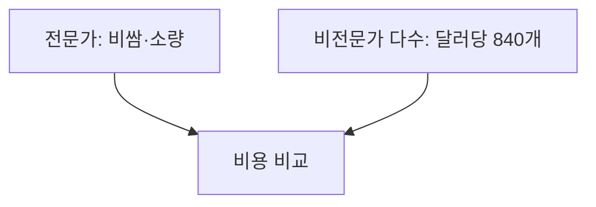

# MTurk 비전문가 라벨링 연구

> Snow 외(EMNLP 2008)는 Amazon Mechanical Turk의 비전문가 라벨을 여러 개 모으면 5개 NLP 과제에서 전문가 수준에 가까운 품질을 아주 싼 값에 얻을 수 있음을 보였다. 크라우드 라벨링 연구의 출발점이다.

## 쉽게 말하면
전문가 한 명에게 큰돈을 주는 대신 일반인 여러 명에게 푼돈을 주고 의견을 합치면, 한 사람의 실수나 치우침이 평균에 묻혀 전문가 못지않은 답이 나온다는 실험이다.

## 자세히
(Snow, O'Connor, Jurafsky, Ng, "Cheap and Fast—But is it Good?", EMNLP 2008 PDF를 직접 읽고 확인.)
- **5개 과제**: 감정 인식(SemEval-2007 헤드라인), 단어 유사도(30쌍), 텍스트 함의(RTE-1, 800쌍), 사건 시간 순서(TimeBank 462 동사쌍), 단어 의미 중의성 해소("president" 177건). 항목당 독립 10개 라벨.
- **비용**: 총 라벨 **21,690개에 25.82달러**, 약 143.9시간, 달러당 약 840개. 감정 인식은 7,000개 라벨 2달러(달러당 3,500개).
- **품질**: 감정 인식은 비전문가 평균 **4명**의 라벨이 전문가 1명과 비슷(Pearson 0.613 대 0.603) → 달러당 전문가 환산 최소 875개. 단어 유사도 상관 0.952(전문가 기준 Resnik 0.958), RTE 정확도 최대 89.7%, 시간 순서 0.94, 단어 의미 0.994(유일한 불일치는 골드 표준의 오류 — 정정 후 100%).
- **편향 보정**: Dawid & Skene 방식의 혼동 행렬을 소량 골드 세트로 추정해 가중 투표. 평균 RTE +4.0%, 사건 순서 +3.4% 정확도 향상, 단어 의미는 이미 최대라 이득 없음.
- **학습에 활용**: 비전문가 10명 라벨로 학습한 감정 모델(평균 성능 0.191)이 전문가 1명 라벨 학습(0.122)보다 낫다 — 저자 해석은 라벨러 다양성이 개별 편향을 줄인다는 것.
- **한계(제안)**: 2008년 단순 과제·영어 기준이며 현재 크라우드 플랫폼 품질·보수 환경과 다르다.

## 그림으로 보기

## 예시
- 상품 리뷰 감성 라벨을 항목당 5명에게 맡기고 다수결 + 골드 세트 20개로 작업자 보정.
- 교육 활용: "싸고 빠르지만 좋은가?"를 5개 과제 결과 표로 토론.

## 헷갈리는 것과 비교
| 개념 | 차이 |
|---|---|
| MTurk 연구(2008) | 다수 비전문가 합의로 품질 확보 |
| [Dawid-Skene](#dawid-skene) | 이 연구가 편향 보정에 쓴 통계 모델 계열 |
| [주석 비용 비교](#annotation-cost-comparison) | 크라우드 대 LLM 비용 비교 |

## 더 읽을거리
- [Cheap and Fast—But is it Good? (ACL Anthology D08-1027)](https://aclanthology.org/D08-1027.pdf) — 5개 과제 결과·비용표.
