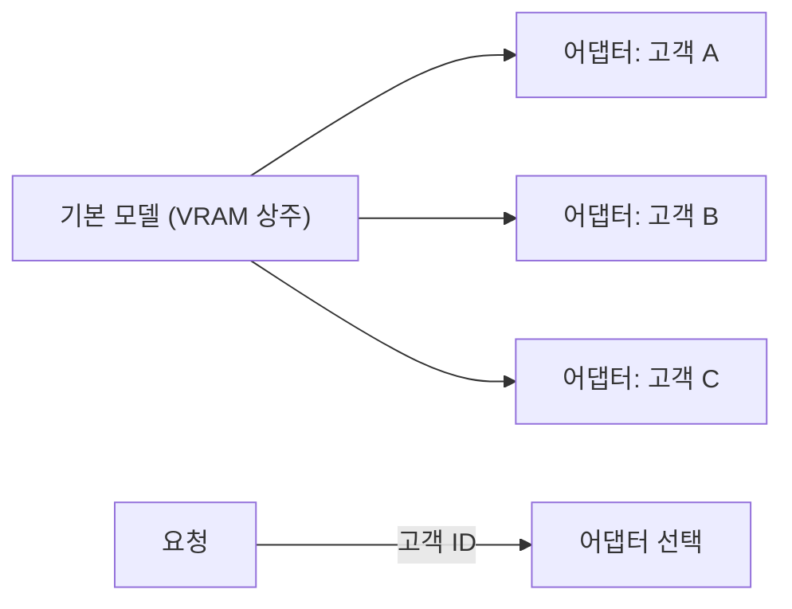

# 다중 어댑터 서빙

> **기본 모델 하나를 메모리에 올려 두고 어댑터를 바꿔 끼워** 여러 과제·고객용 맞춤 모델처럼 서비스하는 방식이다.

## 쉽게 말하면
범용 스마트폰 한 대에 앱(어댑터)을 바꿔 끼우듯 다른 업무를 처리한다. 폰(기본 모델)을 업무마다 따로 살 필요가 없다.

## 자세히
(LoRA 논문과 PEFT 문서를 직접 읽었다. 서빙 프레임워크별 구현은 이 글에서 확인하지 못했다.)
- **논문의 동기**: GPT-3 175B 미세조정 모델을 과제마다 별도로 배포하면 비용이 터무니없다. LoRA는 어댑터 체크포인트가 약 35MB(r=4, Wq·Wv)라 **저장·전환 비용이 작다**.
- **교체 서빙(논문)**: 사전학습 가중치를 VRAM에 두고 **LoRA 가중치만 교체**해 여러 맞춤 모델을 즉석에서 바꿔 쓸 수 있다. 훈련 중 VRAM은 1.2TB에서 350GB로 줄었다.
- **한계(논문)**: 병합해 지연을 없애면 한 배치에서 다른 과제를 섞기 어렵다. 병합하지 않고 배치 내 샘플별로 LoRA를 선택하면 가능하지만 지연이 늘 수 있다.
- **PEFT(문서)**: `delete_adapter()`, `add_weighted_adapter()`로 어댑터 삭제·조합, `merge_adapter()/unmerge_adapter()`로 교체. 다중 어댑터 로딩 예시는 해당 페이지에 코드가 없다.

## 그림으로 보기

## 예시
- 교육사 여러 곳에 어조·용어가 다른 요약 모델을 제공할 때, 기본 모델 하나에 어댑터 3개를 두고 요청 헤더로 선택(제안).

## 헷갈리는 것과 비교
| 방식 | 지연 | 유연성 |
|---|---|---|
| [병합](#lora-merge) | 없음 | 과제 고정 |
| 다중 어댑터 | 약간 증가 가능 | 과제 전환 쉬움 |
| 모델 여러 개 배포 | 없음 | 비용 큼 |

## 더 읽을거리
- [Hu et al. (2021) — LoRA](https://arxiv.org/abs/2106.09685) — 교체·한계(직접 읽음).
- [PEFT LoRA 가이드](https://huggingface.co/docs/peft/main/en/conceptual_guides/lora) — 어댑터 API(직접 읽음).
