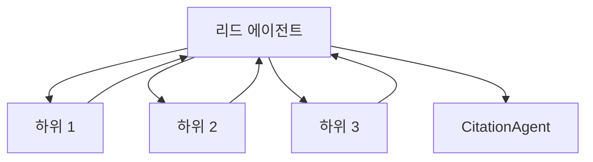
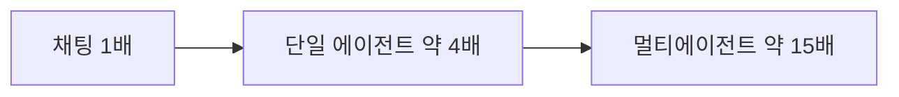

# 멀티에이전트 토큰 비용

> 멀티에이전트는 **성능을 올리지만 토큰을 약 15배** 쓴다. 비용이 정당화되는 건 가치가 높고 병렬화가 잘되는 작업뿐이다.

## 쉽게 말하면
연구원 한 명 대신 열 명을 동시에 투입하면 더 넓게 조사하지만 인건비도 그만큼 든다. 단순한 일에 열 명을 쓰면 낭비다.

## 자세히
(Anthropic "How we built our multi-agent research system" 확인)
- **구조**: 리드 에이전트가 질의를 분석해 전략을 세우고 하위 에이전트를 병렬로 띄운다. 결과는 리드가 종합하고 CitationAgent가 출처를 붙인다. 계획은 메모리에 저장해 컨텍스트가 잘려도 유지한다.
- **성능**: Claude Opus 4(리드)+Sonnet 4(하위) 조합이 단일 Opus 4보다 내부 연구 평가에서 **90.2%** 높았다. 이 글은 "멀티에이전트가 잘 되는 주된 이유는 문제를 풀 만큼의 토큰을 쓰게 하기 때문"이라고 말한다. BrowseComp에서 성능 분산의 약 **80%** 가 토큰 사용량으로 설명됐다.
- **비용**: 에이전트는 채팅 대비 약 **4배**, 멀티에이전트는 약 **15배** 토큰. 가치가 높고 병렬화되는 작업에 적합하고, 의존성이 큰 코딩 같은 작업에는 덜 맞는다.
- **교훈**: 모호한 지시는 중복 작업을 낳는다 / 난이도별 투입 규칙을 명시 / 도구 설명 개선으로 작업 시간 40% 감소 / 병렬화로 복잡한 질의 시간을 최대 90% 단축 / 동기 실행이 병목이라 비동기가 과제.

## 그림으로 보기

## 예시
- 사업 조사처럼 독립적인 방향이 많은 질의는 멀티에이전트, 한 파일의 버그 수정은 단일 에이전트.
- 비용을 줄이려면 쉬운 질의에는 하위 에이전트를 쓰지 않는 규칙을 프롬프트에 넣는다.

## 헷갈리는 것과 비교
| 개념 | 차이 |
|---|---|
| 단일 에이전트 | 토큰 약 4배, 단순 |
| 멀티에이전트 | 토큰 약 15배, 병렬 탐색 |
| [작업자 컨텍스트 격리](#worker-context-isolation) | 비용을 쓰는 이유(깨끗한 창) |

## 더 읽을거리
- [How we built our multi-agent research system](https://www.anthropic.com/engineering/multi-agent-research-system)
