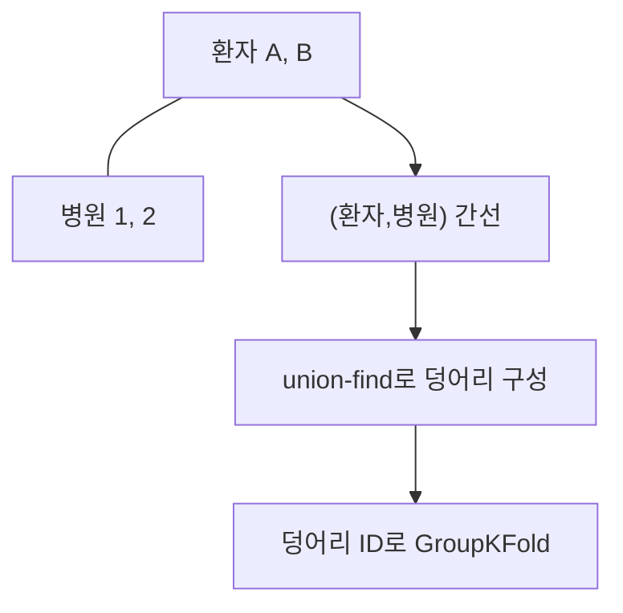
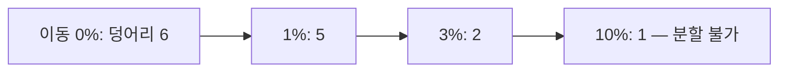

# 다축 그룹(환자+기관)

> 유사성을 만드는 식별자가 **둘 이상**(예: 환자와 병원)일 때, 한 축으로만 묶으면 다른 축에서 누수가 남는다. 두 축 중 하나라도 같으면 한 덩어리로 묶는 "연결 성분" 방식이 정석이지만, 연결이 많으면 덩어리가 하나로 붕괴한다.

## 쉽게 말하면
시험 반 배정에서 "형제는 같은 반"과 "같은 학원 학생끼리는 같은 반"을 동시에 지키려는 것이다. 형제가 학원을 옮겨 다니면 두 규칙이 서로 연결되어 결국 모두가 한 반이 되어 버린다.

## 자세히
(scikit-learn 1.9.1, 합성 데이터 200샘플·환자 40명·병원 6곳, 직접 실험.)
- **한 축만 묶으면**: 환자 ID로 `GroupKFold(5)`를 쓰면 환자 겹침은 `[0,0,0,0,0]`이지만 **병원** 겹침은 폴드마다 6(전부)이다. 같은 병원의 기기·촬영 특성을 모델이 외운다면 새 병원 일반화가 과대평가된다.
- **연결 성분(connected components)**: 샘플을 (환자, 병원) 쌍의 그래프 간선으로 보고 union-find로 연결된 덩어리를 만든 뒤 그 덩어리 ID로 그룹 분할한다. 환자 또는 병원이 같으면 같은 덩어리가 되어 두 축 모두 겹침이 0이 된다.
- **붕괴 위험(직접 확인)**: 환자가 원래 한 병원만 다니도록 만든 데이터에서 일부 샘플이 다른 병원으로 이동하는 비율을 바꿨더니 덩어리 수가 — 이동 0%: **6개**, 1%: **5개**(최대 69샘플), 3%: **2개**(155/45), 10%: **1개**(200 전부). 덩어리가 1~2개면 `GroupKFold(5)`는 `n_splits=5 cannot be greater than the number of groups: 2` 오류가 난다. 소수의 "다리" 샘플이 전체를 연결한다.
- **대응**
  1. 어느 축의 누수가 더 위험한지 정한다(새 환자 vs 새 병원 일반화 중 목표가 무엇인가).
  2. 목표 축만 엄격히, 나머지 축은 **겹침 정도를 보고**하고 허용.
  3. 다리 샘플(병원을 옮긴 환자)을 제외하거나 한쪽 폴드에만 두고 덩어리를 다시 센다.
  4. 두 축을 단계적으로: 병원 단위로 테스트를 정하고 학습 쪽에서 그 병원의 환자를 제거(엄격한 분리).
  5. 어느 방식이든 [그룹 겹침 검증](#group-overlap-check)을 축마다 실행한다.
- 이 수치는 합성 데이터 한 번의 결과이며, 실제 의료 데이터의 연결 구조는 다르다.

## 그림으로 보기



## 예시
```python
# 두 ID가 같으면 같은 덩어리 → 덩어리 ID로 분할
comp = connected_components(patient_id, hospital_id)
for tr, te in GroupKFold(5).split(X, y, groups=comp): ...
```
- 환자 여러 명이 병원 여러 곳을 오가는 영상 데이터에서 환자 기준과 병원 기준의 겹침을 각각 보고.

## 헷갈리는 것과 비교
| 개념 | 차이 |
|---|---|
| 단일 축 그룹 | 한 식별자만 분리 |
| 다축 그룹 | 여러 식별자를 동시에 분리(덩어리) |
| [그룹 ID 누락](#missing-group-ids) | 식별자 자체가 비어 있음 |
| [Leave-P-Groups-Out](#leave-p-groups-out) | 한 축에서 P개 그룹 조합 |

## 더 읽을거리
- [scikit-learn 교차검증 가이드 — 그룹 데이터](https://scikit-learn.org/stable/modules/cross_validation.html) — 환자 ID 예와 그룹이 겹치지 않아야 한다는 원칙.
