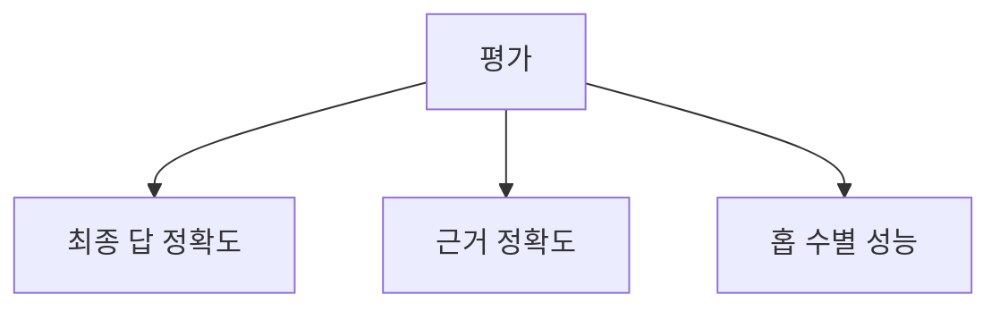

# 멀티홉 질문 응답

> 멀티홉 QA는 한 문서에서 답이 나오지 않고 여러 문서의 사실을 차례로 이어야 답할 수 있는 질문에 답하는 과제다. 앞 단계의 답이 다음 단계 검색·추론의 재료가 된다.

## 쉽게 말하면
"〈영화 A〉 감독의 출생 도시는?"은 ① 영화 A 문서에서 감독 이름 찾기 ② 그 감독 문서에서 출생 도시 찾기의 두 걸음이다. 첫 걸음의 결과가 있어야 둘째 걸음의 검색어가 정해진다. 계단을 한 칸씩 오르는 질문이 멀티홉이다.

## 자세히
- **정의와 데이터셋**: 대표 벤치마크는 [HotpotQA](#hotpotqa)(위키 기반 11.3만 개, 근거 문장 주석, 다리형·비교형 질문)와 [MuSiQue](#musique)(단일 홉 질문을 합성한 2~4홉 2.5만 개, 지름길 억제)다. 각 데이터셋의 설계는 앞의 두 글에서 공식 논문 초록으로 확인했다.
- **전형적 해법의 구조(해석)**: ① 질문 분해(하위 질문으로 나눔) ② 하위 질문마다 검색 ③ 중간 답을 다음 질문에 대입 ④ 최종 답 생성. 검색 증강 시스템에서는 검색을 여러 번 반복하는 구조가 된다. 한 번의 검색으로는 둘째 문서가 안 잡힐 수 있기 때문이다.
- **직접 확인한 장난감 실험의 한계**: 문서 4개짜리 작은 코퍼스에 TF-IDF 검색을 해 보니 질문 하나로도 상위 2개 안에 두 문서(감독 문서, 영화 문서)가 모두 나왔다. 이렇게 작은 코퍼스에서는 한 번 검색으로 충분해 멀티홉의 어려움이 드러나지 않았다. 실제 위키백과 규모에서 둘째 문서는 질문과 단어가 겹치지 않아 놓치기 쉽다는 점은 이 실험으로 확인하지 못했고 논문들의 문제 제기에 근거한다.
- **평가 포인트(해석)**: ① 최종 답의 정확도(EM·F1) ② 근거 문장·문서를 맞혔는지(근거 지표) ③ 홉 수별 성능 ④ 단일 홉 지름길로 맞힌 것은 아닌지([연결 추론 지름길](#connected-reasoning-shortcut)). 답만 맞고 근거가 틀리면 우연이나 지름길을 의심한다.
- **한계**: 중간 단계 오류가 뒤로 전파돼 홉이 늘수록 정확도가 급격히 떨어지기 쉽다.

## 그림으로 보기

## 예시
- 사내 문서 QA: "지난 분기 가장 큰 계약을 담당한 팀의 팀장은 누구인가?"는 계약 문서 → 담당 팀 → 조직도의 3홉이다.
- 교육 활용: 질문 하나를 하위 질문 둘로 직접 쪼개 보게 해 RAG가 왜 반복 검색을 하는지 이해시킨다.

## 헷갈리는 것과 비교
| 개념 | 차이 |
| --- | --- |
| 단일 홉 QA | 문서 하나에서 답 |
| 멀티홉 QA | 여러 문서를 이어서 답 |
| [HotpotQA](#hotpotqa) | 대표 데이터셋 |
| [MuSiQue](#musique) | 지름길 억제 데이터셋 |

## 더 읽을거리
- [HotpotQA (arXiv 1809.09600)](https://arxiv.org/abs/1809.09600) — 멀티홉 QA 데이터셋
- [MuSiQue (arXiv 2108.00573)](https://arxiv.org/abs/2108.00573) — 합성형 멀티홉 데이터셋
