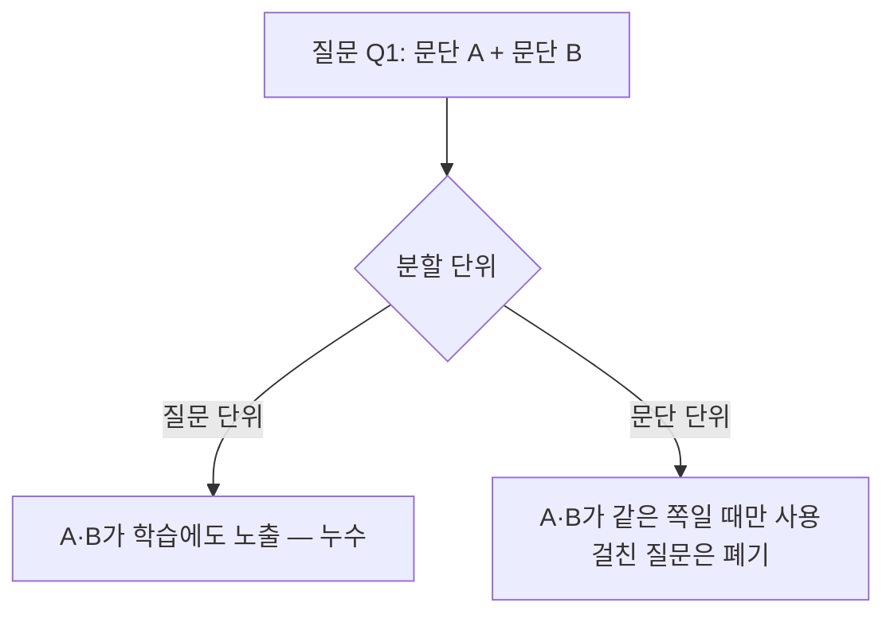

# 다문단 질문 처리

> 한 질문의 정답이 **여러 문단·문서에 걸쳐 있을 때(multi-hop)** 학습/평가 분할을 어떻게 하느냐의 문제다. 질문 단위로만 나누면 같은 문단이 양쪽에 들어가 누수가 생기고, 문단 단위로 나누면 둘에 걸친 질문을 버려야 해서 데이터가 크게 줄어든다.

## 쉽게 말하면
"A 책 3장과 B 책 5장을 같이 봐야 풀리는 문제"를 시험과 연습에 나눈다고 하자. 문제만 따로 나누면 연습 문제에서 이미 A 책 3장을 외운 학생이 시험을 본다. 책 단위로 나누면 두 책에 걸친 문제는 둘 다에서 빼야 한다.

## 자세히
- **데이터셋 배경**: HotpotQA는 위키 기반 약 11만 3천 개 질문으로, 여러 문서를 조합해야 하고 문장 단위 근거(supporting facts)가 주석돼 있다(arXiv 1809.09600 초록 확인). MuSiQue는 단일 홉 질문을 합성해 만든 2~4홉 약 2.5만 개 질문(MuSiQue-Ans)이며, 기존 멀티홉 벤치마크는 지름길로 풀리는 경우가 많다고 지적한다(arXiv 2108.00573 초록 확인).
- **분할 누수 사례(검색 요약, 본문 미확인)**: MuSiQue는 두 질문이 단일 홉 질문·그 답·근거 문단 중 하나를 공유하면 겹친다고 정의하고, 학습 부분집합이 나머지와 가장 덜 겹치게 분할한다고 한다. StepGame은 한 과제에서 테스트의 약 23%가 학습에도 있었고 홉 수가 적은 예를 제거하자 0%가 됐다고 한다. CMT-RAG는 근거 문서 제목과 연결 엔티티로 묶어 분할했다고 한다. 임계값은 논문마다 달라 단일 기준이 없다.
- **직접 시뮬레이션(질문 120개, 각 질문은 문단 2개 필요, 문단 60개)**
  - 질문 단위 무작위 분할(테스트 24개): 테스트 질문 **24개 모두** 문단이 학습에 노출됐고 21개는 두 문단 모두 노출됐다.
  - 문단 단위 분할(문단 25%를 테스트 전용으로): 학습 61, 테스트 6, 두 집합에 걸쳐 **버린 질문 53개**, 공유 문단 0. 누수는 사라지지만 데이터가 극적으로 줄었다.
- **선택 지침**
  1. 목표가 "새 문서에서의 일반화"면 문단·문서 기준으로 나누고 걸친 질문은 버린다(데이터 감소를 보고).
  2. 문서 말뭉치가 고정된 RAG라면(같은 문서가 서비스에서도 쓰임) 질문 단위 분할이 현실에 더 가깝다. 대신 *검색 학습에 정답 문서를 외우는지*를 따로 점검한다.
  3. 연결이 많으면 덩어리가 붕괴한다([다축 그룹](#multi-axis-grouping)의 연결 성분 문제와 같은 구조).
  4. 분할 후 [누수 점검](#split-leakage-audit)으로 근거 문단·답·질문 유사도를 확인한다.
- 이 시뮬레이션은 균일 무작위 합성이라 실제 분포보다 연결이 밀집하다.

## 그림으로 보기

## 예시
- 사내 규정 챗봇 평가셋: 같은 규정 문서에서 만든 질문들을 한 그룹으로 묶어 분할.
- 교육: "정답 근거가 여러 곳에 있는 질문"이 RAG에서 왜 어려운지, 평가를 어떻게 공정하게 나누는지 설명.

## 헷갈리는 것과 비교
| 개념 | 차이 |
|---|---|
| 질문 단위 분할 | 문단 공유 누수 가능 |
| 문단·문서 단위 분할 | 누수 방지, 데이터 감소 |
| [문서 단위 분할](#document-level-split) | 이 노드의 상위 원칙 |
| [그룹 겹침 검증](#group-overlap-check) | 분할 후 겹침 0 확인 |

## 더 읽을거리
- [HotpotQA (arXiv 1809.09600)](https://arxiv.org/abs/1809.09600) — 멀티홉 QA 데이터셋과 근거 문장 주석.
- [MuSiQue (arXiv 2108.00573)](https://arxiv.org/abs/2108.00573) — 지름길을 줄이도록 구성한 2~4홉 데이터셋.
