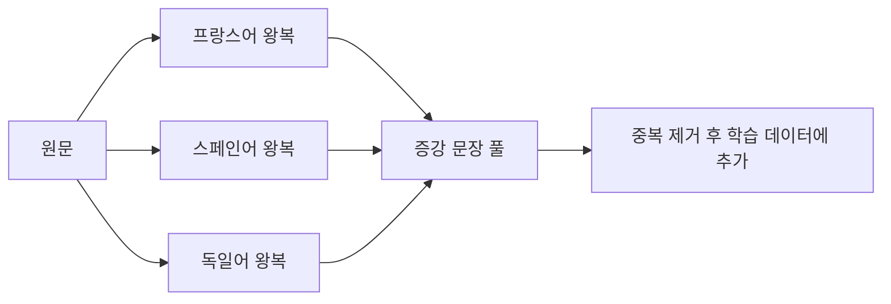
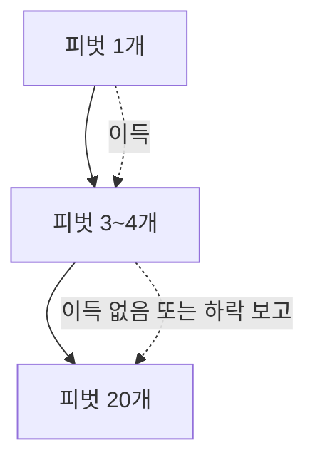

# 여러 중간 언어 혼합

> 역번역을 할 때 중간 언어를 하나만 쓰지 않고 **여러 개를 섞어** 증강 문장을 만드는 방식. 새 문장 수와 표현 다양성은 늘지만, 많이 섞는다고 항상 좋아지는 것은 아니다.

## 쉽게 말하면
같은 문장을 한 사람에게만 돌려 다시 쓰게 하면 말투가 한 가지로 굳는다. 여러 사람에게 나눠 맡기면 표현이 다양해진다. 대신 어떤 사람이 엉뚱하게 옮기면 의미가 틀어진 문장도 같이 섞여 들어온다. 그래서 "몇 명에게 맡길지"와 "결과를 검수할지"가 함께 필요하다.

## 자세히
- 방법: 언어마다 번역→역번역을 따로 돌려 나온 문장을 모두 학습 데이터에 더한다. 언어가 k개면 문장당 최대 k개의 변형이 생긴다(원문과 같으면 버린다).
- 사례 1, 생의학 질의응답(arXiv 2204.04711, Pappas 외, 2021-12 PDF 메타데이터 기준): 프랑스어 하나로 새 학습 예시 4,901개, 프랑스어·스페인어·독일어 셋으로 15,593개를 얻었다. 개발셋 PRAUC는 기준 89.57에서 피벗 1개 시 91.44, 3개 시 92.66으로 올랐다. 역번역만 쓴 3피벗(92.52)이 원본까지 더한 경우(92.66)와 거의 같았다. 저자들은 피벗을 더 늘리면 이득이 더 있을 수 있다고 쓰지만, 단어 치환 같은 단순한 방법이 더 적은 예시로 더 큰 이득을 냈다고도 밝힌다. 분류가 아니라 질의응답 과제다.
- 사례 2, 스페인어 트윗 감성 분석(Atalaya, arXiv 1909.11241, TASS 2019): 영어·프랑스어·포르투갈어·아랍어 4개 피벗 증강은 일부 데이터셋(ES, CR)에서 유용했고 PE에서는 아니었다. 언어 계통이 다른 20개 피벗으로 넓히자 4개 피벗보다 나아진 것이 없었고 **품질이 크게 떨어지는 경우도** 있었다.
- 일반 정리: 피벗 수에는 수확 체감이 있고, 과제·데이터에 따라 손해도 난다. 과제가 바뀌면 개발셋으로 효과를 직접 재야 한다. 큰 사전학습 모델을 미세조정할 때는 역번역이 도움이 되지 않았다는 보고도 있다(Longpre 외 2019, 2020 — 위 논문이 인용).
- 언어 선택 팁: 계통이 다른 언어를 섞되, 각 언어의 번역 품질(해당 쌍의 기계번역 성능)을 확인한다.

## 그림으로 보기

## 예시
| 설정 | 결과 |
|---|---|
| QA, 피벗 fr | 새 예시 4,901개, PRAUC 89.57→91.44 |
| QA, 피벗 fr+es+de | 새 예시 15,593개, PRAUC →92.66 |
| 감성, 피벗 4개 → 20개 | 20개로 넓혀도 개선 없음, 일부 하락 |
- 업무 장면: 고객 문의 분류 데이터 500건을 3개 언어로 왕복해 1,500건을 더하고, 개발셋 점수가 오르는지 확인한 뒤 언어를 더 늘릴지 정한다.

## 헷갈리는 것과 비교
| 개념 | 차이 |
|---|---|
| 여러 중간 언어 혼합 | 한 문장을 여러 언어로 왕복해 변형을 여럿 만듦 |
| [중간 언어 선택](#intermediate-language-choice) | 어떤 언어를 쓸지 고르는 문제 |
| [중간 언어 거리](#pivot-language-distance) | 원문과 변형의 임베딩 거리 |
| [역번역](#back-translation) | 기본 기법. 혼합은 그 확장 |

## 더 읽을거리
- [Data Augmentation for Biomedical Factoid Question Answering (arXiv 2204.04711)](https://arxiv.org/abs/2204.04711) — 1개 vs 3개 피벗 수치(PDF 직접 읽음).
- [Atalaya at TASS 2019 (arXiv 1909.11241)](https://arxiv.org/abs/1909.11241) — 4개 vs 20개 피벗 실험(PDF 직접 읽음).
