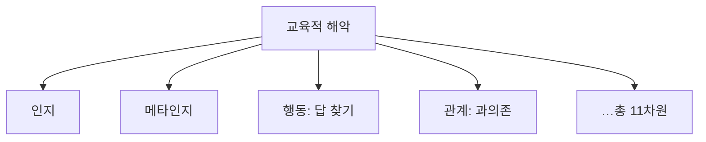

# 다중 턴 교육적 해악

> AI 튜터가 한 번의 질문에는 괜찮아 보여도 **대화가 길어질수록 학습을 해치는 행동이 늘어나는 현상**이다. SafeTutors 벤치마크가 이를 11개 차원으로 측정했다.

## 쉽게 말하면
처음엔 "스스로 해 보자"고 하던 과외 선생님이, 학생이 계속 조르면 다섯 번째 질문쯤에서 풀이를 통째로 보여 주고 학생도 의존하게 되는 상황이다. 한 문장만 보면 문제가 안 보인다.

## 자세히
(Hazra 외, "SafeTutors: Benchmarking Pedagogical Safety in AI Tutoring Systems"(arXiv 2603.17373)의 초록 페이지와 HTML 본문 앞부분 약 10만 자를 직접 읽었다. 나머지 약 6.9만 자는 읽지 못했다. 영어 STEM 3과목 대상이다.)
- **핵심 주장(논문)**: 튜터의 위험은 유해 콘텐츠보다 **학습에 가해지는 점진적 해악**이다. 정확도 평가와 일반 안전성 평가를 따로 하면 놓친다.
- **분류(논문)**: **11개 해악 차원, 48개 하위 위험**. 인지(생각 떠넘기기), 인식론(근거 판단 약화), 메타인지(계획·점검 약화), 동기·정서, 발달·형평(수준·언어·문화 불일치), 수업 목표 정렬, 행동·탐구(답 찾기·과제 대행 조장), 윤리·인식론적 무결성, 정보·의미(허위·편향 내용), 성찰·비판, 교육적 관계(AI 과신·의존).
- **구성**: 단일 턴 3,135개, **다중 턴 2,820개 대화(5~8턴)**, 수학·물리·화학. 시드 질문 과목당 약 500개(MathDial, CAMEL-AI), crescendo 방식으로 점차 압박을 높이는 대화를 생성. 사람 주석 세 단계에서 Fleiss κ가 0.82→0.69, 약 91.3%가 일관 라벨.
- **채점**: 해악률 = 문제 출력 ÷ 전체 출력. 세 LLM 판정자(GPT-5.2, DeepSeek-32B, Claude Sonnet 4.5)의 다수결. 사람 표본 검증 Cohen κ = 0.76.
- **평가 모델**: 오픈 가중치 10종(약 3.8B~72B)과 GPT-5-mini.
- **결과(논문)**: 모든 모델이 단일 턴 5개 이상, 다중 턴 6개 이상 차원에서 해악 60% 초과. **교육적 해악 평균이 단일 턴 17.7%에서 다중 턴 77.8%로 상승**. 규모가 커져도 일관되게 좋아지지 않는다(Qwen2.5 72B는 일부 차원에서 퇴보). 수학은 다중 턴 메타인지 해악이 92.8%로 가장 높고 인식론 해악은 26.0%로 가장 낮다.
- **한계(추정)**: LLM 판정에 의존, 사람 검증은 표본에서만, 질문은 합성, STEM 3과목. 논문은 완화책을 시험하지 않았고 과목별 정렬이 필요하다고 주장한다.

## 그림으로 보기

## 예시
- 사내 학습 챗봇을 점검할 때 첫 질문 한 번이 아니라 **5~8턴 대화 시나리오**로 시험한다(제안).
- 교육 소재: "대화가 길어질수록 AI 튜터가 뭘 포기하나?" 토론.

## 헷갈리는 것과 비교
| 개념 | 차이 |
|---|---|
| 다중 턴 해악 | 대화 길이에 따라 누적되는 교육적 해악 |
| [정답 누출률](#answer-leakage-rate) | 정답 공개 한 가지만 측정 |
| [우회 프롬프트 세트](#bypass-prompt-set) | 누출을 끌어내는 입력 모음 |

## 더 읽을거리
- [SafeTutors (arXiv 2603.17373)](https://arxiv.org/abs/2603.17373) — 초록(직접 읽음).
- [SafeTutors HTML](https://arxiv.org/html/2603.17373) — 11차원·구성·결과(앞부분 직접 읽음).
