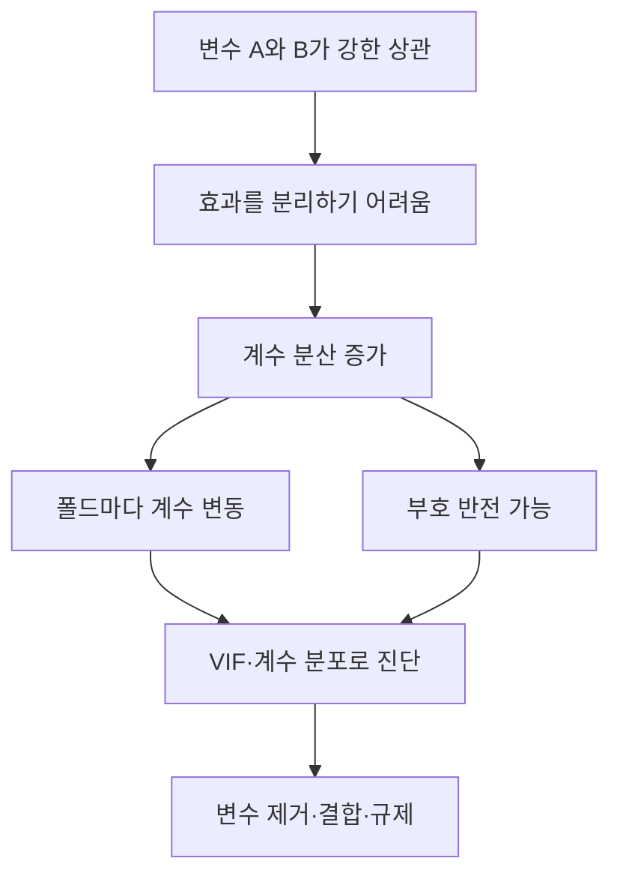

# 다중공선성

> 설명변수끼리 강하게 상관되어 있어, 회귀 계수가 불안정해지고 부호까지 직관과 어긋날 수 있는 문제. 예측 정확도보다 **계수 해석**에 더 큰 타격을 준다.

## 쉽게 말하면
두 사람이 항상 같이 다니며 일을 한다고 하자. 결과가 좋았을 때 누구 덕인지 가리기 어렵다. 한 명의 공을 키우면 다른 한 명의 공이 줄어드는 식으로 평가가 흔들린다. 상관된 변수 둘의 계수가 그렇게 서로 상쇄된다.

## 자세히
출처: scikit-learn 계수 해석 예제(앞 100,000자 확인, 뒤쪽은 읽지 못함)와 statsmodels `variance_inflation_factor` 문서(본문 확인, 2026-11-18).
- **계수의 의미**: 다중 회귀의 계수는 "다른 변수를 고정했을 때"의 조건부 관계다. 상관된 변수는 함께 움직여 한 변수만 바뀌는 상황이 데이터에 거의 없다.
- **불안정성**: 예제에서 AGE와 EXPERIENCE는 강한 상관이 있어, 교차검증 폴드마다 두 계수가 크게 흔들렸고 한쪽이 양이면 다른 쪽이 음이었다.
- **부호 반전**: 나이와 임금의 단순 상관은 양이지만 경험을 고정하면 AGE 계수는 음수로 나왔다. 부호만으로 인과나 중요도를 단정하면 위험하다([잘못된 부호 진단](#wrong-sign-diagnostic)).
- **VIF(분산팽창계수)**: 한 변수를 넣었을 때 추정치 분산이 얼마나 커지는지 나타낸다. 문서는 일반 권고로 VIF가 5보다 크면 강한 공선성으로 본다고 적는다(기준은 관습, 10을 쓰는 자료도 있다). `variance_inflation_factor(exog, exog_idx, standardize=True)`.
- **대응**: 변수 제거(예제는 AGE를 제거해 EXPERIENCE 계수 변동이 크게 줄었다), 상관 변수 결합, 규제(Ridge·Lasso가 안정화하는 경향은 일반 지식), 계수 분포를 `RepeatedKFold`로 확인.
- **구분**: 예측만 목적이면 큰 문제가 아닐 수 있으나, 이유 코드·계수 설명이 필요한 신용 모형에서는 중요하다.

## 그림으로 보기


## 예시
```python
import pandas as pd
from statsmodels.stats.outliers_influence import variance_inflation_factor
Xc = (X - X.mean()) / X.std()
vif = pd.Series([variance_inflation_factor(Xc.values, i) for i in range(Xc.shape[1])], index=Xc.columns)
print(vif.sort_values(ascending=False))   # 5 이상이면 점검
```
신용 모형에서 "카드 한도"와 "카드 사용액"이 함께 들어 있어 계수 부호가 뒤집힌 경우, 한쪽을 빼거나 "사용률" 한 변수로 합친다.

## 헷갈리는 것과 비교
| 개념 | 차이 |
|---|---|
| 다중공선성 | 설명변수끼리의 상관 |
| 변수와 타깃의 상관 | 예측력의 근거, 문제 아님 |
| 과적합 | 학습 데이터 과도 적합, 원인이 다름 |
| [잘못된 부호 진단](#wrong-sign-diagnostic) | 다중공선성은 그 원인 중 하나 |

## 더 읽을거리
- [scikit-learn: 선형 모델 계수 해석](https://scikit-learn.org/stable/auto_examples/inspection/plot_linear_model_coefficient_interpretation.html) — AGE·EXPERIENCE 예제
- [statsmodels VIF](https://www.statsmodels.org/stable/generated/statsmodels.stats.outliers_influence.variance_inflation_factor.html) — 함수 시그니처와 해석 기준
