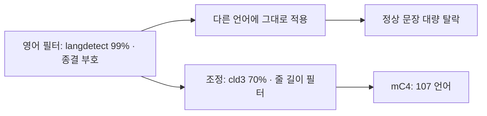
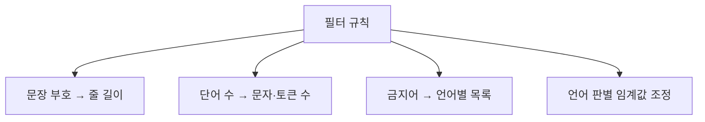

# 다국어 필터 조정

> 영어를 기준으로 만든 데이터 필터(종결 부호, 5단어 이상, 영어 판별)를 그대로 다른 언어에 쓰면 정상 문장이 대량으로 지워진다. 언어마다 문장 부호·띄어쓰기·자원 규모가 달라 규칙과 임계값을 바꿔야 한다.

## 쉽게 말하면
영어 문법 검사기로 한글 문서를 검사하면 거의 모든 문장에 빨간 줄이 생긴다. 필터도 같다. "문장이 마침표로 끝나는가"는 영어에는 좋은 검사지만 일본어·태국어·힌디어 문장에는 맞지 않는다.

## 자세히
(mT5 논문 arXiv 2010.11934의 PDF 본문 3.1절을 직접 내려받아 확인하고, C4 규칙은 직접 코드로 적용해 실행.)
- **C4는 영어 전용**: langdetect가 영어일 확률을 99% 이상으로 본 페이지만 유지, 종결 부호 줄만 유지([C4 데이터셋](#c4-dataset)).
- **mC4의 조정(mT5 논문)**
  - 언어 판별: **cld3**로 100개 넘는 언어를 식별, 페이지 주 언어 신뢰도가 **70% 미만이면 제거**(C4의 영어 99%보다 크게 느슨).
  - 종결 부호 규칙 폐기: 많은 언어가 영어식 종결 부호를 쓰지 않으므로 대신 **"줄 길이 필터"** — 200자 이상인 줄이 최소 3줄 있는 페이지만 유지.
  - 유지: 문서 간 줄 중복 제거, 금지어 페이지 제거.
  - 자원 문제: 희귀 언어를 위해 Common Crawl의 **71개월 크롤을 전부** 사용(C4는 2019년 4월 한 달분이면 충분). 페이지 수 10,000개 이상인 언어만 포함해 cld3 기준 107개 "언어"(그중 6개는 같은 언어의 문자 변형, 예 ru와 ru-Latn).
  - 훈련 시 언어 표집 지수 α=0.3(고자원 편중을 줄이는 조정; mT5 최종 값)이고 α=0.7·0.2와 비교 실험.
- **직접 실행(C4의 종결 부호 규칙을 각 언어 한 문장에 적용)**: 영어·한국어·아랍어 문장은 통과(True). 일본어("…始まります。"), 중국어("…开始。"), 힌디어("…होती है।"), 태국어(문장 부호 없음)는 **False로 탈락** — 일본어·중국어 전각 마침표 `。`, 힌디어 다르 `।`이 영어 목록에 없기 때문. 또 5단어 이상 규칙은 띄어쓰기가 적은 일본어(1단어로 셈)·태국어에 맞지 않고, 한국어의 짧은 문장(4어절)도 탈락한다.
- **조정 체크리스트(제안)**: ① 문장 부호 집합에 언어별 종결 기호 추가(`。` `！` `？` `।` 등) ② 단어 수 대신 문자 수 또는 토큰 수 기준 ③ 금지어 목록은 언어별로 별도 구축·감사([SafeSearch vs 금지어 목록](#safesearch-vs-wordlist)) ④ 언어 판별 임계값을 언어별로 점검 ⑤ 반복 임계값 재조정([반복 제거 임계값](#repetition-thresholds)) ⑥ 한국어는 어절·형태소 기준 길이 정의 검토.
- 한계: 소수 언어는 데이터가 적어 필터 오류의 영향이 크고, 언어 판별 자체가 정확도가 낮을 수 있다(제안).

## 그림으로 보기



## 예시
```python
ENDS = (".", "!", "?", '"', "。", "！", "？", "।")
def keep_line(l, min_chars=20):
    return l.strip().endswith(ENDS) and len(l.strip()) >= min_chars
```
- 한국어 사내 문서 정제: 문장 길이는 단어 수가 아니라 글자 수로 판단하고, 종결 부호 없는 제목·목록은 별도로 처리(제안).

## 헷갈리는 것과 비교
| 개념 | 차이 |
|---|---|
| mC4 | 101개 언어(논문 초록) 코퍼스, 줄 길이 필터·cld3 70% |
| [C4](#c4-dataset) | 영어 전용, langdetect 99%·종결 부호 |
| 언어 판별 | 문서의 언어를 맞히는 단계(필터의 앞 단계) |
| 번역 증강 | 데이터를 만드는 방법. 필터링과 별개 |

## 더 읽을거리
- [mT5: A Massively Multilingual Pre-trained Text-to-Text Transformer (arXiv 2010.11934)](https://arxiv.org/abs/2010.11934) — mC4 구성·필터 조정(PDF 본문 확인).
- [T5 논문 (arXiv 1910.10683)](https://arxiv.org/abs/1910.10683) — 원래 C4 규칙(PDF 본문 확인).
