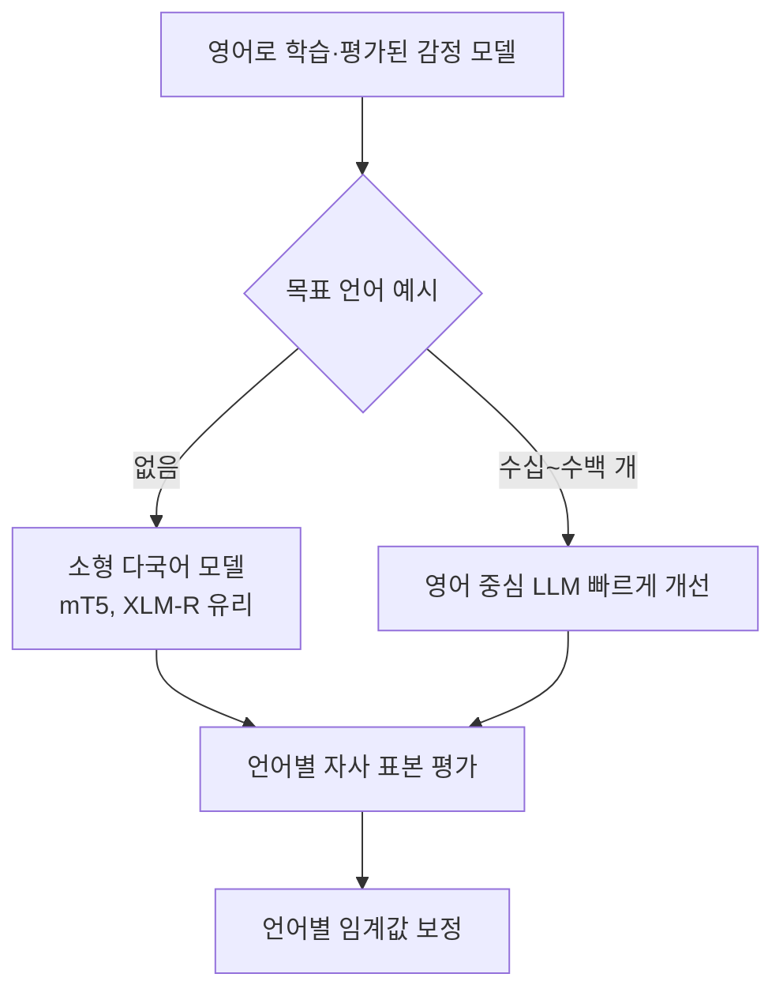

# 다국어 감정 분석

> 영어로 만든 감정 분석 모델이나 프롬프트를 다른 언어에 그대로 쓰면 성능이 달라진다. 언어별 **별도 시험이 필요한 이유**와, 영어에서 다른 언어로 옮길 때(교차 언어 전이) 어떤 모델이 유리한지를 정리한 노드.

## 쉽게 말하면
영어 시험으로만 훈련한 번역가를 갑자기 스페인어 손님에게 보내면 대체로 통하지만 어떤 말투에서는 미끄러진다. 어느 언어에서 얼마나 미끄러지는지는 그 언어로 직접 시험해 봐야 안다.

## 자세히
출처: "The Model Arena for Cross-lingual Sentiment Analysis"(arXiv 2406.19358, WASSA 2024, HTML 본문 확인), Zero-shot Cross-lingual Transfer 논문 초록(arXiv 2101.10649, 확인), 검색 요약, 2026-11-18. 한국어 수치는 직접 열어 확인하지 못했다.
- **WASSA 2024 연구 설정**: 영어 **콜센터 발화**로 학습·시험한 감정 분류를 스페인어·프랑스어·중국어로 옮겼다. 점수는 세 목표 언어의 평균 micro-F1. 프랑스어·중국어 데이터는 기계번역이고, 데이터는 한 사내 데이터셋이라는 한계가 있다.
- **제로샷(목표 언어 예시 없음)**: 상용 GPT-3.5 79.4, GPT-4 78.1(영어 예시 300개 문맥 학습). 공개 모델에서는 mT5-large(1.2B) 73.5, XLM-R-large 70.8, mT5-base 70.1, mT5-xl 68.4. 공개 LLM 최고 Llama-3-8B 69.5, Mistral-7B 44.5. 논문 요약: 공개 모델 중에선 **소형 다국어 모델(SMLM)이 제로샷에서 LLM보다 우수**.
- **소수 예시(few-shot)**: 60개 예시에서 Llama-3 82.1, Llama-2 81.2, Falcon 81.0이 모든 SMLM을 앞섰고 GPT-3.5·GPT-4는 각 79.2. 150개에서 Llama-2 83.2, Falcon 82.5, Llama-3 81.9, 최고 SMLM XLM-R-large 79.6. 600개에서 Falcon 84.7, Llama-2 84.6, Llama-3 84.0, mT5-xl 84.5, GPT-4 78.0.
- **결론(논문)**: 목표 언어 데이터가 없으면 소형 다국어 모델이 유리하고, 몇십~몇백 개의 목표 언어 예시가 있으면 영어 중심 LLM이 빠르게 따라잡는다. 상용 GPT는 제로샷은 강하지만 예시를 더해도 이득이 작아 미세 조정된 공개 모델이 60~600 예시에서 앞지른다.
- **한국어에 대하여**: 위 연구는 한국어를 다루지 않는다. 검색 요약에 한 연구(XLM-R, 영어 영화 리뷰 → 한국어 NSMC)가 제로샷 한국어 79.24 대 영어 93.52를 보였다는 서술이 있으나 원문 수치가 본문 서술과 일치하지 않는다는 지적이 함께 있어 확정하지 못했다. KLUE에는 감정 분석 과제가 없다는 검색 요약도 있다. 한국어는 직접 평가가 필요하다.
- **운영 시사점(제안)**: ①언어별 라벨 표본 평가(자사 상담 발화) ②빈정거림·존대·관용 표현은 언어마다 다름([빈정거림 탐지](#sarcasm-detection)) ③번역으로 만든 평가 데이터는 분포가 다를 수 있음 ④언어별 임계값 따로 보정([감정 임계값 보정](#sentiment-threshold-calibration)).

## 그림으로 보기

## 예시
- 한국어·영어·일본어 상담 채팅의 "화남" 분류 모델: 언어별로 각 300건을 라벨링해 정밀도·재현율을 따로 측정하고 임계값을 언어별로 정한다.
- 교육 활용: 글로벌 컨택센터 교육에서 "영어에서 95% 정확한 모델"이 다른 언어에서 같은 수준이라는 가정의 위험을 짚는 실습.

## 헷갈리는 것과 비교
| 개념 | 차이 |
|---|---|
| 제로샷 교차 언어 전이 | 목표 언어 학습 예시 없이 옮김 |
| 퓨샷 | 소수의 목표 언어 예시 사용 |
| [빈정거림 탐지](#sarcasm-detection) | 감정 극성과 의도의 반대 여부 |
| [감정 임계값 보정](#sentiment-threshold-calibration) | 이관 기준 숫자를 정하는 단계 |

## 더 읽을거리
- [The Model Arena for Cross-lingual Sentiment Analysis (arXiv 2406.19358)](https://arxiv.org/html/2406.19358v1) — 콜센터 발화 기반 제로샷·퓨샷 비교
- [Analyzing Zero-shot Cross-lingual Transfer in Supervised NLP Tasks (arXiv 2101.10649)](https://arxiv.org/abs/2101.10649) — XLM-R 전이 정도 비교(STS > 감정 > 독해)
