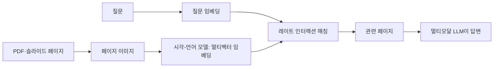
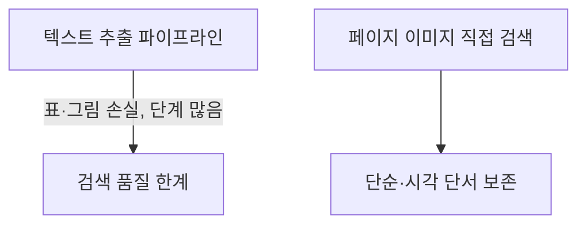

# 멀티모달 RAG

> **멀티모달 RAG**는 텍스트뿐 아니라 이미지·표·도면·슬라이드 같은 **시각 자료까지 검색**해 답변 근거로 쓰는 RAG다. 문서를 글자로 뽑지 않고 **페이지 이미지 자체를 임베딩**하는 방법이 등장했다.

## 쉽게 말하면
계약서 PDF를 글자만 복사해 두면 표의 칸 구조나 도장, 그래프의 의미가 사라진다. 멀티모달 RAG는 페이지를 사진처럼 통째로 보고 "이 질문에는 이 페이지"를 찾는 방식이다.

## 자세히
(ColPali, arXiv 2407.01449 초록 확인)
- **문제**: 텍스트 추출 기반 파이프라인(OCR·레이아웃 분석·청킹)은 길고 깨지기 쉬우며 레이아웃·그림·표 같은 시각 단서를 놓친다.
- **ViDoRe**: 여러 도메인·언어·설정의 **페이지 단위 검색** 벤치마크를 새로 제시.
- **ColPali**: 페이지 이미지에서 **멀티벡터 임베딩**을 만드는 시각-언어 모델 + **레이트 인터랙션** 매칭. 초록은 기존 문서 검색 파이프라인을 "크게 앞서면서" 더 단순·빠르고 종단 간 학습 가능하다고 주장하며 모델·데이터·코드를 오픈 라이선스로 공개했다. 구체 점수는 초록에 없어 확인하지 않았다.
- 구성 방식(일반 지식): ① 이미지를 텍스트로 캡션해 텍스트 RAG에 넣기 ② 이미지·글을 같은 공간에 임베딩해 검색 ③ 페이지 이미지를 멀티모달 LLM에 직접 넘겨 답변. 비용·정확도가 다르다.

## 그림으로 보기

## 예시
- 재무 보고서에서 "3분기 매출 막대그래프 설명"을 질문하면 해당 그래프가 있는 페이지를 찾아 보여 주고 답변.
- 교육 활용: 슬라이드 덱 수백 장을 검색 가능한 지식 기반으로 만들기.

## 헷갈리는 것과 비교
| 개념 | 차이 |
|---|---|
| 텍스트 RAG | 추출된 글자만 검색 |
| 멀티모달 RAG | 이미지·표·도면 포함 |
| ColPali | 페이지 이미지 임베딩 검색 방식의 하나 |
| [문서 추출 AI](#document-extraction-ai) | 문서에서 항목을 뽑는 용도 |

## 더 읽을거리
- [ColPali: Efficient Document Retrieval with Vision Language Models](https://arxiv.org/abs/2407.01449)
