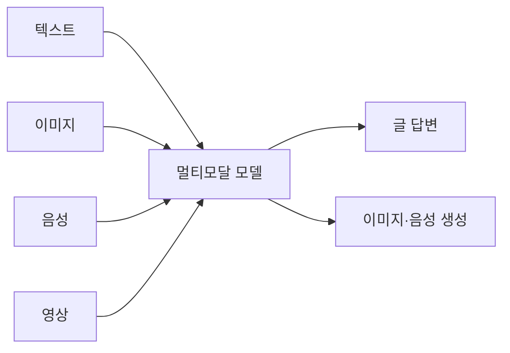
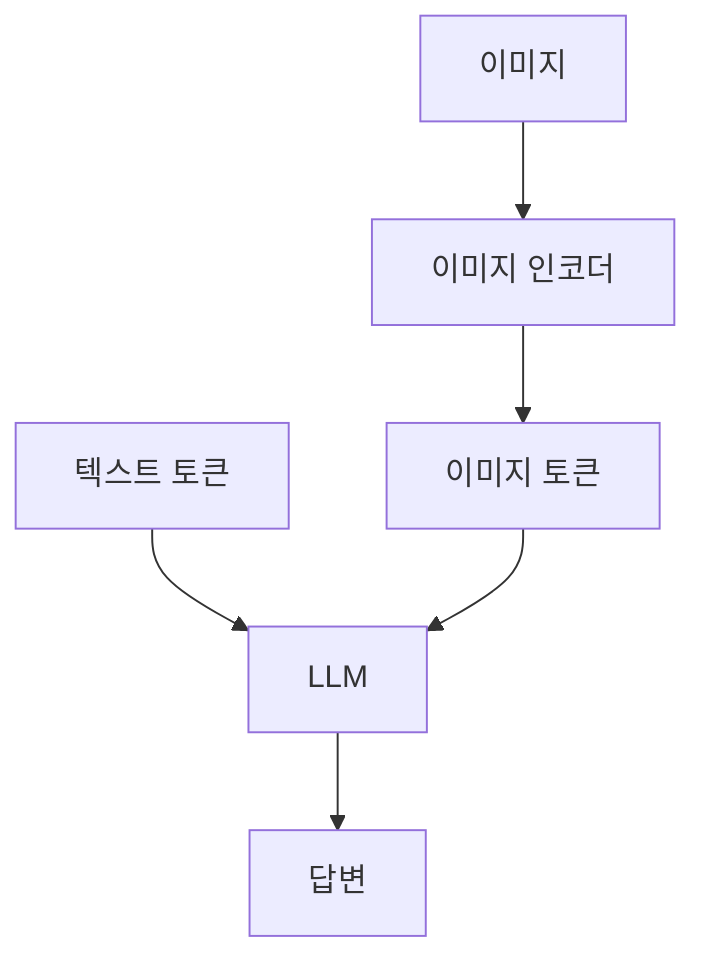

# 멀티모달

> 글뿐 아니라 이미지·음성·영상 같은 여러 종류(모달리티)의 데이터를 함께 이해하고 만들어 내는 AI.

## 쉽게 말하면
사람은 눈으로 보고 귀로 들으며 동시에 이해한다. 글만 읽던 AI에 눈과 귀와 목소리가 생긴 것이 멀티모달이다. 사진을 보여 주고 "이 영수증 합계가 얼마야?"라고 말로 물을 수 있고, 글을 주면 그림이나 음성을 만들어 준다.

## 자세히
- **모달리티**: 텍스트, 이미지, 오디오, 비디오, 그리고 로봇의 신체 감각, 소스코드 구조 등.
- **이해(입력)와 생성(출력)** 은 다른 문제다. 이미지를 보고 설명하는 것(캡셔닝, 시각 질의응답)과 글로 이미지를 만드는 것(DALL-E류)은 서로 다른 모델이 맡거나, 한 모델이 둘 다 한다.
- **결합 방식**(위키백과 정리):
  - *초기 융합*: 이미지 인코더 출력을 "이미지 토큰"으로 바꿔 텍스트 토큰 사이에 끼워 LLM에 넣는다. LLaVA가 대표.
  - *중간 융합*: 각 모달리티를 따로 처리한 뒤 cross-attention으로 합친다. Flamingo.
  - *공동 임베딩*: 이미지와 글을 같은 의미 공간에 놓는다. CLIP.
- 대표 모델: Gemini, GPT-4o(대형 멀티모달), Whisper(음성 인식), PaLM-E(로봇 제어).
- 업무 사례: 화면 캡처로 오류 설명, 회의 녹음 요약, 이미지 속 표를 텍스트로 추출, 영상 요약.
- 한계: 이미지 속 글자·숫자를 틀리게 읽을 수 있으니 중요한 수치는 [검증](#literacy)한다.

## 그림으로 보기

## 예시
- 프롬프트: (표 사진 첨부) "이 표를 마크다운으로 옮기고 합계를 검산해 줘."
- 회의 녹음 → 음성 인식 → 요약 → 할 일 목록.

## 헷갈리는 것과 비교
| 개념 | 차이 |
| --- | --- |
| 멀티모달 | 여러 데이터 종류를 한 모델이 다룸 |
| 생성형 AI | 새 결과물을 만드는 AI 전반(텍스트만이어도 포함) |
| [비전 모델](#vision-models) | 이미지 이해에 특화된 부분 |

## 더 읽을거리
- [Multimodal learning (Wikipedia)](https://en.wikipedia.org/wiki/Multimodal_learning) — 모달리티·융합 방식·모델 목록
