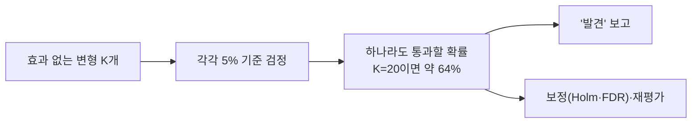

# 머신러닝의 다중 비교

> 아무 효과도 없는 변형을 여러 개 시험하면, 시도 횟수가 늘수록 **"하나쯤은 유의하게 좋아 보이는"** 확률이 급격히 커진다. 5% 유의수준으로 K번 시험하면 우연히 이길 확률은 대략 1−0.95^K다.

## 쉽게 말하면
동전을 한 번 던져 앞면이 나오면 "마법 동전"이라 하면 틀릴 일이 적다. 그런데 동전 50개를 던져 앞면 나온 것만 골라 마법이라 부르면 거의 항상 "발견"이 나온다.

## 자세히
- **직접 실행**(numpy: 실제 효과 0인 K개 변형, 각 변형의 z점수는 표준정규, 기준선을 "단측 5%(z>1.645)"로 이기면 유의, 4,000회 반복):

| 변형 수 K | 하나라도 유의하게 이길 확률(시뮬레이션) | 이론 1−0.95^K |
|---|---|---|
| 1 | 0.050 | 0.050 |
| 5 | 0.218 | 0.226 |
| 10 | 0.397 | 0.401 |
| 20 | 0.643 | 0.642 |
| 50 | 0.918 | 0.923 |

- 프롬프트·하이퍼파라미터·시드·데이터 전처리 조합을 시험하는 일은 모두 "비교"이므로 K에 포함된다. 기록하지 않은 시도가 가장 위험하다.
- **보정 방법**: 본페로니(유의수준을 α/K로), 홀름(Holm) 등 단계적 방법, 거짓발견율(FDR) 제어(Benjamini–Hochberg). 보정할수록 보수적이 된다.
- **실무 대응**: 가설·비교 횟수를 사전에 정하고, 시도 로그를 남기고, 최종 후보는 별도 데이터에서 한 번만 평가한다. 다중 비교와 [승자의 저주](#winners-curse)는 같은 현상의 확률 쪽·크기 쪽 설명이다.
- 한계: 변형끼리 상관이 크면 실제 확률은 위 표보다 낮다(독립 가정 시뮬레이션).

## 그림으로 보기


## 예시
- 프롬프트 20개 중 하나가 기준선보다 "유의하게" 좋아 보였다면 → 20번 시도했음을 밝히고 보정 p값이나 새 평가셋 재현으로 확인.
```python
from statsmodels.stats.multitest import multipletests
rej, p_adj, *_ = multipletests(p_values, alpha=0.05, method="holm")
```

## 헷갈리는 것과 비교
| 개념 | 차이 |
|---|---|
| 다중 비교 | 시도가 많아 우연한 유의 확률이 커짐 |
| [승자의 저주](#winners-curse) | 최고 선택 시 점수 크기가 부풀음 |
| [시드 골라 쓰기](#seed-cherry-picking) | 시드를 다중 비교의 한 형태로 남용 |
| [적응적 과적합](#adaptive-overfitting) | 평가셋 재사용으로 생기는 누적 효과 |

## 더 읽을거리
- [statsmodels multipletests](https://www.statsmodels.org/stable/generated/statsmodels.stats.multitest.multipletests.html) — Bonferroni·Holm·FDR 구현.
- [Benjamini & Hochberg (1995) 요약, Wikipedia: False discovery rate](https://en.wikipedia.org/wiki/False_discovery_rate) — FDR 개념 개요.
