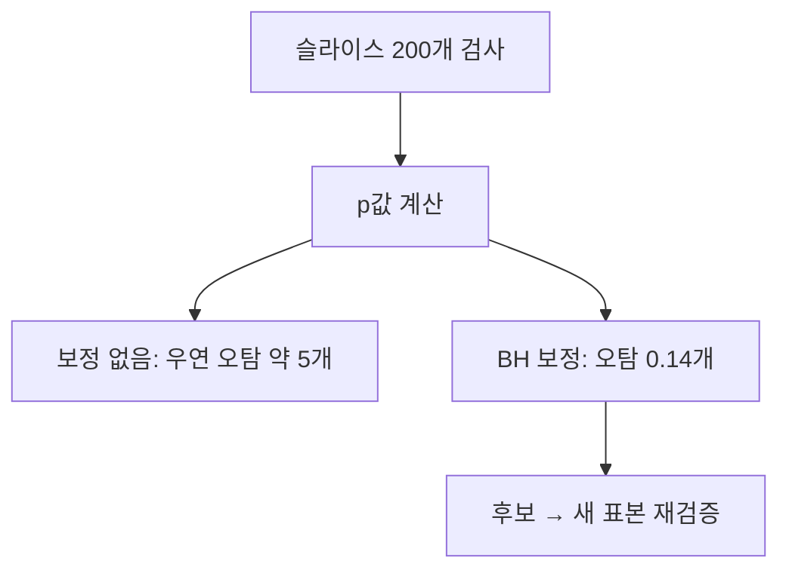
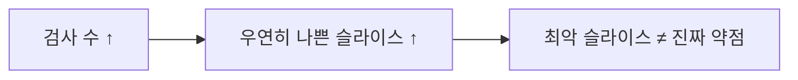

# 슬라이스 다중 비교

> 데이터를 잘게 쪼갠 슬라이스를 **많이 검사할수록**, 진짜 약점이 없어도 **우연히 성능이 낮아 보이는 슬라이스가 반드시 생긴다**. 그래서 "가장 나쁜 슬라이스"를 곧바로 약점으로 단정하지 않고 다중 비교를 보정하거나 새 표본으로 재검증한다.

## 쉽게 말하면
동전을 200번씩 던지는 사람 200명을 모으면, 그중 몇 명은 우연히 앞면만 많이 나온다. 그 사람들을 "앞면이 잘 나오는 사람"이라고 부르는 것은 틀렸다. 슬라이스를 많이 만들수록 우연히 이상해 보이는 슬라이스도 늘어난다.

## 자세히
(Benjamini–Hochberg와 Bonferroni 설명은 위키백과 False discovery rate 문서를 직접 열어 확인했고, 오탐 수는 직접 시뮬레이션했다.)
- **보정 방법(위키백과)**: **Bonferroni**는 가족 단위 오류율(FWER, 적어도 하나의 제1종 오류 확률)을 통제하므로 엄격하다. **Benjamini–Hochberg(BH)**는 p값을 오름차순 정렬해 P(k) ≤ (k/m)·α인 가장 큰 k까지를 기각하며, **거짓 발견 비율(FDR)**, 즉 기각한 것 중 거짓의 기대 비율을 통제한다. FDR 방식은 덜 엄격해 검출력이 크고, 독립 같은 조건에서 FDR을 통제하며 종속이 의심되면 Benjamini–Yekutieli 같은 변형이 있다고 문서가 설명한다.
- **직접 시뮬레이션(슬라이스 200개, 슬라이스당 50건, 비교 기준 정확도 0.9, 한쪽 이항검정 α=0.05, 200회 반복 평균)**
  | 상황 | 보정 없음: 오탐 슬라이스 수 | Bonferroni 오탐 | BH 오탐 |
  |---|---|---|---|
  | **진짜 약점이 전혀 없음** | **4.91개** | 0.02개 | 0.02개 |
  | 진짜 약점 10개(정확도 0.7) 포함 | 4.69개 | 0.01개 | 0.14개 |
  - 진짜 약점이 없어도 보정 없이 검사하면 평균 **약 5개 슬라이스가 "유의하게 낮다"**고 표시된다(이항 분포가 이산적이라 이론값 10개보다 작다).
  - 진짜 약점 10개가 있을 때: 보정 없음은 평균 **9.54개**를 찾지만 거짓 4.7개가 함께 섞이고, BH는 **7.74개**를 찾고 거짓은 0.14개다. 즉 BH는 일부 진짜 약점을 놓치는 대신 목록의 신뢰도를 크게 높였다(Bonferroni의 적중 수는 기록하지 않았다).
- **운영 팁(제안)**
  1. 슬라이스 탐색(자동 발견이든 수작업이든)에서 **검사한 슬라이스 총수를 기록**한다 — 총수가 분모.
  2. 후보는 **BH 같은 FDR 보정**으로 거르고, 중요한 슬라이스는 **새 표본으로 재검증**한다.
  3. 각 슬라이스의 건수와 95% 구간을 함께 보고([작은 집단의 불확실성](#small-subgroup-uncertainty)).
  4. 사전에 정한 소수의 가설(예: 법적으로 중요한 집단)은 보정 대상과 분리해 확인적 분석으로 둔다.
  5. 보정 후에도 탐색적 발견은 "가설"로 적고 데이터 보강 후 확인([슬라이스 기반 데이터 보강](#slice-driven-data-collection)).
- **한계**: BH는 독립성 같은 조건에서 FDR을 통제한다. 슬라이스는 겹치므로 독립이 아니다(상관이 큰 경우 보수적 변형 사용 검토). 시뮬레이션은 이상적인 이항 설정이다.

## 그림으로 보기

## 예시
- 이미지 모델 오류 분석에서 속성 조합 300개를 훑어 상위 5개 약점을 보고하기 전에, 300개를 분모로 BH 보정하고 새로 모은 표본에서 같은 슬라이스 성능을 다시 확인.
- 교육 소재: "분석을 많이 할수록 우연한 발견이 늘어난다" — 동전 던지기 실습(데이터 리터러시).

## 헷갈리는 것과 비교
| 개념 | 차이 |
|---|---|
| 슬라이스 다중 비교 | 많이 쪼갤수록 우연한 나쁜 슬라이스 증가 |
| [슬라이스 표본 크기 주의](#slice-sample-size-caution) | 개별 슬라이스의 표본 부족 |
| [작은 집단의 불확실성](#small-subgroup-uncertainty) | 구간·수축 추정 |
| [평가 오차 막대](#eval-error-bars) | 점수 자체에 오차를 붙임 |

## 더 읽을거리
- [False discovery rate — 위키백과](https://en.wikipedia.org/wiki/False_discovery_rate) — Benjamini–Hochberg 절차와 FWER 비교(직접 확인).
