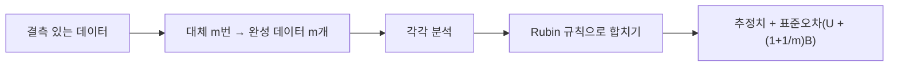
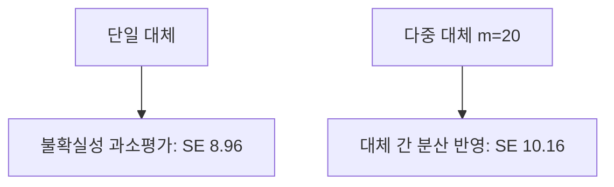

# 다중 대체

> 결측값을 한 가지 값으로 채우지 않고, 그럴듯한 값을 여러 번 뽑아 완성된 데이터셋 여러 개를 만들고, 각각 분석한 뒤 Rubin의 규칙으로 하나로 합치는 방법이다. 결측 때문에 생기는 불확실성이 표준오차에 반영된다.

## 쉽게 말하면
시험에서 지워진 점수를 "평균 점수로 하자"고 한 번 채우면 마치 그 점수를 정확히 아는 것처럼 보인다. 다중 대체는 "아마 70~85점 사이일 것"이라 여러 가능성을 20번 시나리오로 만들어 분석하고, 시나리오 사이의 차이를 불확실성으로 함께 보고한다.

## 자세히
(Stef van Buuren의 『Flexible Imputation of Missing Data』 개요 절을 직접 열어 확인하고, scikit-learn으로 직접 실험.)
- **3단계(책)**: ① **대체(impute)**: 각 결측 항목을 그 항목을 위해 모델링한 분포에서 뽑은 그럴듯한 값으로 채워 완성 데이터셋 여러 개를 만든다. 관측된 값은 같고 대체된 값만 다르다. ② **분석(analyze)**: 각 데이터셋에 평소 분석을 적용. 결과가 다른 이유는 대체값이 다르기 때문. ③ **합치기(pool)**: Rubin의 규칙으로 하나의 점추정치와 표준오차로 합친다.
- **분산 구성**: 합친 분산 = 대체 내 분산(U, 보통의 표본 분산) + (1 + 1/m) × 대체 간 분산(B, 결측으로 인한 추가 불확실성). 적절한 조건에서 합친 추정치는 불편이고 올바른 통계적 성질을 가진다. 책은 설명에서 m=3을 쓰고 "실제로는 더 크게 잡는다"고 하며 airquality 예에서 20을 쓴다.
- **직접 실험(MAR 결측, 소득 평균, n=2,000, 진짜 평균 2190.9)**: 결측 제외 평균 **2125.4**(편향). `IterativeImputer(sample_posterior=True)`로 m=20번 대체 후 합치면 평균 **2192.9**, 대체 내 분산 89.91, 대체 간 분산 12.59, 합친 분산 103.13 → **표준오차 10.16**. 한 번만 회귀 대체해 단순 계산한 표준오차는 **8.96**으로 더 작다 — 단일 대체는 불확실성을 과소평가한다. 이 차이(10.16 vs 8.96)가 다중 대체의 핵심 가치다. 합친 분산 공식은 위에서 직접 계산했으며 scikit-learn은 Rubin 규칙을 자동 제공하지 않는다.
- **전제**: 주로 MAR 가정에서 쓴다([MCAR·MAR·MNAR](#mcar-mar-mnar)). MNAR이면 민감도 분석이 필요.
- **주의(제안)**: 대체 모델에 분석에 쓸 변수(특히 결과 변수)를 포함해야 한다. 머신러닝 예측에서는 학습 데이터로만 대체 모델을 학습하고 시험에는 적용만 하며(전처리 누수 방지 — [전처리 누수와 Pipeline](#preprocessing-leakage-pipeline)), 예측 성능이 목적이면 단일 대체+결측 표시 특징이 더 간단하고 충분할 때가 많다.

## 그림으로 보기



## 예시
```python
import numpy as np
from sklearn.experimental import enable_iterative_imputer
from sklearn.impute import IterativeImputer
means, vars_ = [], []
for i in range(20):
    Xi = IterativeImputer(sample_posterior=True, random_state=i).fit_transform(X)
    means.append(Xi[:, 1].mean()); vars_.append(Xi[:, 1].var(ddof=1) / len(Xi))
Q = np.mean(means); U = np.mean(vars_); B = np.var(means, ddof=1)
se = (U + (1 + 1/20) * B) ** 0.5       # Rubin의 합친 표준오차
```

## 헷갈리는 것과 비교
| 개념 | 차이 |
|---|---|
| 단일 대체 | 한 번 채움 → 불확실성 과소평가 |
| 다중 대체 | 여러 번 채우고 합침 |
| 평균 대체 | 평균값으로 채움(분산 축소, 관계 약화) |
| [결측 표시 특징](#missing-indicator-feature) | 결측 여부를 입력 특징으로 추가 |

## 더 읽을거리
- [Flexible Imputation of Missing Data — 다중 대체 개요](https://stefvanbuuren.name/fimd/sec-nutshell.html) — 세 단계·Rubin 규칙(열어 확인).
