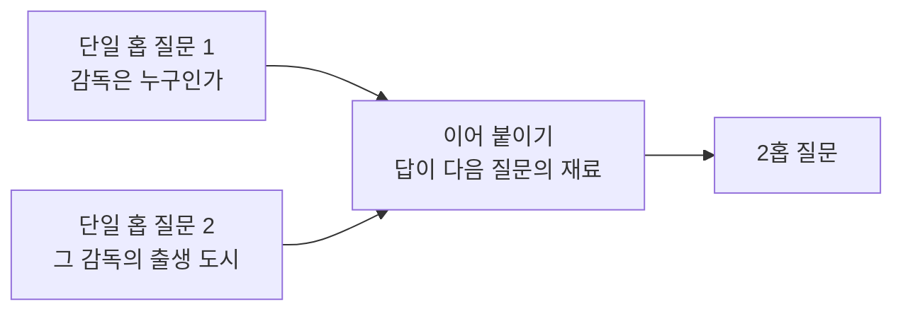
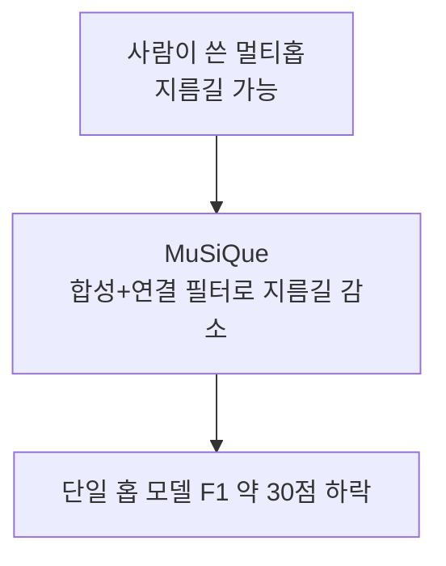

# MuSiQue

> MuSiQue는 단일 홉 질문 여러 개를 이어 붙여 만든 멀티홉 질문 응답 데이터셋이다. 한 문서만 보고 맞히는 지름길을 최대한 막아, 진짜 여러 단계 추론이 필요한 2~4홉 질문 2.5만 개를 담았다.

## 쉽게 말하면
"감독이 태어난 도시는?"처럼 두 번 건너야 하는 질문을 사람이 처음부터 쓰면, 질문 속 단어만 보고도 답을 짐작할 수 있는 허점이 생긴다. MuSiQue는 이미 있는 쉬운 질문 둘을 "앞 질문의 답이 뒤 질문의 재료가 되도록" 레고처럼 이어 붙여, 중간 단계를 건너뛸 수 없게 만들었다.

## 자세히
- **만든 방식(논문 초록, 열람)**: 아래에서 위로 쌓는 방식이다. 한 추론 단계가 다른 단계의 정보에 의존하도록 단일 홉 질문들을 짝지어 합성하고, 연결된 추론을 선호하는 여러 필터를 적용해 많은 질문을 만든다.
- **규모와 변형**: MuSiQue-Ans는 2~4홉 질문 2.5만 개. MuSiQue-Full은 답할 수 없는 대조 질문을 추가한 더 엄격한 변형이다.
- **난이도**: 기존 데이터셋 대비 사람과 모델의 성능 격차가 약 3배 크고, 단일 홉 모델은 이 데이터에서 F1이 약 30점 떨어진다고 보고한다. 단일 홉 지름길이 덜 통한다는 근거다.
- **문제의식(해석)**: 기존 멀티홉 데이터셋([HotpotQA](#hotpotqa) 등)에서 모델은 질문과 한 문서의 단어 겹침 같은 지름길로 맞히는 경우가 있다. MuSiQue는 그 지름길이 통하지 않게 설계한 보강책이다. 이 글에서는 논문 본문의 필터 상세와 수치를 확인하지 못했고 초록 요약에 근거한다.
- **쓰임(해석)**: 멀티홉 검색 증강 시스템이 중간 사실을 실제로 거치는지 평가한다. 홉 수(2·3·4)별로 점수를 나눠 보면 추론 단계가 늘수록 성능이 어떻게 떨어지는지 드러난다.

## 그림으로 보기

## 예시
- 3홉 질문 예: 질문 A의 답이 질문 B의 재료가 되고, B의 답이 C의 재료가 되어 마지막 답을 얻는다.
- 교육 활용: 같은 질문을 홉 수별로 나눠 모델 정확도 변화를 표로 만든다.

## 헷갈리는 것과 비교
| 개념 | 차이 |
| --- | --- |
| [HotpotQA](#hotpotqa) | 사람이 쓴 멀티홉, 근거 문장 주석 |
| MuSiQue | 단일 홉 질문을 합성, 지름길 억제, 2~4홉 |
| [멀티홉 질문 응답](#multi-hop-qa) | 과제 일반 |
| [근거 문장 주석](#supporting-fact-annotation) | 근거를 표시하는 방식 |

## 더 읽을거리
- [MuSiQue 논문 (arXiv 2108.00573)](https://arxiv.org/abs/2108.00573) — 합성 방식과 지름길 억제
