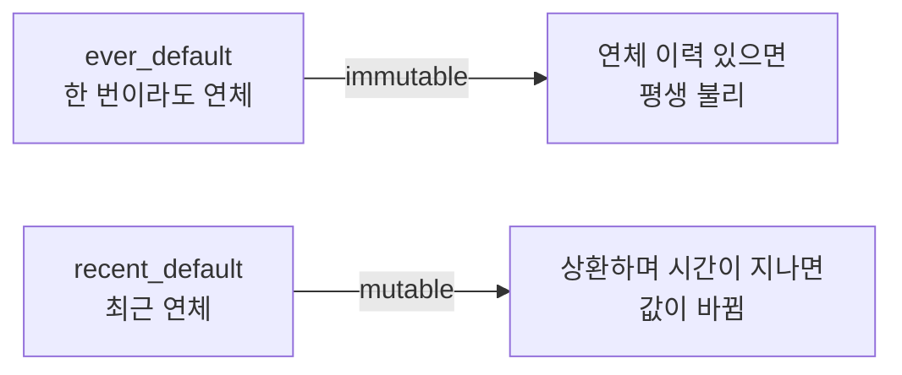
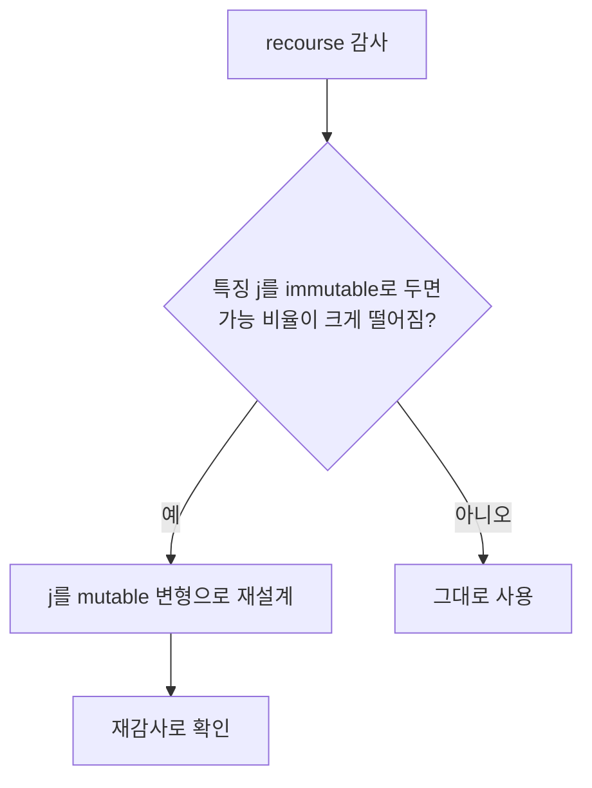

# 가변 변형 특징

> 바꿀 수 없는 특징(예: "과거에 한 번이라도 연체했는가")을 **바꿀 수 있는 형태**(예: "최근 연체했는가")로 다시 설계한 특징이다. 모델이 사람에게 대안(recourse)을 줄 수 있게 하는 특징 설계 방법이다.

## 쉽게 말하면
"학교 다닐 때 한 번이라도 지각한 적 있는가"라는 질문은 평생 바뀌지 않는다. 한 번 지각하면 영원히 "예"다. 그런데 "최근 6개월 지각 횟수"는 앞으로 노력해서 줄일 수 있다. 같은 성실성을 재지만 후자는 사람에게 **다시 기회를 준다**.

## 자세히
(Ustun·Spangher·Liu, 「Actionable Recourse in Linear Classification」(arXiv 1809.06514) 4.1절 PDF를 직접 읽어 확인.)
- **문제 상황**: 모델이 immutable 특징(바꿀 수 없는 특징)을 쓰면, 어떤 사람은 어떤 행동으로도 결정을 못 뒤집는다. 논문 Remark에 따르면 특징이 모두 유계일 때 immutable 특징이 하나라도 있는 선형 분류기는 일부 사람에게 recourse를 주지 못할 수 있다.
- **진단 방법(논문)**: 어떤 특징 j의 영향을 알려면 recourse 감사를 두 번 돌린다. (i) j를 immutable(A_j(x)={0})로 둔 경우, (ii) j를 완전히 actionable(A_j(x)=X_j)로 둔 경우. 두 결과의 차이가 j 때문에 생긴 recourse 손실이다.
- **논문 속 사례**: 신용 데이터에서 recourse 부족의 원인이 **"한 번이라도 대출을 연체했는가"라는 immutable 지표**로 드러났다. 대안으로 **"최근 연체했는가"**라는 **mutable 변형**으로 바꾸면 recourse를 주는 모델을 배포할 수 있다고 제안한다.
- **규제와의 연결**: 논문은 이런 변경이 산업별 규정(과거 기록을 일정 기간 뒤 잊는 "forgetfulness" 정책 등)으로 요구되기도 한다고 언급하고, 그런 규정이 배포 시 recourse에 어떤 영향을 주는지 감사 도구로 볼 수 있다고 말한다.
- **설계 패턴(제안)**: `ever_X`(영구) → `recent_X`(최근 N개월), 누적 건수 → 최근 구간 건수, 상태 플래그 → 현재 상태. 다만 최근성 기준(몇 개월)을 임의로 정하면 새로운 불공정이 생길 수 있어 도메인·법무와 합의해야 한다.
- **한계**: 예측 성능이 달라질 수 있고(정보 손실), 최근 특징도 사람이 실제로 빨리 바꿀 수 있는지(시간)는 별도 확인해야 한다. → [행동 집합 정의](#action-set-definition)

## 그림으로 보기

## 예시
- 대출: `ever_defaulted`(영구) → `defaulted_in_last_24_months`(최근 24개월). 연체 후 2년간 성실히 상환하면 값이 0으로 바뀐다.
- 채용 스크리닝: "이직 횟수 전체" 대신 "최근 3년 이직 횟수".
- 교육 활동: 입력 특징 목록에서 "영구 낙인" 특징을 찾아 변형 버전을 직접 설계해 본다.

## 헷갈리는 것과 비교
| 개념 | 차이 |
|---|---|
| 가변 변형 특징 | immutable 특징을 mutable 형태로 재정의 |
| [행동 가능한 특징](#actionable-features) | 이미 바꿀 수 있는 특징의 분류 |
| [조건부 immutable 특징](#conditionally-immutable-features) | 상태에 따라 한 방향으로만 바뀌는 특징 |
| [recourse와 정규화](#recourse-vs-regularization) | 특징 수를 줄여 recourse가 바뀌는 다른 경로 |

## 더 읽을거리
- [Actionable Recourse in Linear Classification (arXiv 1809.06514)](https://arxiv.org/abs/1809.06514) — 4.1절의 immutable 특징 진단과 mutable 변형 제안(PDF 직접 확인).
