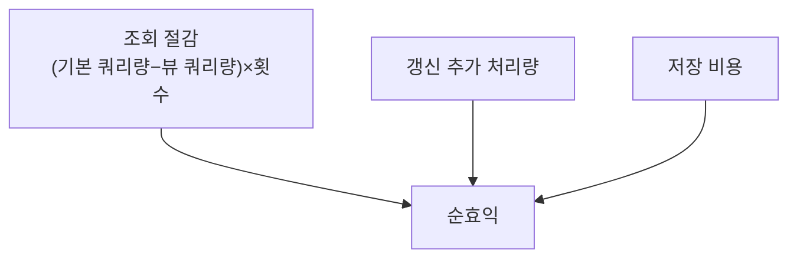

# 구체화 뷰 비용-효익 계산

> 구체화 뷰를 만들지 판단하려면 **조회에서 아끼는 처리량**과 **갱신·저장에 새로 드는 비용**을 비교한다. 같은 쿼리를 자주 돌리고 뷰가 훨씬 작을수록 이득이 크다.

## 쉽게 말하면
요약표를 만들어 두면 매번 두꺼운 장부를 넘기는 수고(조회 비용)는 줄지만, 장부가 바뀔 때마다 요약표를 고치는 수고(갱신 비용)와 요약표를 보관할 서랍(저장 비용)이 생긴다. 하루에 몇 번 찾아보느냐가 손익분기를 가른다.

## 자세히
(BigQuery 문서의 비용 구조를 앞서 직접 읽었다. 아래 계산은 이 지도가 **가상 수치**로 만든 장난감 모델이다. 문서에는 요금 단가가 없었고, 단가는 계산 예시를 위한 가정이다.)
- **비용 항목(BigQuery 문서)**: 온디맨드에서는 **조회**(뷰와 필요한 기본 테이블 부분의 처리 바이트), **갱신**(갱신 중 처리 바이트), **저장**(저장 바이트)에 과금된다. 용량 기반이면 조회·갱신이 슬롯을 쓴다. 자동 갱신 비용은 뷰의 프로젝트에, 수동 갱신은 갱신 작업을 실행한 프로젝트에 청구된다.
- **장난감 모델(가정)**: 기본 테이블 쿼리 1회 처리량 500GB, 같은 질문을 뷰로 하면 5GB, 하루 200번 조회, 증분 갱신 처리량 하루 40GB, 뷰 저장 5GB.
  - **조회 절감**: (500 − 5) × 200 = **99,000GB/일**
  - **갱신 추가**: **40GB/일**
  - **순절감**: 99,000 − 40 = **98,960GB/일**
  - 단가를 예시로 TB당 6.25달러(가정)로 두면 순절감은 약 **하루 604달러**, 저장은 5GB × 월 0.02달러(가정) ≈ **월 0.10달러**.
- **손익분기(같은 모델)**: 하루 조회 횟수 ≥ 갱신량 ÷ (기본 쿼리량 − 뷰 쿼리량) = 40 ÷ 495 ≈ **0.08회/일**. 이 가정에서는 하루 한 번만 조회해도 이득이다. 현실에서는 뷰가 모든 질의에 쓰이지 않고(재작성 조건 불충족), 갱신량이 더 클 수 있다.
- **모델이 단순화한 것(해석)**: ① 기본 테이블 변경이 많아 갱신 처리량이 커지거나 증분이 불가능해 전체 재계산이 일어나는 경우(비증분 뷰는 갱신마다 전체 쿼리 — 문서) ② 슬롯 기반 과금 ③ 최신성 요구(`max_staleness`)에 따라 조회 때 기본 테이블 변경분을 합치는 추가 처리 ④ 지원되지 않는 SQL 제약. 이런 요소는 계산에 넣지 않았다.
- **측정 방법(제안)**: 실제 쿼리의 처리 바이트(쿼리 통계), 뷰 갱신 작업의 처리 바이트, 저장 크기를 한 달 모아 위 식에 넣는다. 가정이 아닌 측정값으로 계산하는 것이 핵심이다.

## 그림으로 보기



## 예시
```python
base_gb, mv_gb, per_day, refresh_gb = 500, 5, 200, 40
net_gb = (base_gb - mv_gb) * per_day - refresh_gb     # 98,960
break_even = refresh_gb / (base_gb - mv_gb)            # 약 0.081 회/일
```
- 교육 소재: 자기 대시보드의 쿼리 처리량으로 손익분기를 계산해 보기.

## 헷갈리는 것과 비교
| 개념 | 차이 |
|---|---|
| 비용-효익 계산 | 절감분과 추가 비용을 비교해 도입 판단 |
| [일반 뷰 vs 구체화 뷰](#view-vs-materialized-view) | 두 방식의 구조·제약 비교 |
| [증분 갱신](#incremental-refresh) | 갱신 비용을 줄이는 방식 |
| [허용 최신성 지연](#max-staleness) | 최신성과 비용의 절충 |

## 더 읽을거리
- [Introduction to materialized views (BigQuery)](https://docs.cloud.google.com/bigquery/docs/materialized-views-intro) — 비용 구조(직접 읽음).
