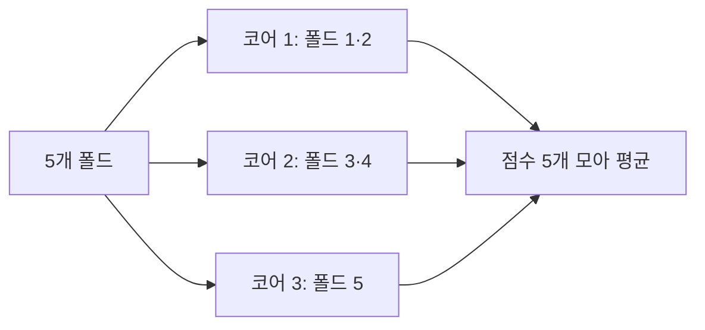
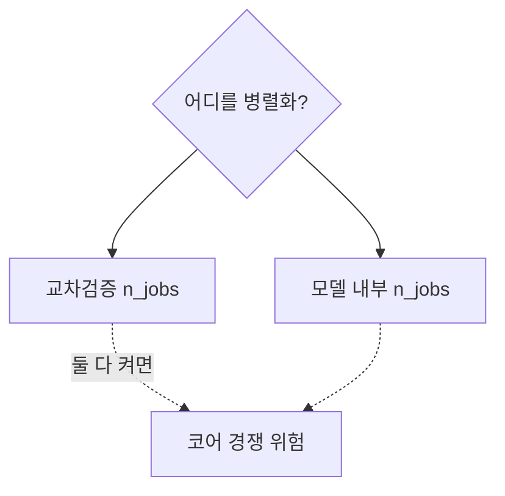

# n_jobs 병렬 교차검증

> `n_jobs`는 교차검증의 폴드를 여러 CPU 코어에 나눠 동시에 실행하게 하는 인자다. `-1`이면 모든 코어를 쓴다. 점수는 그대로고 시간만 줄어든다.

## 쉽게 말하면
시험지 5장을 채점할 때 채점자 한 명이 차례로 보면 5장 분량의 시간이 걸린다. 채점자 네 명이 나눠 보면 한두 장 분량이면 끝난다. 채점 결과는 같고, 채점자 수가 장수보다 많거나 장당 채점이 아주 짧으면 사람 부르는 수고가 더 든다.

## 자세히
- **정의(scikit-learn `cross_val_score` 문서, 열람)**: 모델 학습과 점수 계산이 교차검증 분할 단위로 병렬화된다. `n_jobs=None`은 `joblib.parallel_backend` 문맥이 아니면 1, `-1`은 모든 프로세서. `pre_dispatch`(기본 `'2*n_jobs'`)는 한 번에 미리 보낼 작업 수를 제한해 메모리를 아낀다.
- **직접 해 본 실험(4코어, 숫자 손글씨 1,797개, 랜덤 포레스트 200그루, 5겹, 1회 측정)**: n_jobs=1은 2.1초, 2는 2.1초, 5는 1.9초, -1(4코어 전부)은 0.9초였다. 평균 정확도는 모두 0.9366으로 같았다. 폴드가 5개라 코어 2개면 3번에 나눠 돌고, 코어 4개면 2번에 끝난다는 구조가 시간으로 보인다고 해석한다. 1회 측정이라 오차가 있으며, 5가 -1보다 느린 것은 코어보다 많은 작업자가 겹친 영향일 수 있다(확인하지 못함).
- **병렬의 상한**: 병렬로 줄일 수 있는 것은 폴드 수(K)까지다. K=5면 코어를 5개 넘게 줘도 더 빨라지지 않는다. 반복 교차검증이나 격자 탐색이면 작업 수가 H×K×R이라 코어를 더 잘 쓴다([교차검증 예산 계획](#cv-budget-planning)).
- **함정(해석)**: 모델 자체가 이미 멀티코어(랜덤 포레스트의 `n_jobs`)면 두 겹으로 병렬화해 코어를 서로 빼앗을 수 있다. 한쪽만 병렬화한다. 메모리는 작업자 수만큼 데이터가 복사돼 늘 수 있다.
- **재현성**: 병렬이어도 `random_state`를 고정하면 점수는 같다(위 실험에서 같은 평균).

## 그림으로 보기

## 예시
- `cross_val_score(model, X, y, cv=5, n_jobs=-1)`로 시간을 재고, 모델이 이미 병렬이면 `n_jobs=1`과 비교한다.
- 교육 활용: 코어 수를 1·2·전부로 바꿔 시간표를 만들고 "왜 코어가 2배면 시간이 반이 아닌가"를 토론한다.

## 헷갈리는 것과 비교
| 개념 | 차이 |
| --- | --- |
| n_jobs | 병렬 작업자 수 |
| `pre_dispatch` | 미리 보낼 작업 수(메모리 조절) |
| [교차검증 예산 계획](#cv-budget-planning) | 총 학습 횟수 계산 |
| [RepeatedKFold](#repeated-kfold) | 작업 수를 늘리는 반복 |

## 더 읽을거리
- [scikit-learn: cross_val_score](https://scikit-learn.org/stable/modules/generated/sklearn.model_selection.cross_val_score.html) — n_jobs, pre_dispatch 설명
