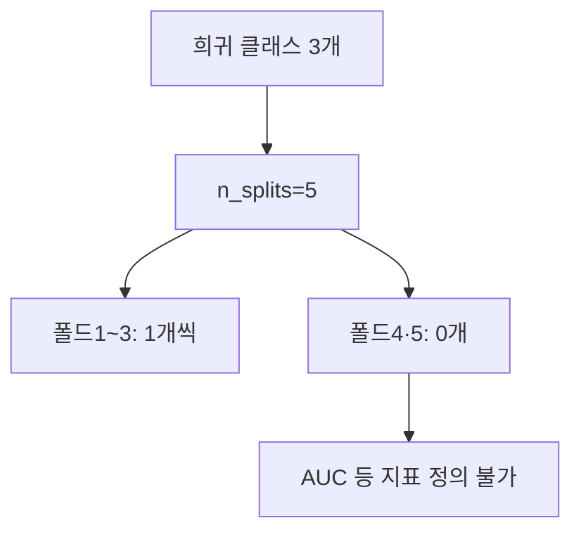
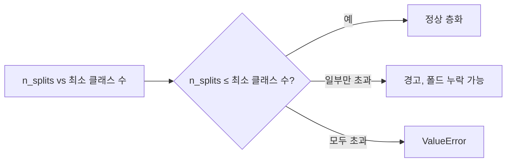

# 조각 수와 희귀 클래스 수

> StratifiedKFold에서 **폴드 수(`n_splits`)가 가장 적은 클래스의 샘플 수보다 크면** 일부 폴드의 테스트 세트에 그 클래스가 아예 없어서 층화가 깨진다.

## 쉽게 말하면
사탕 3개를 5명에게 똑같이 나눠 줄 수 없는 것과 같다. 희귀 클래스가 3개뿐인데 5조각으로 나누면 두 조각은 그 클래스를 하나도 못 받는다.

## 자세히
(scikit-learn 1.9.1에서 직접 실행해 확인.)
- 클래스 0이 20개, 클래스 1이 3개일 때 `StratifiedKFold(5)`: 테스트 세트의 클래스별 개수가 `[4 1] [4 1] [4 1] [4 0] [4 0]`. 마지막 두 폴드엔 클래스 1이 없다. 경고: `The least populated class in y has only 3 members, which is less than n_splits=5.`
- **모든 클래스**가 `n_splits`보다 적으면(예: 클래스가 `[3,1,1,1]`개) `ValueError: n_splits=5 cannot be greater than the number of members in each class.`
- 일부 클래스만 적으면 에러 없이 **경고만** 나온다. 그래서 조용히 지나치기 쉽다.
- 공식 문서가 밝히는 층화의 존재 이유: 폴드에 특정 클래스가 없으면 ROC AUC 같은 분류 지표가 **정의되지 않는다**.
- **대응**: ① `n_splits`를 희귀 클래스 수 이하로 낮춘다. ② 희귀 클래스를 더 수집하거나 합친다. ③ `RepeatedStratifiedKFold`로 반복해 변동을 평균한다. ④ 층화 자체가 불가능한 극소수 클래스는 별도 평가(예: 레이블당 재현율)로 본다.
- 주의: 폴드 안에 클래스가 1~2개뿐이면 지표 변동이 매우 크다. 숫자 하나로 모델을 비교하지 않는다.

## 그림으로 보기

## 예시
- 사기 거래 3건뿐인 데이터에 5-폴드 → 폴드 2개에 사기가 없어 재현율 계산 불가. `n_splits=3`으로 낮추거나 데이터를 더 모은다.
- 교육: "경고를 읽는 습관" 사례.

## 헷갈리는 것과 비교
| 개념 | 차이 |
|---|---|
| 조각 수 vs 희귀 클래스 | 폴드 수 설정 문제 |
| [StratifiedGroupKFold](#stratified-group-kfold) | 그룹 제약 때문에 추가로 층화가 깨질 수 있음 |
| [회귀 층화](#stratify-regression-binning) | 연속값을 구간화해 클래스처럼 취급 |

## 더 읽을거리
- [scikit-learn: StratifiedKFold](https://scikit-learn.org/stable/modules/generated/sklearn.model_selection.StratifiedKFold.html) — 파라미터·층화 설명.
- [scikit-learn 사용자 가이드: 교차검증](https://scikit-learn.org/stable/modules/cross_validation.html) — 층화가 필요한 이유(지표 정의 문제).
