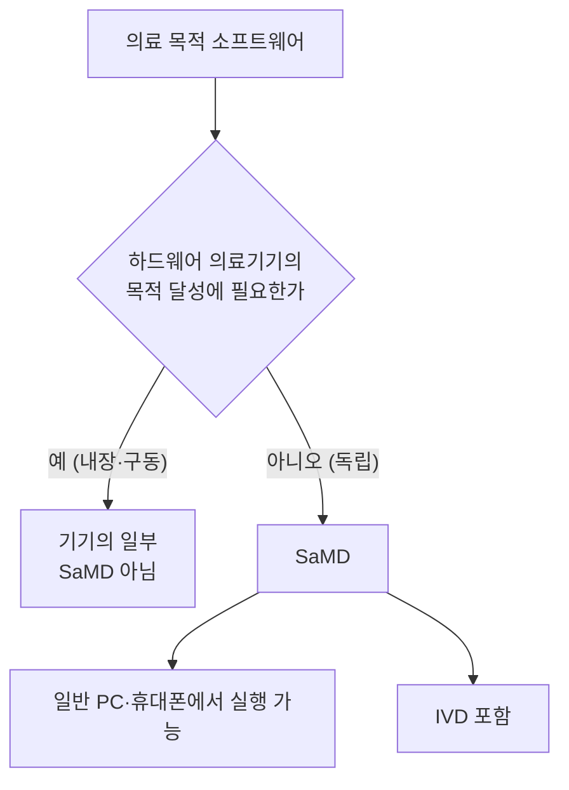
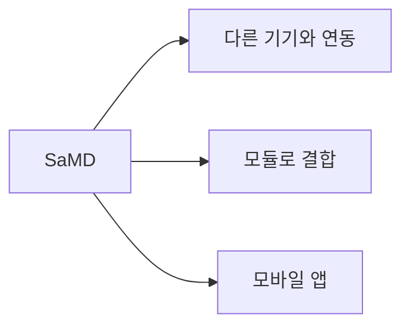

# N10 SaMD 정의

> IMDRF가 2013년 12월 9일 낸 문서(IMDRF/SaMD WG/N10FINAL:2013, "Software as a Medical Device: Key Definitions"). "의료 목적을 가진 소프트웨어 중 하드웨어 의료기기의 일부가 아닌 것"을 SaMD라고 부르기로 정한 국제 공통 정의다.

## 쉽게 말하면
병원에는 두 종류의 소프트웨어가 있다. 초음파 기계 안에 들어 있어 기계를 움직이는 소프트웨어(부품), 그리고 일반 노트북·스마트폰에서 돌며 혼자 진단·판독을 하는 소프트웨어(독립 제품). N10은 후자만 SaMD라고 부르자는 약속이다. "기계를 돌리는 소프트웨어"인지 "혼자 의료 목적을 이루는 소프트웨어"인지가 갈림길이다.

## 자세히
출처: N10 본문(사우디 SFDA 지침 MDS-G23이 그대로 수록한 판본을 직접 읽음).
- **정의(5.1)**: "software intended to be used for one or more medical purposes that perform these purposes without being part of a hardware medical device."
- **주석 7가지**
  - SaMD는 의료기기이며 체외진단(IVD) 의료기기를 포함한다.
  - 일반 목적(비의료용) 컴퓨팅 플랫폼에서 돌 수 있다.
  - "일부가 아니다"란, 하드웨어 의료기기가 의도된 의료 목적을 이루는 데 **필요하지 않은** 소프트웨어라는 뜻이다.
  - 하드웨어 의료기기를 **구동**하는 것이 목적이면 SaMD가 아니다.
  - 다른 제품(의료기기 포함)과 조합·모듈로 쓰이거나 연결될 수 있다.
  - 정의에 맞는 모바일 앱은 SaMD다.
- **의료 목적(5.2)**: 2012년 GHTF 정의를 가져왔다. 질병의 진단·예방·모니터링·치료·완화, 부상 관련, 해부·생리 과정의 조사·대체·변경·지원, 생명 유지, 피임, 의료기기 소독, 검체의 체외 검사 정보 제공. 약리·면역·대사 수단이 주된 작용이면 의료기기가 아니다.
- **추가 고려(5.2.3)**: SaMD는 질병 완화 수단·제안 제공, 진단 보조, 선별, 소인 판단, 예후·예측 등도 할 수 있다.
- **SaMD 변경(5.3)**: 수명주기 전 과정, 유지보수 단계까지 포함. 적응형·완전형·교정형·예방형 유지보수가 있다(ISO/IEC 14764:2006). 결함 수정, 보안 패치도 변경의 예다.
- **제조사(5.4)**: GHTF/SG1/N55:2009. 설계·제조에 책임을 지고 자기 이름으로 시장에 내놓는 개인·법인이 규제 준수의 최종 책임자.
- 이 문서는 이후 N12(위험 분류)·N23(품질) 등 다른 SaMD 문서의 공통 어휘다. IMDRF 문서는 법이 아니라 권고다.

## 그림으로 보기

## 예시
- SaMD: 일반 태블릿에서 흉부 X-ray를 판독해 폐결절 후보를 표시하는 AI, 의료진용 심전도 부정맥 판독 앱.
- SaMD 아님: CT 장비를 구동·제어하는 내장 소프트웨어, 심박동기 펌웨어(하드웨어를 움직이는 것이 목적).
- 경계 사례: 병원 전자의무기록에서 의학 정보를 그냥 보여 주기만 하는 프로그램은 N10 이전에 "의료 목적"이 있는지부터 따진다(나라별 판단이 다름).

## 헷갈리는 것과 비교
| 개념 | 차이 |
|---|---|
| [SaMD](#samd) | 이 정의가 가리키는 대상 |
| SiMD(기기 내장 SW) | 하드웨어 기기의 일부. N10의 SaMD가 아님 |
| [IMDRF](#imdrf) | 정의를 만든 포럼 |
| [SaMD 위험 분류](#samd-risk-categorization) | N10 정의 위에 얹은 N12 틀 |

## 더 읽을거리
- [IMDRF N10 원문 PDF](https://www.imdrf.org/sites/default/files/docs/imdrf/final/technical/imdrf-tech-131209-samd-key-definitions-140901.pdf) — 원 문서(서버 503으로 직접 열지 못함)
- [SFDA MDS-G23: Guidance on Software as a Medical Device (PDF)](https://www.sfda.gov.sa/sites/default/files/2020-03/MDS_G23.pdf) — N10 본문을 수록. 이 글의 정의·주석 출처
