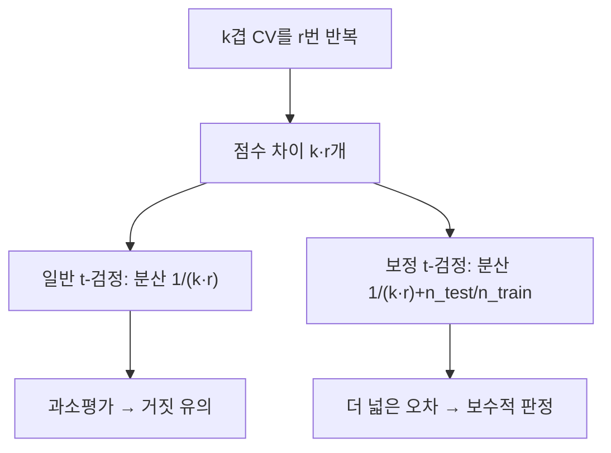
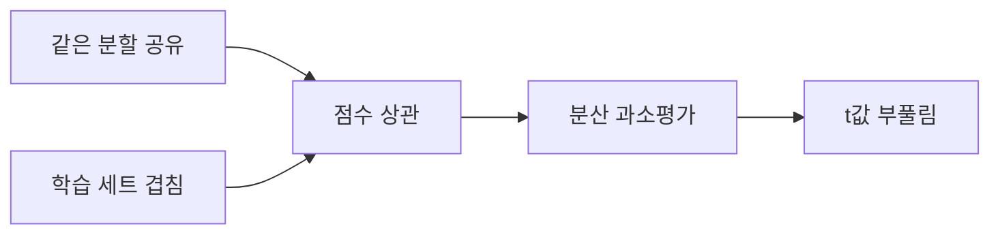

# 보정 재표집 t-검정

> 교차 검증의 폴드 점수 차이에 일반 쌍체 t-검정을 쓰면 폴드끼리 독립이 아니라 분산을 과소평가해 거짓 "유의"가 나온다. **Nadeau & Bengio 보정 t-검정**은 분산에 `n_test/n_train` 항을 더해 이를 바로잡는다.

## 쉽게 말하면
같은 문제집(분할)으로 두 학생(모델)을 100번 채점했다고 해서 100명의 독립 표본이 생긴 것은 아니다. 문제집 난이도와 공부 자료가 겹치기 때문이다. 표본 수를 부풀려 믿지 않도록 오차 막대를 일부러 넓혀 주는 것이 이 보정이다.

## 자세히
- **문제**: k겹 CV를 r번 반복하면 k·r개 점수 차이 x_ij가 나오지만, 모든 모델이 같은 분할을 쓰고 학습 세트가 크게 겹쳐 서로 독립이 아니다([폴드 간 상관](#fold-correlation)).
- **공식(scikit-learn 문서 소개)**: t = mean(x) / sqrt( (1/(k·r) + n_test/n_train) · σ̂² ). 일반 검정은 1/(k·r)만 쓰고, 보정은 `n_test/n_train` 항을 더한다. 자유도는 k·r − 1.
- **scikit-learn 문서 예시**(10겹×10회, 학습 90·시험 10): 분산 계수가 1/100=0.01 → 0.121로 약 12배(표준편차 약 3.5배). rbf vs linear 비교에서 **일반 검정 t=2.611, p=0.005(유의)** 가 **보정 t=0.750, p=0.227(유의하지 않음)** 으로 바뀐다.
- **해석 요령**: 보정 항은 학습·시험 크기 비율에만 의존하므로 시험 비율이 클수록 더 보수적이다. 결과는 "유의하지 않다 = 같다"가 아니라 "구별할 증거 부족"이다.
- **베이즈 변형**: 같은 보정 분산으로 차이의 사후분포를 Student t로 두고 "A가 낫다 / B가 낫다 / 실질적으로 같다(ROPE)" 확률을 낸다.
- **한계**: 근사 보정이며 불편(unbiased) 분산 추정량은 없다. 데이터가 아주 작거나 분할 수가 적으면 여전히 불안정.

## 그림으로 보기



## 예시
```python
import numpy as np
from scipy.stats import t
def corrected_ttest(diff, n_train, n_test):
    kr = len(diff)
    std = np.sqrt(np.var(diff, ddof=1) * (1/kr + n_test/n_train))
    tstat = np.mean(diff) / std
    return tstat, t.sf(abs(tstat), kr-1)
```
- 두 모델의 `cross_val_score` 결과(RepeatedKFold) 차이를 넣어 비교. "A가 0.5%p 높다"를 보고하기 전에 이 검정으로 확인한다.

## 헷갈리는 것과 비교
| 방법 | 분산 | 위험 |
|---|---|---|
| 일반 쌍체 t-검정 | σ²/(k·r) | 거짓 유의 |
| Nadeau-Bengio 보정 | σ²(1/(k·r)+n_test/n_train) | 보수적 |
| 순수 폴드 sd/√K | 독립 가정 | [오차 막대 과소평가](#cv-error-bar-underestimation) |

## 더 읽을거리
- [scikit-learn: Statistical comparison of models using grid search](https://scikit-learn.org/stable/auto_examples/model_selection/plot_grid_search_stats.html) — 공식·수치·코드(열어 확인).
- Nadeau & Bengio, "Inference for the Generalization Error", Machine Learning 2003 — 원 논문(미열람).
