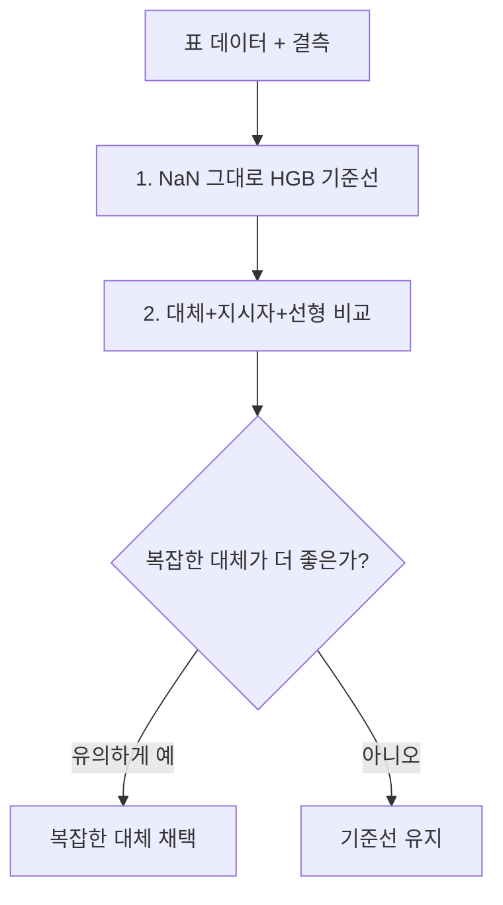
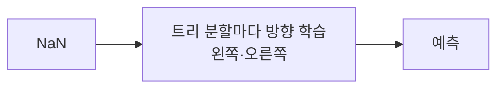

# NaN 직접 처리로 기준선 만들기

> 결측값이 많은 표 데이터에서 **대체(imputation) 설계를 고민하기 전에**, NaN을 그대로 받는 모델(히스토그램 그래디언트 부스팅 등)로 먼저 기준선 성능을 재는 작업 순서다. 이후 복잡한 대체 방식이 정말 이득인지 비교할 기준이 생긴다.

## 쉽게 말하면
새 식당 메뉴를 개발할 때 먼저 재료를 있는 그대로 쓴 기본 요리를 만들어 보고, 그 기본 맛과 비교해 가며 양념(복잡한 전처리)을 더하는 것과 같다. 기본 요리가 이미 충분하면 양념은 필요 없다.

## 자세히
(scikit-learn 앙상블 문서의 결측값 지원 절을 직접 열어 확인하고, scikit-learn 1.9.1로 직접 실험.)
- **문서의 동작**: `HistGradientBoostingClassifier`·`Regressor`는 결측값을 내장 지원해 **대체기가 필요 없다**. 분할마다 결측 샘플을 왼쪽·오른쪽 중 어느 자식으로 보낼지 이득을 보고 배우며, 학습 때 결측이 없던 특징은 예측 때 결측을 샘플이 가장 많은 자식으로 보낸다. 범주형 특징에서는 결측을 하나의 범주로 다루고, 학습에 없던 범주는 예측 때 결측으로 취급한다. 문서는 이 두 추정기만 NaN 내장 지원으로 소개한다(다른 트리 모델 지원 여부는 이 문서에서 확인하지 못했다).
- **직접 실험(합성 데이터 20,000행·특징 20개, 7:3 분할, AUC, 학습 시간)**
  | 결측 설정 | HGB(NaN 그대로) | 평균 대체 + 로지스틱 | 평균 대체 + 지시자 + 로지스틱 |
  |---|---|---|---|
  | 0% | 0.886 (0.4초) | 0.883 | 0.883 |
  | 20% 무작위 | 0.832 (0.5초) | 0.840 | 0.840 |
  | 40% 무작위 | 0.784 (0.4초) | 0.791 | 0.791 |
  | 20% + 정보성 결측(양성일 때 한 열이 더 빔) | 0.849 (0.4초) | 0.838 | 0.853 |
  이 합성 데이터는 거의 선형이라 단순한 로지스틱 기준선도 강했다. **NaN 직접 처리가 항상 더 낫지는 않았다**(무작위 결측에서는 대체+로지스틱이 근소 우위). 그러나 코드 한 줄로 전처리 없이 비슷한 성능이 나왔고, 정보성 결측에서는 대체만 한 로지스틱(0.838)보다 높았다(0.849, 지시자를 더한 로지스틱 0.853과는 비슷). 한 번의 시드·한 가지 데이터 구조이므로 일반화 금지.
- **절차(제안)**: ① NaN을 그대로 두고 HGB로 학습해 기준선 AUC·정확도 기록 ② 평균/중앙값 대체 + 지시자 + 선형 모델 ③ 더 복잡한 대체(반복 대체 등)는 앞 둘보다 유의하게 좋아질 때만 채택 ④ 결측률 구간별·집단별 성능([결측률의 공정성 점검](#missingness-fairness-check)) ⑤ 서빙에서 결측률이 변해도 성능이 유지되는지 확인([결측 패턴 드리프트](#missing-pattern-drift)).
- **한계**: 해석이 어려워질 수 있다([결측 분기의 해석](#nan-interpretability)). 결측 방향 규칙은 학습 데이터의 결측 패턴에 의존하므로 서빙에서 패턴이 바뀌면 흔들릴 수 있다.

## 그림으로 보기

## 예시
- 고객 이탈 예측 표(결측 20~40%)에서 `HistGradientBoostingClassifier().fit(X_with_nan, y)`로 하루 만에 기준선을 잡고, 이후 대체 방식 실험은 이 값과 비교.
- 교육 소재: "복잡한 전처리 전에 기준선부터"를 위 표로 실습(데이터 분석 입문).

## 헷갈리는 것과 비교
| 개념 | 차이 |
|---|---|
| NaN 직접 처리 기준선 | 대체 없이 모델이 결측을 처리 |
| [NaN 직접 처리 모델](#native-nan-models) | 그런 모델의 원리 |
| [결측 표시 특징](#missing-indicator-feature) | 대체 후 결측 여부 열을 추가 |
| [결측 분기의 해석](#nan-interpretability) | NaN 직접 처리의 해석 난점 |

## 더 읽을거리
- [scikit-learn 앙상블 문서: Missing values support](https://scikit-learn.org/stable/modules/ensemble.html) — HGB의 NaN 처리 방식(직접 확인).
