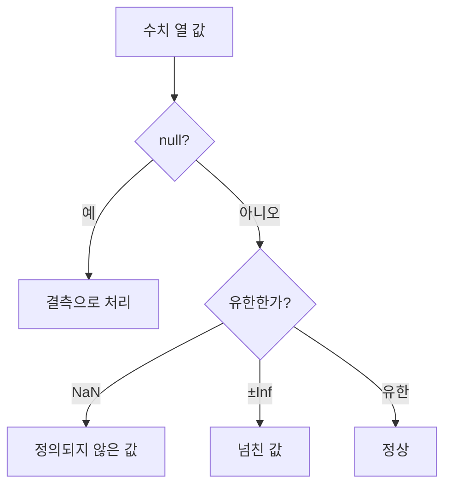
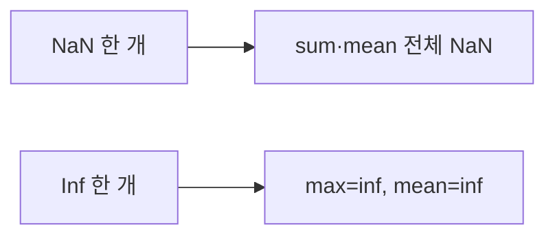

# NaN·Inf 검사

> 숫자 열에 **NaN(숫자가 아님)** 과 **±Inf(무한대)** 가 섞여 있는지 찾아 처리하는 검사다. 이 값들은 결측(null)과 다르고, 한 개만 섞여도 합계·평균 같은 집계 결과 전체를 오염시킨다.

## 쉽게 말하면
계산기에 "0÷0" 같은 불가능한 연산을 넣으면 "오류" 표시가 나오고, 그 표시를 이용해 더하면 합계 전체가 "오류"가 된다. NaN은 그 "오류" 표시와 같아서 한 칸에만 있어도 평균이 통째로 무너진다. 그래서 집계 전에 먼저 찾아내야 한다.

## 자세히
(아래 수치와 동작은 이 세션에서 **Python 3.13과 pyarrow 26.0.1**로 직접 실행해 확인했다. 외부 문서를 근거로 한 서술이 아니라 직접 실험한 결과이며, 다른 라이브러리는 동작이 다를 수 있다. scikit-learn 같은 모델 라이브러리의 처리는 이 환경에 설치돼 있지 않아 확인하지 못했다.)
- **세 가지는 서로 다른 값**: 데이터 `[1.0, NaN, +Inf, -Inf, null, 2.5]`에서 pyarrow의 `is_nan`은 `[F, T, F, F, null, F]`, `is_inf`는 `[F, F, T, T, null, F]`, `is_null`은 `[F, F, F, F, T, F]`, `is_finite`는 `[T, F, F, F, null, T]`. null은 "값 없음", NaN은 "정의되지 않은 수", Inf는 "범위를 넘은 수"다. null에 대한 `is_nan`·`is_inf` 결과는 null이다.
- **집계가 오염된다(직접 실행)**: 같은 열에서 `sum`은 **NaN**, `mean`도 **NaN**, `min`은 **-inf**, `max`는 **inf**였다. 한두 값 때문에 열의 요약 통계 전체가 쓸모없어진다.
- **정리하고 나면 정상(직접 실행)**: null·NaN·Inf를 걸러내 `[1.0, 2.5]`만 남기면 `mean`이 **1.75**로 정상이다. 즉 걸러내는 조건은 "null이 아니고 유한한 값"(`is_valid` 그리고 `is_finite`)이다.
- **NaN의 기묘한 성질(직접 실행)**: `NaN == NaN`은 **False**, `NaN != NaN`은 **True**다. 그래서 `x == NaN`으로는 NaN을 찾을 수 없고 `isnan` 계열 함수를 써야 한다. 또 `inf - inf`는 NaN이 되고, `1e308 * 10`은 inf로 넘친다.
- **언어마다 다르다(직접 실행)**: 순수 Python에서 `0.0 / 0.0`은 `ZeroDivisionError`를 내지만 `float('nan')`을 직접 만들거나 `inf - inf`를 계산하면 NaN이 생긴다. 다른 언어·SQL 엔진은 `0/0`을 NaN 또는 null 또는 오류로 처리할 수 있다.
- **검사 설계(일반 원칙, 제안)**: ① 수치 열마다 NaN 개수·Inf 개수·null 개수를 따로 센다 ② 허용치를 정한다(대개 0) ③ 발견 시 원인(0 나눗셈, 로그 0, 오버플로, 센서 오류)을 찾아 업스트림에서 고친다 ④ 정리 방식(제거·대체·표시 열 추가)을 문서화하고 학습·서빙에서 똑같이 적용한다. 결측 처리의 불일치는 [학습-서빙 일관성](#feature-consistency-check) 문제가 된다.
- **TFDV의 이상 유형(anomalies.proto, 직접 읽음)**: TFDV의 `AnomalyInfo.Type` 열거형에 **`FLOAT_TYPE_HAS_NAN`(53, "Contains NaN values")** 과 **`FLOAT_TYPE_HAS_INF`(62, "Contains Inf or -Inf values")** 가 있다. 즉 TFDV는 NaN·Inf를 별도 이상 유형으로 보고한다. (시작 가이드 페이지에는 이 검사 설정 방법이 없어 설정 방식은 확인하지 못했다.)

## 그림으로 보기



## 예시
```python
import pyarrow as pa, pyarrow.compute as pc
x = pa.array([1.0, float("nan"), float("inf"), None, 2.5])
bad = pc.or_(pc.is_nan(x), pc.is_inf(x))
n_nan = pc.sum(pc.cast(pc.is_nan(x), pa.int64())).as_py()
clean = pc.filter(x, pc.and_(pc.is_valid(x), pc.is_finite(x)))
```
- 교육 소재: 엑셀에서 `#DIV/0!` 한 칸이 합계 전체를 오류로 만드는 것을 보여 주기.

## 헷갈리는 것과 비교
| 값 | 의미 | 검사 함수(pyarrow) |
|---|---|---|
| null | 값 없음 | `is_null` |
| NaN | 정의되지 않은 수 | `is_nan` |
| ±Inf | 범위를 넘은 수 | `is_inf` |
| 유한한 값 | 정상 수 | `is_finite` |

## 더 읽을거리
- [anomalies.proto (TensorFlow Metadata)](https://raw.githubusercontent.com/tensorflow/metadata/master/tensorflow_metadata/proto/v0/anomalies.proto) — FLOAT_TYPE_HAS_NAN·HAS_INF 이상 유형(직접 읽음).
- [Get started with TensorFlow Data Validation](https://www.tensorflow.org/tfx/data_validation/get_started) — 스키마 기반 이상 탐지의 틀.
