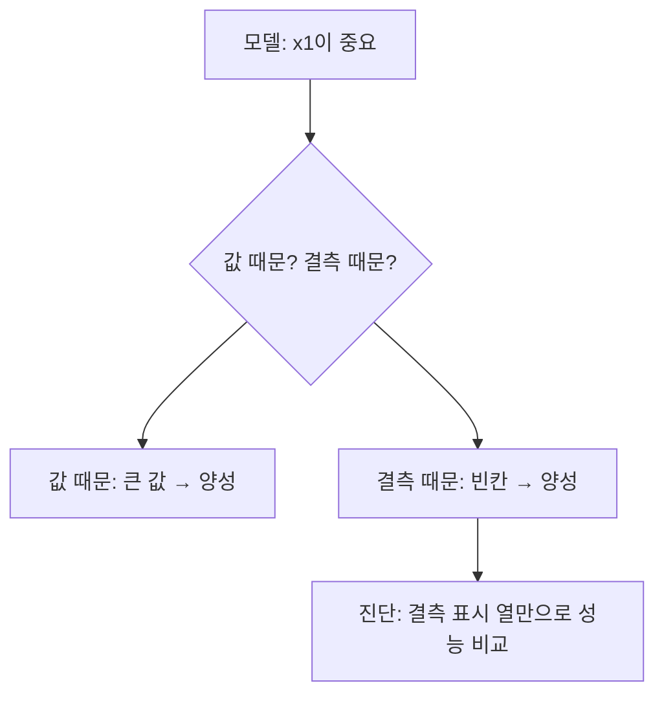
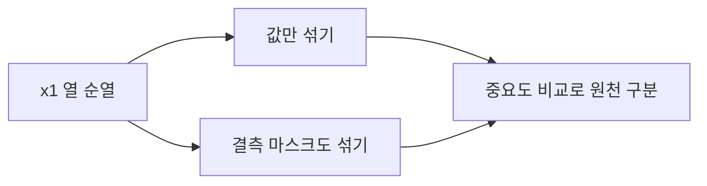

# 결측 분기의 해석

> NaN을 그대로 받는 트리 모델에서 **"이 특징이 중요하다"는 결과가 실제로는 값 때문이 아니라 값이 비어 있다는 사실 때문일 수 있어서**, 해석할 때 결측 때문에 간 길과 값 때문에 간 길을 구분해야 한다는 문제다.

## 쉽게 말하면
"소득 칸이 중요한 변수"라는 결과를 보고 소득이 높고 낮음이 중요하다고 해석했는데, 실제로는 "소득 칸을 비웠는가"가 단서였다면 해석이 틀린 것이다. 칸의 숫자가 아니라 빈칸이 신호다.

## 자세히
(scikit-learn 앙상블 문서의 결측값 지원 절을 직접 열어 확인하고, scikit-learn 1.9.1로 직접 실험.)
- **문서 근거**: 결측이 예측적이면 분할이 결측과 비결측을 가를 수 있다고 문서가 예시와 함께 설명한다([NaN 직접 처리 모델](#native-nan-models)). 즉 모델 입장에서 NaN은 하나의 신호다.
- **직접 실험(5,000행, 정답은 x0로만 결정, x1은 정답과 무관한 값이지만 양성일 때 40%가 비도록 정보성 결측을 만듦)**
  - 결측이 아닌 행에서 x1과 정답의 상관은 **−0.019**(사실상 무관).
  - 깊이 3 `DecisionTreeClassifier`의 `export_text`는 분기를 `x1 <= inf` / `x1 > inf`처럼 출력한다. 결측 행이 어느 쪽으로 가는지는 이 텍스트에 NaN이라고 나오지 않고, `tree_.missing_go_to_left` 배열에 따로 담긴다. **텍스트만 읽어서는 결측 분기를 알아채기 어렵다**(이 표현은 이 환경에서 관찰한 출력).
  - HGB의 **순열 중요도**: x0 0.367, **x1 0.117**. 값은 정답과 무관한데 중요도가 높게 나왔다. x1 열의 값을 섞자(결측 위치도 함께 이동) 정확도가 0.987→0.873으로 떨어졌다. 중요도의 원천은 값이 아니라 결측 패턴이다.
  결론: 특징 중요도가 높다고 값의 크기가 중요하다고 해석하면 안 된다.
- **구분하는 방법(제안)**: ① 결측 표시 열을 따로 만들어 단순 모델(로지스틱)로 "결측 여부만" 넣었을 때 성능 비교 ② 결측이 아닌 행만으로 같은 모델을 다시 학습해 중요도 비교 ③ 결측 위치만 섞는 순열과 값만 섞는 순열을 나눠 측정 ④ 부분 의존도(PDP)를 그릴 때 결측 구간을 따로 표시 ⑤ 결측이 왜 생기는지 도메인에 확인(정보성 결측이면 서빙에서 패턴이 바뀔 수 있음, [결측 패턴 드리프트](#missing-pattern-drift)).
- **문서화**: 모델 카드에 "결측 방향 학습 사용, 결측이 신호로 쓰일 수 있음"과 변수별 결측률을 적는다.

## 그림으로 보기

## 예시
- 이탈 예측 모델에서 "마지막 로그인 일수"가 중요 변수로 나옴. 비어 있는 고객(앱 미설치)이 이탈과 연결된 것이라면 값 해석("오래 안 들어온 사람")이 아니라 결측 해석이 필요.
- 교육 소재: "AI가 중요하다고 한 변수가 사실은 빈칸이었다" — 변수 중요도 해석 교육의 사례.

## 헷갈리는 것과 비교
| 개념 | 차이 |
|---|---|
| 결측 분기의 해석 | 중요도의 원천이 값인지 결측인지 구분 |
| [NaN 직접 처리 모델](#native-nan-models) | NaN을 그대로 받는 모델의 동작 |
| [NaN 직접 처리로 기준선 만들기](#nan-baseline-first) | 먼저 기준선을 재는 순서 |
| [결측 표시 특징](#missing-indicator-feature) | 결측 여부를 명시 열로 분리 |

## 더 읽을거리
- [scikit-learn 앙상블 문서: Missing values support](https://scikit-learn.org/stable/modules/ensemble.html) — HGB의 NaN 방향 학습과 결측이 신호인 예시(직접 확인).
