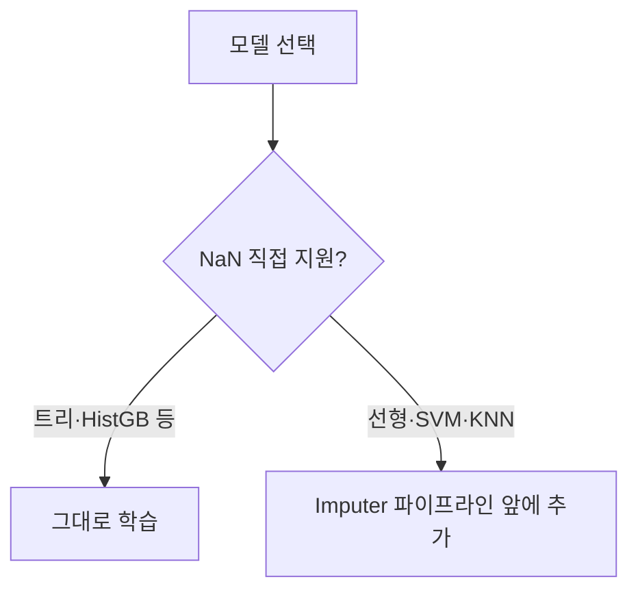

# NaN 지원 모델 목록

> scikit-learn에는 결측값(NaN)을 대체 없이 그대로 받는 추정기가 있다. 트리 계열과 일부 전처리기가 대표적이고, 선형 모델·SVM·KNN은 대체가 필요하다.

## 쉽게 말하면
빈칸 있는 시험지를 그냥 받아 주는 선생님(트리 계열)과 "빈칸 먼저 채워 오세요"라는 선생님(선형 모델)이 있다.

## 자세히
(scikit-learn 1.9.1 "Estimators that handle NaN values" 절을 하위 에이전트가 읽은 노트. 요약 도구로 전달된 목록이라 생략이 있을 수 있다.)
- **군집**: HDBSCAN.
- **분류기·회귀기**: DecisionTree, ExtraTree, ExtraTrees, RandomForest, Bagging, HistGradientBoosting 각 분류/회귀판, Stacking·Voting(내부 추정기가 NaN을 지원할 때만 — 이번에 확인 못 함).
- **변환기**: IterativeImputer, KNNImputer, MissingIndicator, SimpleImputer, MaxAbsScaler, MinMaxScaler, RobustScaler, StandardScaler, PowerTransformer, QuantileTransformer, SplineTransformer, OneHotEncoder, OrdinalEncoder, TargetEncoder, RandomTreesEmbedding, VarianceThreshold.
- **목록에 없는 것**: LogisticRegression, SVM, KNN 분류기, 선형 모델 → 앞단에서 대체 필요.
- **버전 주의**: 지원 목록은 버전마다 늘어난다. 쓰는 버전의 문서를 확인한다.

## 그림으로 보기

## 예시
- 기준선 모델로 HistGradientBoosting을 NaN 그대로 학습 → 대체 파이프라인과 비교([NaN 직접 처리 기준선](#nan-baseline-first)).
- 교육 활용: "어떤 모델이 결측을 견디는가" 표 만들기.

## 헷갈리는 것과 비교
| 개념 | 차이 |
|---|---|
| NaN 지원 모델 | 대체 없이 학습 |
| 변환기의 NaN 지원 | 스케일러 등이 NaN을 통과시킴(채우지는 않음) |
| [HistGB NaN 규칙](#hist-gradient-boosting-nan) | 한 모델의 처리 방식 |

## 더 읽을거리
- [Imputation of missing values (sklearn)](https://scikit-learn.org/stable/modules/impute.html) — NaN 처리 추정기 절.
