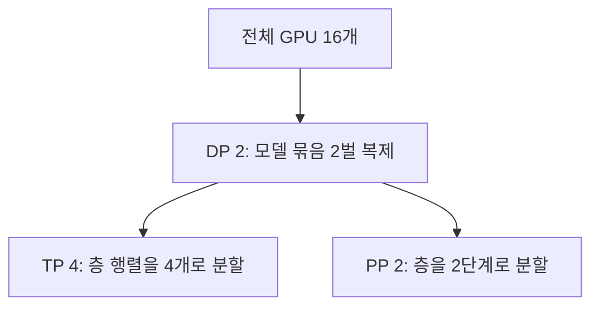
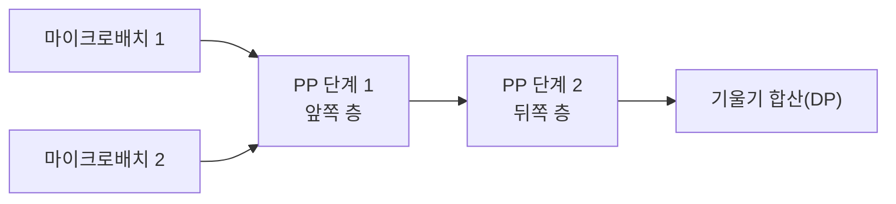

# nanotron의 3D 병렬

> 큰 모델을 여러 GPU에서 학습하려고 **데이터 병렬(DP)·텐서 병렬(TP)·파이프라인 병렬(PP)을 곱해서 조합**하는 방식. GPU 수 = DP × TP × PP로 나누고, nanotron은 이를 지원하는 오픈소스 학습 라이브러리다.

## 쉽게 말하면
공장에 일손이 많을 때 일을 나누는 세 가지 방법이 있다. ① 같은 라인을 여러 개 복제해 다른 주문을 처리(DP) ② 한 제품의 한 공정을 여러 사람이 나눠 맡음(TP) ③ 공정 순서대로 구역을 나눠 릴레이로 넘김(PP). 큰 공장은 세 가지를 모두 섞는다.

## 자세히
(nanotron README와 Megatron-LM 논문 arXiv 2104.04473 초록을 직접 읽음)
- **세 가지 축**:
  - **DP(데이터)**: 모델 전체를 여러 GPU에 복제하고 배치를 쪼개 처리, 기울기를 합산. 구현이 쉽지만 모델이 한 GPU에 안 들어가면 못 쓴다.
  - **TP(텐서)**: 한 층의 행렬을 여러 GPU로 쪼개 계산. 층마다 통신이 필요해 보통 한 노드 안의 빠른 연결에서 쓴다(일반 설명).
  - **PP(파이프라인)**: 층을 단계별로 나눠 GPU에 배치. 미니배치를 쪼개 흘려보내 GPU가 놀지 않게 한다.
- **조합 계산**: 총 GPU 수 = DP × TP × PP. 예를 들어 노드 2대(16 GPU)에서 TP=4, PP=2라면 DP=2다. 모델은 TP×PP=8개 GPU에 나뉘어 실리고 이 묶음이 2벌 복제된다(산술 예시).
- **Megatron-LM 결과(논문 초록)**: 세 병렬을 단순히 쓰면 수천 GPU에서 노드 간 통신과 유휴 시간 때문에 무너진다. 인터리브 파이프라인 스케줄이 처리량을 **10% 넘게** 올리면서 메모리는 비슷했고, **3,072 GPU**에서 1조 파라미터 모델을 502 petaFLOP/s(GPU당 이론 최대의 52%)로 학습했다.
- **nanotron 기능(README)**: 3D 병렬(DP+TP+PP), MoE용 expert 병렬, AFAB·1F1B 파이프라인 스케줄, 명시적 TP·PP API(디버깅 용이), ZeRO-1 옵티마이저, FP32 기울기 누적. 로드맵에 FP8, ZeRO-3(FSDP), torch.compile, ring attention, 인터리브 1F1B가 있다.
- **실행(README)**: 노드 1대·GPU 8개: `CUDA_DEVICE_MAX_CONNECTIONS=1 torchrun --nproc_per_node=8 run_train.py --config-file examples/config_tiny_llama.yaml`. 다중 노드는 Slurm 가이드를 따른다. 설정 YAML의 병렬 항목 이름은 README에 없어 확인하지 못했다. 요구사항: Python 3.11, uv, CUDA 12.4용 PyTorch.
- **ablation에서의 의미(제안)**: 1.71B 같은 작은 모델은 DP만으로 충분한 경우가 많아 3D 병렬 설정이 단순하다. 모델이 커질 때 TP·PP가 필요해진다. 직접 실행은 GPU가 없어 하지 못했다.

## 그림으로 보기

## 예시
| 설정 | GPU 수 |
|---|---|
| DP 8, TP 1, PP 1 | 8 |
| DP 2, TP 4, PP 2 | 16 |
| DP 4, TP 2, PP 4 | 32 |
- 업무 장면: 실습 환경에서 GPU 8개 한 대로 작은 모델을 DP만으로 돌려 보고, 모델이 커지면 TP·PP를 늘려야 하는 이유를 메모리 계산으로 설명한다.

## 헷갈리는 것과 비교
| 개념 | 차이 |
|---|---|
| DP | 모델 복제, 데이터 분할 |
| TP | 층 내부 행렬 분할 |
| PP | 층 단위 분할 |
| [nanotron·lighteval](#nanotron-lighteval) | 학습 라이브러리와 평가 도구의 상위 개요 |

## 더 읽을거리
- [huggingface/nanotron (GitHub)](https://github.com/huggingface/nanotron) — 기능·실행 명령(README 직접 읽음).
- [Efficient Large-Scale Language Model Training on GPU Clusters (arXiv 2104.04473)](https://arxiv.org/abs/2104.04473) — 3D 병렬과 인터리브 스케줄(초록 직접 읽음).
