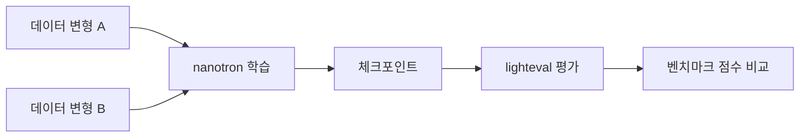
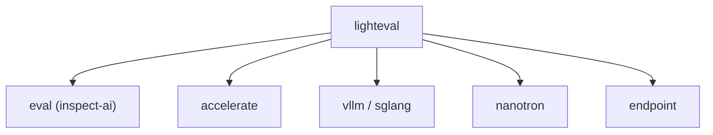

# nanotron·lighteval

> Hugging Face가 만든 두 오픈소스 도구. nanotron은 트랜스포머를 처음부터 사전학습하는 라이브러리, lighteval은 학습된 LLM을 벤치마크로 평가하는 도구다. 데이터 ablation(데이터만 바꿔 작은 모델을 학습·비교)을 돌릴 때 짝으로 쓴다.

## 쉽게 말하면
요리 대회에서 재료(데이터)만 바꿔 같은 주방에서 같은 레시피로 요리하고(nanotron), 같은 심사표로 채점하는(lighteval) 설비다. 둘이 고정돼 있어야 "재료 차이 때문"이라고 말할 수 있다.

## 자세히
(두 GitHub README를 직접 열어 확인.)
- **nanotron**: Apache-2.0. 3D 병렬(데이터·텐서·파이프라인) + MoE용 expert 병렬, AFAB·1F1B 파이프라인 스케줄, ZeRO-1, FP32 gradient accumulation 지원. 로드맵: FP8, ZeRO-3(FSDP), torch.compile, ring attention. 설치는 Python 3.11 + uv + CUDA 12.4용 PyTorch 후 `uv pip install -e .`. 별 약 2.9k(확인 시점).
- **lighteval**: `pip install lighteval`. 진입점: `lighteval eval`(inspect-ai, 권장), `accelerate`, `nanotron`, `vllm`, `sglang`, `endpoint`, `custom`. 샘플 단위 결과를 저장해 디버깅 가능. 예: `lighteval eval "hf-inference-providers/openai/gpt-oss-20b" gpqa:diamond`. Windows는 미검증.
- **연결**: `lighteval nanotron`이 nanotron 체크포인트를 분산 평가한다.
- **ablation에서의 역할(제안)**: 데이터 필터·중복 제거 방식을 바꿀 때마다 같은 크기·같은 토큰 수로 작은 모델을 nanotron으로 학습하고 lighteval로 같은 벤치마크를 돌려 비교한다. FineWeb 논문·블로그의 구체 설정(모델 크기·토큰 수)은 이번에 직접 확인하지 못했다 → [ablation 데이터 연구](#ablation-data-studies) 노드에서 다룬다.

## 그림으로 보기

## 예시
- 필터 A·B로 만든 데이터로 각각 소형 모델을 학습한 뒤 같은 평가 세트 점수를 표로 비교.
- 교육 활용: 도구 없이도 "한 번에 하나만 바꿔 비교"하는 실험 원칙을 설명하는 사례.

## 헷갈리는 것과 비교
| 개념 | 차이 |
|---|---|
| nanotron | 사전학습 |
| lighteval | 평가 |
| [vLLM](#vllm) | 추론 서빙(lighteval의 백엔드로도 쓰임) |

## 더 읽을거리
- [huggingface/nanotron](https://github.com/huggingface/nanotron) — 기능·설치.
- [huggingface/lighteval](https://github.com/huggingface/lighteval) — 평가 백엔드·사용법.
