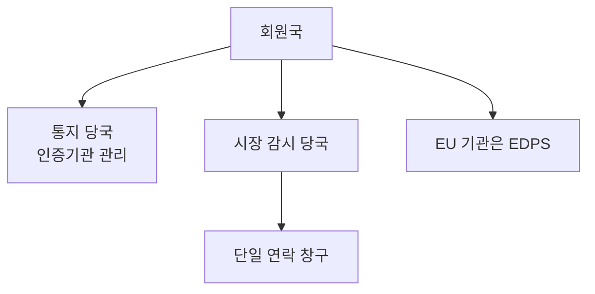
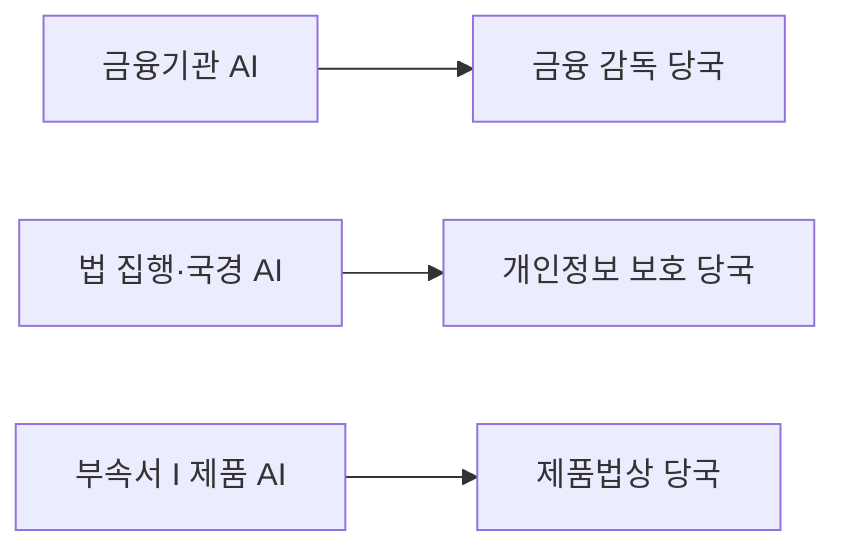

# 회원국 감독기관

> EU AI Act를 각국에서 실제로 집행하는 기관들. 회원국은 최소 하나의 통지 당국과 하나의 시장 감시 당국을 지정하고, 그중 하나를 단일 연락 창구로 삼는다. EU 기관에 대해서는 유럽 개인정보감독관(EDPS)이 맡는다.

## 쉽게 말하면
EU가 법을 만들면 집행은 각 나라의 담당 부서가 한다. 식품 안전 규정을 나라별 식약처가 집행하는 것과 같다. 부서가 나라마다 다르니, 누구에게 문의·신고하는지를 알아야 한다.

## 자세히
출처는 artificialintelligenceact.eu의 70조·74조(열람). 개정 표시가 섞여 있다. 법률 자문이 아니다.
- **지정 의무(70조 1항)**: 회원국은 적어도 하나의 통지 당국(인증기관 관리)과 하나의 시장 감시 당국을 설치·지정하고, 이들은 독립적·공정하게 활동해야 한다. 여러 기관이 업무를 나눌 수 있다.
- **통지·연락(70조 2항)**: 지정한 당국과 업무, 변경 사항을 집행위에 알린다. 2025-08-02까지 전자적 연락 방법과 단일 연락 창구를 공개해야 하며, 시장 감시 당국 중 하나가 단일 연락 창구가 되고 집행위가 목록을 공개한다.
- **자원(70조 3항)**: 기술·재정·인력·인프라를 충분히 갖추고 AI·데이터·사이버 보안·기본권·보건 안전 전문성을 가진 상시 인력을 유지한다. 회원국은 매년 필요를 점검한다. 70조 6항에 따라 2025-08-02까지 이후 2년마다 인력·재정 현황과 적정성 평가를 집행위에 보고한다.
- **지침(70조 8항, 개정 표시)**: 특히 SME(스타트업 포함)·소형 중견기업에 이행 자문을 줄 수 있고, AI Board와 집행위 지침을 고려한다. 다른 EU 법과 겹치면 그 법의 당국과 협의한다.
- **EU 기관(70조 9항, 74조 9항)**: EU 기구·기관 등이 범위에 들면 EDPS가 관할 당국이다(사법 기능의 법원 제외).
- **시장 감시(74조, 2026-08-02 전면 적용)**: 규정 2019/1020의 시장 감시 규칙이 AI Act 대상 AI 시스템에 적용된다.
  - 부속서 I 섹션 A 제품 관련 고위험 AI는 해당 제품법상 기존 당국이 담당(필요시 다른 당국 지정 가능, 조율 필요).
  - 금융기관 고위험 AI는 국가 금융 감독 당국이 담당(금융 서비스와 직접 관련된 범위).
  - 법 집행·국경 관리·사법·민주주의 관련 부속서 III 일부는 개인정보 보호 당국 또는 동일 조건의 다른 당국.
  - 심각한 위험이 두 개 이상 회원국에 걸치면 공동 조사 등 공동 활동을 제안할 수 있고, AI Office가 조율을 돕는다.
- **접근 권한(74조 12~13항)**: 필요한 범위에서 제공자의 문서와 학습·검증·시험 데이터에 전면 접근하고 API 등 원격 접근도 가능. 고위험 AI 소스 코드는 이유 있는 요청에 한해, 적합성 평가에 필요하고 제공자의 시험·감사가 소진되거나 불충분한 경우에만 접근한다.
- 실제 국가별 지정 현황은 이번에 확인하지 못했다. 각국 당국은 집행위 공개 목록과 해당국 공지로 확인해야 한다.

## 그림으로 보기

## 예시
- 한국 기업이 EU에 AI 서비스를 제공할 때 어느 회원국 시장 감시 당국이 관할인지 확인해야 한다(관할 판단은 사안별 법률 검토).
- 교육 실습: 자기 AI 서비스가 금융·고용·의료 중 무엇과 관련되는지 표시하고 어느 유형의 당국이 맡는지 연결.

## 헷갈리는 것과 비교
| 개념 | 차이 |
|---|---|
| 통지 당국 | 인증기관 지정·감독 |
| 시장 감시 당국 | 시장의 AI 시스템 감시·집행 |
| [AI Board](#ai-board) | 당국들의 협의체 |
| [AI Office](#ai-office) | 집행위 내 범용 AI 집행 조직 |

## 더 읽을거리
- [AI Act Article 70](https://artificialintelligenceact.eu/article/70/) — 국가 당국과 단일 연락 창구(열람)
- [AI Act Article 74](https://artificialintelligenceact.eu/article/74/) — 시장 감시(열람)
