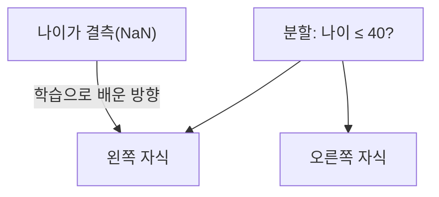
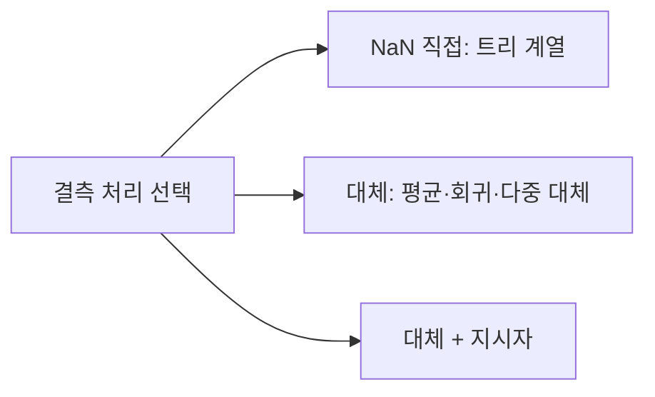

# NaN 직접 처리 모델

> 일부 모델(히스토그램 그래디언트 부스팅 등 트리 계열)은 결측값(NaN)을 별도 대체 없이 입력으로 받아, 학습 중에 결측 샘플을 어느 쪽 가지로 보낼지 스스로 배운다. 결측 여부가 정보일 때 자연스럽게 활용된다.

## 쉽게 말하면
설문 응답을 분류하는 갈림길 질문마다 "빈칸인 응답은 왼쪽 문으로 보낼까, 오른쪽 문으로 보낼까"를 그동안의 성적(이득)을 보고 정하는 것이다. 빈칸을 억지로 값으로 채우지 않고 "빈칸"이라는 사실 그대로 길 안내를 받는다.

## 자세히
(scikit-learn 앙상블 문서의 "Missing values support" 절을 직접 열어 확인하고, 직접 실험을 실행.)
- **동작(문서)**
  - **학습**: 분할 지점마다 트리 성장기가 결측값 샘플을 **왼쪽 자식으로 보낼지 오른쪽으로 보낼지**를 잠재 이득을 보고 배운다.
  - **예측**: 결측 샘플은 학습 중 배운 방향의 자식으로 간다.
  - **학습에 결측이 없던 특징**: 예측 때 결측 샘플은 **샘플이 가장 많은 자식**으로 보낸다.
- **문서 예시**: `X=[0,1,2,NaN]`, `y=[0,0,1,1]`에서 NaN 샘플이 이득에 따라 오른쪽으로 가서 예측이 `[0,0,1,1]`. 결측이 신호인 예(`X=[0,NaN,1,2,NaN]`, `y=[0,1,0,0,1]`)에서는 모델이 "결측 여부"로 직접 분할해 `[0,1,0,0,1]`을 맞힌다(깊이 2, 한 번 반복).
- **지원 모델(문서 목록)**: `HistGradientBoostingClassifier/Regressor`를 비롯해 `DecisionTree`, `RandomForest`, `ExtraTrees` 계열 등(내부 처리 방식은 이 페이지에 설명이 없다).
- **직접 실험(scikit-learn, 6,000개, 특징 3개 중 첫 특징이 정보성으로 결측, HistGradientBoosting)**
  | 처리 | 시험 정확도 |
  |---|---|
  | NaN 직접 입력 | **0.784** |
  | 평균 대체 후 학습 | 0.778 |
  | 평균 대체 + 지시자 | 0.777 |
  차이가 0.6~0.7%p로 작아 이 설정에서는 사실상 비슷하다. 결측이 신호인 경우 NaN 직접 처리가 지시자를 따로 만든 것만큼 효과를 낸다고 해석할 수 있지만, 시험 세트 크기(2,400개)상 우열은 단정할 수 없다([작은 시험셋의 변동](#small-test-set-variance)).
- **학습에 NaN이 없고 예측에만 NaN이 있어도** 예측이 오류 없이 수행됐다(직접 확인, 문서에 규칙 설명이 있음).
- **한계(제안)**: ① 선형 모델·신경망은 보통 NaN을 받지 못한다 ② 결측 패턴이 학습과 운영에서 다르면 [학습-서빙 편향](#training-serving-skew) 위험 ③ 해석 시 "결측 때문에 이 방향으로 갔다"를 확인하기 어려울 수 있다 ④ MNAR이 의심되면 모델이 결측을 이용해 잘 맞더라도 그 이유를 공정성 관점에서 점검([결측 표시 특징](#missing-indicator-feature)의 주의).

## 그림으로 보기



## 예시
```python
from sklearn.ensemble import HistGradientBoostingClassifier
import numpy as np
X = np.array([0, 1, 2, np.nan]).reshape(-1, 1)
y = [0, 0, 1, 1]
gbdt = HistGradientBoostingClassifier(min_samples_leaf=1).fit(X, y)
gbdt.predict(X)        # array([0, 0, 1, 1])
```
- 사내 표 데이터 모델링에서 결측이 많을 때 먼저 NaN 직접 처리 트리 모델로 기준선을 만들고, 선형 모델을 쓸 때만 대체를 도입(제안).

## 헷갈리는 것과 비교
| 개념 | 차이 |
|---|---|
| NaN 직접 처리 | 모델이 결측 방향을 배움 |
| 값 대체 | 빈칸을 값으로 채운 뒤 학습 |
| [결측 표시 특징](#missing-indicator-feature) | 결측 여부를 열로 추가 |
| [다중 대체](#multiple-imputation) | 통계적 추정을 위한 불확실성 반영 |

## 더 읽을거리
- [scikit-learn: Ensembles — Missing values support](https://scikit-learn.org/stable/modules/ensemble.html) — NaN 직접 처리 규칙·예제(열어 확인).
- [scikit-learn: Imputation of missing values](https://scikit-learn.org/stable/modules/impute.html) — NaN 지원 목록(열어 확인).
