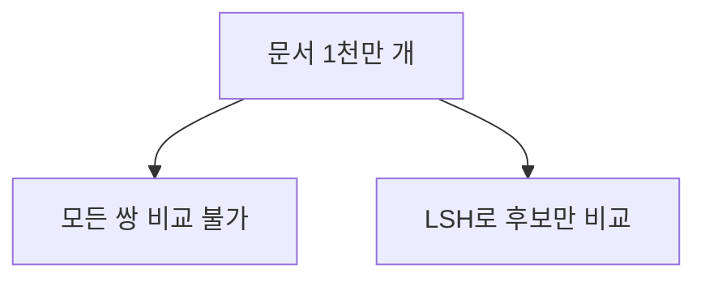

# 근접 중복 탐지

> 복사본·개정판·약간 고친 문서처럼 **거의 같은 텍스트를 찾아내는** 기술이다. 모든 쌍을 비교하면 너무 오래 걸려서 보통 **MinHash + LSH**로 후보만 빠르게 추린다.

## 쉽게 말하면
도서관에서 "개정판과 초판"을 찾는다고 하자. 책 수천만 권을 둘씩 펼쳐 비교할 수는 없다. 대신 각 책의 "지문 몇 줄"을 만들어 지문이 한 줄이라도 같은 책끼리만 자세히 비교한다.

## 자세히
- **셔플링(shingling)**: 텍스트를 겹치는 작은 조각(예: 글자 4개 단위)의 집합으로 만든다(Yorko 블로그 예: 크기 4).
- **MinHash**: 조각 집합을 길이 96~128 정도의 정수 서명(`num_perm`)으로 줄인다. 두 서명이 일치하는 비율이 두 집합의 **Jaccard 유사도** 추정치다.
- **LSH(밴드)**: 서명을 b개 밴드(밴드당 r행)로 나눠 밴드별 해시가 하나라도 같으면 후보 쌍. 두 문서의 Jaccard 유사도가 s일 때 후보가 될 확률은 `P(s)=1-(1-s^r)^b`(Skeptric)이고 임계점은 대략 `(1/b)^(1/r)`다. 행(r)을 늘리면 임계가 올라가고 밴드(b)를 늘리면 내려간다.
- **직접 계산한 S-곡선**: (b=42, r=3)은 s=0.05에서 0.52%, s=0.5에서 99.6% 후보(임계 약 0.29). (b=16, r=8)은 s=0.5에서 6.1%, s=0.8에서 94.7%(임계 약 0.71). 같은 128개 해시로도 b·r에 따라 "얼마나 비슷해야 잡는가"가 크게 달라진다.
- **검증(선택)**: 후보 쌍의 실제 Jaccard를 계산해 임계 미만을 버리면 정밀도를 높일 수 있다.
- **datasketch 사용**: `MinHash(num_perm=128)` + `.update()`, `MinHashLSH(threshold=0.8, num_perm=128)` + `.insert()/.query()`. 대규모는 Redis 백엔드. 단 Skeptric은 `threshold` 인자의 오차 계산 방식이 부적절하다고 보고 밴드·행을 `params=(b, r)`로 직접 정하라고 권한다(개인 블로그 의견).
- **실측 사례(Yorko, 암호화폐 뉴스 제목)**: 색인 약 27,462개(2013~2017), 질의 약 11K개(2018), 임계 0.8, `num_perm=128`. 정밀도 0.8334, 재현율 0.925, 색인 크기 약 35MB.
- **한계**: 어휘적 유사도만 잡고 의역·동의어는 놓친다. 확률적 방법이라 정밀도·재현율을 둘 다 재야 하고, 큰 데이터에서 재현율은 전수 비교 없이는 측정하기 어렵다.
- **AI와의 관계**: 학습·평가 데이터의 중복은 누수와 과대평가의 원인이다. 문서 단위 분할 전에 근접 중복을 먼저 묶어야 한다.

## 그림으로 보기



## 예시
```python
from datasketch import MinHash, MinHashLSH
lsh = MinHashLSH(threshold=0.8, num_perm=128)
def sig(text):
    m = MinHash(num_perm=128)
    for i in range(len(text) - 3): m.update(text[i:i+4].encode())
    return m
lsh.insert("doc1", sig(doc1))
print(lsh.query(sig(doc2)))  # 비슷한 문서 키 목록
```
- 사내 규정집의 v1·v2를 묶어 한 그룹으로 분할(데이터 누수 방지).

## 헷갈리는 것과 비교
| 개념 | 차이 |
|---|---|
| 완전 중복 제거 | 해시가 같은 것만 |
| 근접 중복 탐지 | 약간 다른 것도(어휘 기준) |
| 의미적 중복(임베딩) | 의역까지, 비용·오탐 더 큼 |
| [문서 단위 분할](#document-level-split) | 분할 전에 이 단계로 묶음 |

## 더 읽을거리
- [Near-duplicate Detection with LSH and Datasketch](https://yorko.github.io/2023/practical-near-dup-detection) — 실측 정밀도·재현율.
- [Searching for Near Duplicates with Minhash](https://skeptric.com/minhash-lsh) — 밴드/행과 S-곡선, threshold 주의.
